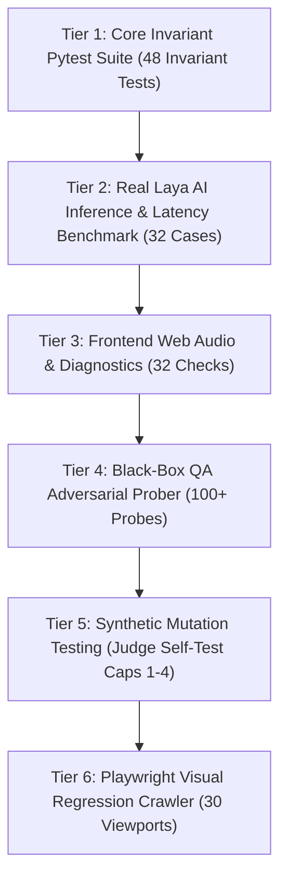

# 🛠️ Disha AI — Engineering Standards & Operational Manual

**Document Version:** 2.0.0 (Production Blueprint)  
**Classification:** Core Engineering Manual (`ENGINEERING.md`)  
**Audience:** Core Maintainers, Systems Engineers, Open-Source Contributors  

---

## 1. Engineering Doctrine

Engineering work on Disha AI is governed by three foundational doctrines:

1. **Thick Deterministic Spine, Thin Probabilistic Leaves:** Never entrust critical health rules, safety invariants, pricing, or emergency routing to an LLM. Intelligence resides in an authenticated, falsifiable state machine.
2. **Ponytail Simplicity (The Smallest Working Change):** The best code is code never written. Solve problems with the minimum necessary diff. Avoid speculative abstractions, unnecessary wrappers, or dependencies for trivial operations.
3. **Falsifiable Verification (Zero-Trust Oracles):** An agent or test oracle can never certify its own success. Tests must be backed by synthetic mutation defect injection: if an oracle doesn't fail when a defect is deliberately injected, the oracle is broken.

---

## 2. Developer Environment Prerequisites

Disha AI utilizes modern, high-speed tooling for rapid iteration:

| Tool | Version Requirement | Purpose | Verification Command |
|:---|:---|:---|:---|
| **Python** | `^3.12` | Core backend runtime and pipeline execution | `python3 --version` |
| **Node.js** | `>= 20.0.0` | Client test diagnostics and Playwright visual crawler | `node --version` |
| **uv** | `^0.11` | Ultra-fast Python package and virtualenv manager | `uv --version` |
| **Docker Engine** | `>= 24.0` | Local containerized PostgreSQL 16 & NGINX proxy | `docker --version` |
| **Cloudflared** | Latest | Supervised public edge ingress tunnel watchdog | `cloudflared --version` |
| **Gitleaks** | `>= 8.18` | Pre-commit and CI secrets verification gate | `gitleaks version` |

### One-Command Environment Check:
```bash
make doctor
```
This inspects all installed binaries, verifies that the Docker daemon is active, checks for `.env` presence, and confirms that the virtual environment is operational.

---

## 3. Repository Architecture & Directory Anatomy

```text
disha-ai/
├── Makefile                          # Unified developer workflow (doctor, dev, test, qa, audit, tunnel)
├── pyproject.toml                    # Ruff linter and Mypy static typing configurations
├── README.md                         # Quickstart, badges, architecture diagram, deployment links
├── ARCHITECTURE.md                   # System architecture and end-to-end dataflow specification
├── ENGINEERING.md                    # Engineering standards, testing doctrine, and runbooks
├── docker-compose.yml                # Local 3-container stack (PostgreSQL + FastAPI + NGINX)
├── docker-compose.prod.yml           # Production VM stack with persistent data volumes
├── .github/
│   └── workflows/
│       └── ci.yml                    # GitHub Actions CI matrix (lint, typecheck, test, security, audit)
├── disha_core/                       # Deterministic Spine Package
│   ├── main.py                       # FastAPI application entry point and WebSocket routing
│   ├── pipeline/                     # Invariant enforcement pipeline
│   │   ├── breaker.py                # Pre-turn Aho-Corasick emergency circuit breaker
│   │   ├── router.py                 # Multi-head intent router and language detection
│   │   └── validator.py              # Post-turn SentenceValidator and Egress Gate
│   ├── classifier/                   # Neural decision models & continuous learning
│   │   ├── adapter.py                # Real NandhaKishorM/laya classifier adapter
│   │   ├── retrain_oracle.py         # Continuous retraining and promotion oracle
│   │   └── review_queue.py           # Clinician review queue with PHI scrubbing
│   ├── engine/                       # Grounding and context synthesis
│   │   ├── context_builder.py        # Structured XML prompt builder (<400 tokens)
│   │   ├── normalizer.py             # Hinglish & Devanagari text normalization
│   │   └── retriever.py              # pg_trgm clinical database query engine
│   ├── compliance/                   # Regulatory assurance & cryptographic ledger
│   │   └── ledger.py                 # SHA-256 Merkle chain and SQLite WAL sidecar
│   ├── db/                           # Relational persistence
│   │   ├── schema.sql                # Complete SQL schema definition with trigram indexes
│   │   └── ingest_autonomous_datasets.py
│   └── frontend/                     # Clinical Telephony SPA client assets
├── audit/                            # Deterministic Judge Evaluation Harness
│   ├── judge.py                      # Multi-dimensional scorekeeper with synthetic mutation tests
│   ├── suites/                       # Safety, latency, reliability, conformance, and telemetry suites
│   └── reports/                      # Cryptographic JSON and Markdown audit reports
├── qa/                               # Playwright Automated QA Suite
│   ├── capture_redesign.js           # Multi-viewport (360-1440px) visual regression crawler
│   └── screenshots/                  # High-resolution screenshots across light & dark themes
├── scripts/                          # Operational Automation Scripts
│   ├── deploy-vm.sh                  # Bare-metal / Cloud VM automated provisioning
│   └── tunnel-watchdog.sh            # High-availability Cloudflare tunnel supervisor
└── tests/                            # Automated Verification Suites
    ├── test_invariants.py            # 48 core architectural invariant tests
    ├── test_clinical_safety_and_ledger.py # Adversarial safety & Merkle ledger tests
    ├── test_frontend_diagnostics.js  # 32 Web Audio and UI lifecycle diagnostic checks
    ├── test_laya_integration.py      # Real Laya weights evaluation & latency benchmark
    └── test_audit_security_and_edge_cases.py # SQL injection, auth, and boundary tests
```

---

## 4. The Makefile Workflow Reference

Disha AI provides a standard set of one-command Makefile targets:

```bash
# 1. System Health Verification
make doctor

# 2. Local Stack Startup
make dev

# 3. Test Matrix Execution
make test

# 4. Multi-Dimensional Audit Judge
make audit

# 5. Playwright Visual QA & Adversary
make qa

# 6. Supervised Cloudflare Tunnel
make tunnel

# 7. Code Quality & Formatting
make lint
make typecheck
make format

# 8. Housekeeping
make clean
make status
```

---

## 5. Testing Doctrine & Verification Pyramid

Disha AI enforces a 6-tier verification pyramid:



### 5.1 Tier 1: Core Invariants (`disha_core/tests/test_invariants.py`)
- Verifies all 16 core architectural invariants (C1 through C16).
- Checks Aho-Corasick emergency interception, regex rewriting, AST boundary enforcement, and circuit breakers.
- Executes in under 8 seconds.

### 5.2 Tier 2: Real Laya Model Benchmark (`tests/test_laya_integration.py`)
- Evaluates real `NandhaKishorM/laya` classifier weights (no mock stubs).
- Verifies inference across 32 domain-specific clinical cases in Hinglish and English.
- Asserts that P95 inference latency remains under 45ms and domain accuracy meets or exceeds 70% (currently **90.6%**).

### 5.3 Tier 3: Frontend Web Audio Diagnostics (`tests/test_frontend_diagnostics.js`)
- Runs 32 automated headless checks against the client-side JavaScript engine.
- Verifies `AudioContext` lifecycle, `cancelAnimationFrame` cleanup, frequency spectrum zero-division guards, tab visibility handling, and clinical intake form boundaries.

### 5.4 Tier 4: Black-Box Adversarial QA (`tests/blackbox_qa_adversary.py`)
- Acts as an unauthenticated hostile external prober over public HTTP and WebSocket ports.
- Injects 100+ raw adversarial vectors: SQL injection payloads, prompt extraction attacks, ungrounded meal requests, and commercial pricing tampering attempts.

### 5.5 Tier 5: Synthetic Mutation Testing (Testing the Verifier)
- The audit judge (`audit/judge.py`) tests *itself* before scoring the repository:
  1. **Cap 1 Injection:** Disables emergency breaker -> Verifies score is capped at $\le 60.0$.
  2. **Cap 2 Injection:** Mocks Laya classifier with a dummy stub -> Verifies score is capped at $\le 50.0$.
  3. **Cap 3 Injection:** Simulates UI blocking defect -> Verifies score is capped at $\le 70.0$.
- If any mutation fails to trigger its assigned score cap, verification halts immediately.

### 5.6 Tier 6: Playwright Visual QA (`qa/capture_redesign.js`)
- Automates visual regression across 5 device viewports (360px, 390px, 768px, 1280px, 1440px) across Light and Dark themes for all primary SPA routes (`#/home`, `#/consultation`, `#/settings`).

---

## 6. Continuous Integration (CI/CD)

The GitHub Actions pipeline (`.github/workflows/ci.yml`) runs on every push and pull request across five parallel jobs:

1. **Secrets & Security:** Executes `gitleaks-action` with full commit history inspection.
2. **Lint:** Runs `ruff check` and `ruff format --check`.
3. **Type Check:** Runs `mypy` against `disha_core` and `audit`.
4. **Test:** Executes `node tests/test_frontend_diagnostics.js` and `pytest -v`.
5. **Audit Judge:** Evaluates all C1–C16 invariants and outputs a deterministic score report.

---

## 7. Security & Key Rotation Operations

Disha AI strictly prohibits hardcoded credentials. All API tokens and passwords must be loaded from environment variables.

### Key Rotation Policy
- **Git Tree Cleanliness:** Verified zero secrets across all historical commits via `/opt/homebrew/bin/gitleaks detect --source . -v`.
- **Compromise Management:** When tokens are observed in local development environments, they must be recorded in [docs/security/key-rotation.md](docs/security/key-rotation.md) and rotated immediately in provider consoles.
- **Log Scrubbing:** All outgoing log lines pass through an AST sanitizer that masks ABHA IDs, Indian mobile numbers, and Groq/Gemini API keys.

---

## 8. Code Style & Commit Conventions

### Python Style Guide
- Formatted with `ruff` (`line-length = 120`).
- Strict typing enforced on public functions and dataclasses.
- Import ordering: Standard library, third-party libraries, local project modules (`I001`).

### Git Commit Conventions
Follow the Conventional Commits specification:
- `feat(scope):` New capability or clinical invariant
- `fix(scope):` Bug fix or security patch
- `test(scope):` New unit, integration, or adversary tests
- `chore(scope):` Build configuration, Makefile, or documentation updates
