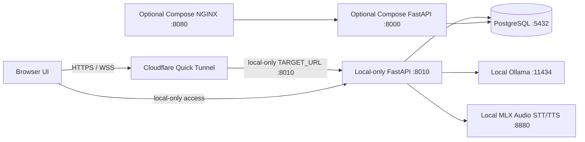

# Disha AI

Disha AI is a web-based conversational health-coaching prototype. The repository contains a FastAPI application, browser client, PostgreSQL persistence, lexical retrieval of approved knowledge records, and chat and turn-based voice interfaces.

This repository does **not** establish clinical validation, regulatory compliance, production readiness, or medical-device status. Code-level checks are incomplete and do not replace qualified clinical review. Do not use the project as an emergency service or a substitute for professional care.

## What is implemented

- Text chat through JSON and Server-Sent Events, plus a WebSocket interface for voice and text turns.
- Patient accounts, profile/PEP fields, approved prescribed-meal schedule lookup, and a persisted conversation journal.
- PostgreSQL retrieval from approved knowledge rows using full-text and trigram matching; the runtime retriever does not use embeddings or pgvector.
- Deterministic emergency and exercise-risk checks. These are limited safeguards, not complete triage or exercise-clearance systems.
- Configurable local and cloud model/audio adapters. Provider use depends on environment settings, credentials, and explicit data-processing/usage authorization flags.

See [Architecture](docs/ARCHITECTURE.md), [Memory and PEP](docs/MEMORY_AND_PEP.md), [Knowledge and RAG](docs/architecture/04_rag_ingestion_and_retrieval.md), [Voice Pipeline](docs/VOICE_PIPELINE.md), and [Deployment](docs/DEPLOYMENT.md).

## Runtime shape



The current verified tunnel targets the local-only FastAPI runner on `127.0.0.1:8010`. The runner is configured for local Ollama and MLX Audio on `127.0.0.1:8880`; neither model service is exposed by the tunnel. A separate Compose/Nginx mode remains available on port `8080`, but its configured providers and behavior differ. The tunnel does not host the application, database, or models. See the deployment guide for the distinction and the verified TTS limitation.

## Local Compose quickstart

The constrained local stack is documented in [`disha_core/README.md`](disha_core/README.md). From the repository root:

```sh
cd disha_core
export POSTGRES_PASSWORD='replace-with-a-long-random-value'
docker compose --env-file /dev/null -f compose.yaml up --build -d
curl -fsS http://127.0.0.1:8080/health
```

This starts the `disha_core/compose.yaml` stack. Its provider authorization defaults are disabled; model-backed chat or voice may return an unavailable response until the required provider configuration and authorization are set. No test corpus or clinical approval is implied by a successful health check. PostgreSQL's init SQL, including the product-facts seed, runs when the database volume is first created; existing volumes do not replay init files, so apply reviewed SQL updates explicitly rather than deleting the volume.

Stop that stack with:

```sh
docker compose --env-file /dev/null -f compose.yaml down
```

For repository-wide development targets, run `make help`. The root `docker-compose.yml` and `docker-compose.prod.yml` are separate configurations; their behavior and important caveats are described in [Deployment](docs/DEPLOYMENT.md).

## Current local-only deployment

The local-only runner is the deployment mode currently exposed by the TryCloudflare tunnel:

```sh
scripts/local-models.sh start
make tunnel-local
scripts/local-models.sh status
```

The host must remain powered on, connected to the internet, and running the local API, database, Ollama, MLX Audio, and tunnel watchdog. TryCloudflare assigns a temporary public URL; check `agent/TUNNEL_URL.txt` after starting or restarting the tunnel. The local-only LLM and synthetic STT checks passed, but the MLX Audio server's Svara TTS endpoint currently fails with a GPU-stream error; direct CLI generation works, so do not treat voice TTS as verified. See [Deployment](docs/DEPLOYMENT.md) for precise checks and limitations.

## Repository map

| Path | Purpose |
|---|---|
| `disha_core/main.py` | FastAPI app, shared turn pipeline, and SPA mount |
| `disha_core/routers/` | Chat, auth, patient, and voice routes |
| `disha_core/engine/` | Context assembly, normalization, and PostgreSQL retriever |
| `disha_core/pep/` | PEP and exercise-risk helpers |
| `disha_core/services/` | Profile, authentication, and conversation persistence |
| `disha_core/db/schema.sql` | PostgreSQL schema initialized by the Core Compose stack |
| `disha_core/frontend/` | Browser app served by FastAPI |
| `scripts/tunnel-watchdog.sh` | Optional Cloudflare Tunnel watchdog |
| `scripts/local-models.sh` | Optional Apple Silicon local-model launcher |
| `docs/` | Runtime architecture, operating notes, and historical design material |

## Documentation

- **Docs Map:** [Complete Documentation Index](docs/README.md)
- **Behavior Spec v1:** [Behavior Spec v1 (Owner Provided)](docs/spec/BEHAVIOR_SPEC.md) & [Enforcement Matrix](docs/spec/ENFORCEMENT_MATRIX.md)
- **How It Works:** [System Execution & Port Tour](docs/HOW_IT_WORKS.md)
- **Theory & Cognition:** [How Disha Thinks (Decision Pipeline)](docs/theory/HOW_DISHA_THINKS.md)
- **Learnings & RCA:** [Consolidated Engineering Learnings](docs/LEARNINGS.md)
- **Interview & QA:** [20 Engineering Questions & Answers](docs/interview/QA.md) and [Project Story](docs/interview/STORY.md)
- [Architecture](docs/ARCHITECTURE.md)
- [Deployment and local services](docs/DEPLOYMENT.md)
- [Memory, onboarding, and PEP](docs/MEMORY_AND_PEP.md)
- [Voice pipeline](docs/VOICE_PIPELINE.md)
- [Security notes](docs/SECURITY.md)

## Validation

Use the focused tests that correspond to a change. The repository also contains historical evaluation reports and design documents; their presence is not evidence that the current deployment, model providers, clinical corpus, or end-to-end voice path has been validated. A local `/health` response confirms only API/database connectivity.
