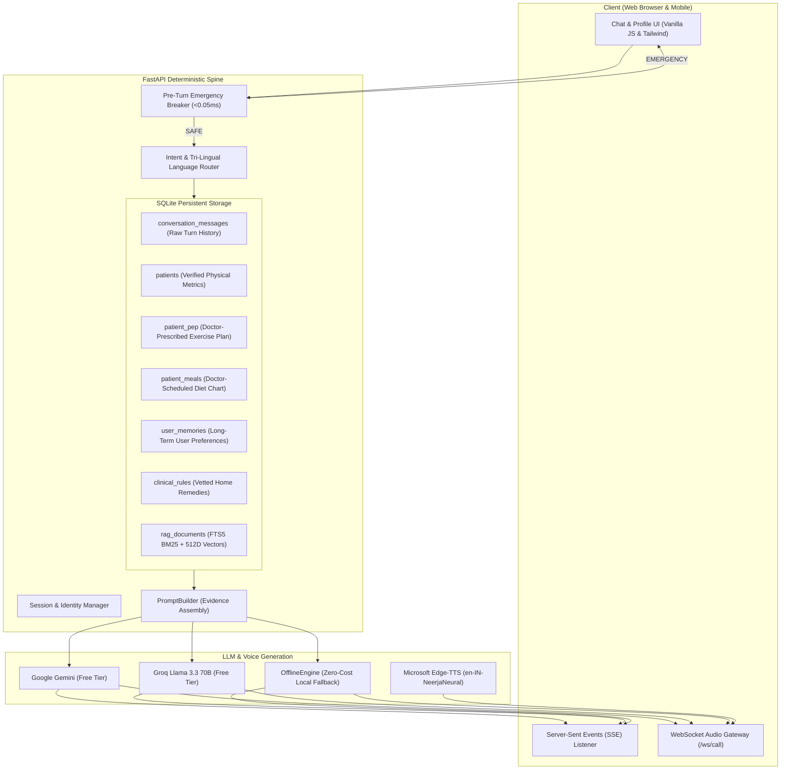

# Disha AI — Conversational Health Coach

Disha AI is an open-source, voice and text conversational health coach. It conducts personalized follow-up conversations with users in **English, Hindi, and everyday Hinglish** (Hindi in Roman script).

Disha helps people stay on track with their nutrition, daily workouts, routine domestic remedies, and lifestyle goals.

---

## What Makes Disha Different?

Most AI chatbots are simple wrappers around an LLM API. In healthcare, this leads to hallucinations, missed medical emergencies, and invented advice. 

Disha uses a **Thick Deterministic Spine** built with FastAPI and SQLite:
1. **Emergency Safety First:** Medical emergencies (chest pain, stroke, breathing difficulty) are caught by a pre-turn circuit breaker in **less than 0.05 milliseconds** before any AI model is contacted.
2. **Deterministic Language Matching:** Detects whether the user is typing in English, Devanagari Hindi, or Roman Hinglish, and responds in the exact same language.
3. **Strict Data Isolation:** Personal diet plans and exercise records are fetched directly from relational database tables. The AI never confuses a user's personal dinner with general clinical advice.
4. **Shared Context across Chat & Voice:** You can start a conversation in text chat, tap the voice call button, and continue the conversation seamlessly with the same conversation ID and memory.
5. **Real Barge-In (Interruption):** In voice calls, if you speak while Disha is talking, she immediately stops speaking and updates the conversation history to only what you actually heard.
6. **100% Free-Tier & Zero-Cost:** Runs entirely on free-tier services (Google Gemini free tier, Groq free tier, Microsoft Edge-TTS, and local SQLite).

---

## Quickstart (Run Locally in 2 Minutes)

### 1. Clone & Set Up Virtual Environment
```bash
git clone https://github.com/saahilpal/disha-ai.git
cd "disha ai"

python3 -m venv .venv
source .venv/bin/activate
pip install -r requirements.txt
```

### 2. Configure Environment Variables (Optional)
Copy the example environment file:
```bash
cp .env.example .env
```
*(Note: If no API keys are provided, Disha automatically runs using its built-in intelligent local `OfflineEngine`, so you can test all features with zero setup.)*

### 3. Start the Server
```bash
python -m uvicorn app.main:app --host 0.0.0.0 --port 8000 --reload
```
Open your browser and visit: **[http://localhost:8000](http://localhost:8000)**

---

## Running the Automated Test Suite

Disha includes **60 automated unit and integration tests** testing all API endpoints, emergency guardrails, two-tier RAG retrieval, and voice mechanics:

```bash
pytest -v
```

To run the independent 109-scenario evaluation suite:
```bash
python evals/runner.py
```

---

## High-Level System Architecture



---

## API Overview

| Method | Endpoint | Description |
| :--- | :--- | :--- |
| `GET` | `/health` | Health check verifying database and active AI model. |
| `POST` | `/chat` | Standard single-turn chat completion. |
| `POST` | `/chat/stream` | Real-time Server-Sent Events (SSE) token streaming. |
| `POST` | `/voice-turn` | Single-turn speech/text execution with Edge-TTS audio. |
| `WS` | `/ws/call` | Real-time bidirectional WebSocket voice call with barge-in support. |
| `GET` | `/patient/{id}` | Fetches patient profile, PEP constraints, and scheduled meals. |
| `GET` | `/patient/{id}/memories` | Returns long-term memories and preferences extracted from conversation. |
| `DELETE` | `/patient/{id}/memories/{mem_id}` | Deletes or invalidates a memory fact. |
| `GET` | `/conversations/{id}` | Retrieves persistent message history across chat and voice calls. |
| `GET` | `/rules` | Lists clinician-authored rules, stances, and pricing plans. |
| `POST` | `/rules` | Allows clinicians to author/update rules with automatic regex validation. |

---

## Project Documentation & Interview Prep

Comprehensive documentation is available in the `docs/` folder:

- **Interview Preparation Guide (For Freshers):**
  - [Project Story](docs/interview/PROJECT_STORY.md) — What is Disha, why I built it, and how it works.
  - [Technical Decisions](docs/interview/TECHNICAL_DECISIONS.md) — Why I chose this architecture, alternatives, and trade-offs.
  - [Real Problems & Solutions](docs/interview/PROBLEMS_AND_SOLUTIONS.md) — 6 real engineering bugs I faced and how I fixed them.
  - [Interview Questions & Answers](docs/interview/INTERVIEW_QUESTIONS.md) — 17 technical Q&As covering architecture, backend, RAG, and voice.
  - [Project Request Walkthrough](docs/interview/PROJECT_WALKTHROUGH.md) — Step-by-step trace of a request from click to display.
  - [Trade-offs & Learnings](docs/interview/TRADE_OFFS_AND_LEARNINGS.md) — What worked, what failed, and key engineering lessons.

- **System Architecture & Technical Specs:**
  - [System Architecture](docs/03-system-architecture.md) — End-to-end architecture and data flow.
  - [Technology Comparison](docs/02-technology-comparison.md) — Evaluation of voice, LLMs, and RAG options.
  - [Voice & Product UX](docs/04-product-and-voice-ux.md) — Voice state machine and barge-in mechanics.
  - [Engineering & Safety Plan](docs/05-engineering-and-safety-plan.md) — Clinical safety guidelines and compliance.
  - [Production Failure Audit](docs/01-design-audit.md) — Deep audit of the 8 production failure modes.

---

## Deployment

### Deploy to Render (1-Click)
The repository includes `render.yaml` and `Dockerfile`. You can deploy directly to Render free tier:
1. Push repository to GitHub.
2. In Render, select **New +** $\to$ **Blueprint** and connect the repository.
3. Render automatically provisions the web service and persistent disk.

### Live Cloudflare Edge Tunnel
Expose your local development server to the internet with a public HTTPS and WSS URL:
```bash
cloudflared tunnel --url http://127.0.0.1:8000
```

---

## License
MIT License. Free for educational and commercial use.
