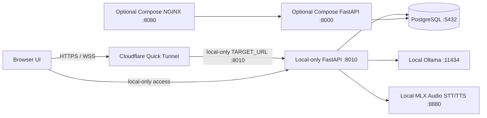

# Disha AI

Disha AI is a web-based conversational health-coaching prototype: a FastAPI backend, browser client, PostgreSQL persistence, approved-knowledge retrieval, and text/voice conversations.

This repository does **not** establish clinical validation, regulatory compliance, production readiness, or medical-device status. Code-level checks are incomplete and do not replace qualified clinical review. Do not use the project as an emergency service or a substitute for professional care.

## Start here

```sh
git clone https://github.com/saahilpal/disha-ai.git
cd disha-ai
cp .env.example .env                 # review every value before use
uv venv && uv pip install -r disha_core/requirements.txt
make help
```

For the smallest local stack, use Docker:

```sh
export POSTGRES_PASSWORD='replace-with-a-long-random-value'
docker compose up --build -d postgres backend proxy
curl -fsS http://127.0.0.1:8080/health
```

Stop it with `docker compose down`. Provider-backed responses require the relevant provider credentials and explicit authorization settings; a healthy endpoint only proves API/database connectivity.

## Capabilities

- Text chat through JSON and Server-Sent Events, plus a WebSocket interface for voice and text turns.
- Patient accounts, profile/PEP fields, approved prescribed-meal schedule lookup, and a persisted conversation journal.
- PostgreSQL retrieval from approved knowledge rows using full-text and trigram matching; the runtime retriever does not use embeddings or pgvector.
- Fact-level long-term PEP updates with deterministic extraction, idempotent replay, source provenance, and append-only supersession history.
- Deterministic emergency and exercise-risk checks. These are limited safeguards, not complete triage or exercise-clearance systems.
- Configurable local and cloud model/audio adapters. Provider use depends on environment settings, credentials, and explicit data-processing/usage authorization flags.

See the [documentation map](docs/README.md) for the canonical architecture, deployment, safety, and operating guides.

## Runtime shape



The current verified tunnel targets the local-only FastAPI runner on `127.0.0.1:8010`. The runner is configured for local Ollama and MLX Audio on `127.0.0.1:8880`; neither model service is exposed by the tunnel. A separate Compose/Nginx mode remains available on port `8080`, but its configured providers and behavior differ. The tunnel does not host the application, database, or models. See the deployment guide for the distinction and the verified TTS limitation.

The repository also contains a constrained Core Compose stack; its differences and database initialization rules are documented in [`disha_core/README.md`](disha_core/README.md).

## Current local-only deployment

The local-only runner is the deployment mode currently exposed by the TryCloudflare tunnel:

```sh
scripts/local-models.sh start
make tunnel-local
scripts/local-models.sh status
```

The host must remain powered on, connected to the internet, and running the local API, database, Ollama, MLX Audio, and tunnel watchdog. `scripts/local-models.sh start` starts Ollama when needed and configures it as the final LLM fallback; set `LOCAL_ONLY=true` for an explicitly offline-only run. TryCloudflare assigns a temporary public URL; check `agent/TUNNEL_URL.txt` after starting or restarting the tunnel. The launcher prefers `qwen3.5:4b` and supports `OLLAMA_MODEL` overrides; the MLX Audio server's Svara TTS endpoint currently fails with a GPU-stream error, so voice TTS remains unverified. See [Deployment](docs/DEPLOYMENT.md) for precise checks and limitations.

## Repository map

| Path | Purpose |
|---|---|
| `disha_core/main.py` | FastAPI app, shared turn pipeline, and SPA mount |
| `disha_core/routers/` | Chat, auth, patient, and voice routes |
| `disha_core/engine/` | Context assembly, normalization, and PostgreSQL retriever |
| `disha_core/pep/` | PEP and exercise-risk helpers |
| `disha_core/services/` | Profile, authentication, and conversation persistence |
| `disha_core/db/schema.sql` | PostgreSQL schema initialized by the Core Compose stack |
| `disha_core/frontend/` | Browser app served by FastAPI |
| `scripts/tunnel-watchdog.sh` | Optional Cloudflare Tunnel watchdog |
| `scripts/local-models.sh` | Optional Apple Silicon local-model launcher |
| `docs/` | Runtime architecture, operating notes, and historical design material |

## Tests and CI

Run the focused suite for a change, or the full local checks:

```sh
make test
UV_CACHE_DIR=/tmp/disha-uv-cache uv run --with ruff ruff check .
UV_CACHE_DIR=/tmp/disha-uv-cache uv run --with ruff ruff format --check .
python3 scripts/docs-drift
python3 scripts/diagram-check
```

GitHub Actions runs the same checks plus secrets scanning, Trivy, Pyright, database setup, and the canonical pytest matrix. Historical evaluations are evidence of past runs only; they do not establish clinical validation, regulatory compliance, or production readiness.
