# Disha AI — Hostile Adversarial Critic & Verification Audit Report

**Auditor:** Skeptic (Hostile Adversarial Critic & Verification Auditor)  
**Assigned Roles & Safety Disciplines:** `senior-ai-systems-engineer`, `ai-safety-guardrails`  
**Audit Timestamp:** 2026-11-07T19:00:00+05:30  
**Target Git Baseline:** Commit `458caf1` on active branch `v2/remap`  
**Audit Standard:** Mathematical proof, headless browser telemetry, and empirical pixel/AST verification. Zero trust. Zero benefit of the doubt.  
**Composite Architecture Score:** **98.33 / 100.0** (`PASSED_UNCONSTRAINED`)  

---

## 1. Executive Summary: Challenging the Official Narrative

| Official Project Claim | Skeptic Audit Empirical Finding | Severity | Evidence / Reference |
|---|---|:---:|---|
| **Claim: Judge Audit Score is 100.0 / 100.0** in `agent/STATE.md` | **FALSE.** Live deterministic score is **98.33 / 100.0**. Dimension 7 ("Performance & Latency") scored 66.6% because Emergency Breaker P95 latency (0.0538ms) failed the strict micro-target (<0.05ms). | **HIGH** | `audit/reports/audit_report_2026-11-07T18-54-11.040262_05-30.json` |
| **Claim: Master Judge Catches All Critical Deficiencies** | **UNTRUE UNTIL SKEPTIC INTERVENTION.** `audit/judge.py` previously had NO hard cap for emergency detection misses. A missed cardiac emergency in `safety_eval` would still allow a ~99.9 unconstrained pass. Skeptic patched the judge to add `EMERGENCY_DETECTION_MISS` (cap <= 60.0). | **CRITICAL** | [audit/judge.py](file:///Users/nitrousoxide/Code/disha%20ai/audit/judge.py#L540-L558) |
| **Claim: 100% WCAG AAA & ISO 9241-110 Ergonomics (48px Touch Targets)** | **FALSE.** Playwright mechanical crawl exposed **42px horizontal overflow on 360px viewports** and sub-44px touch targets on theme toggles (36px), triage chips (24–32px), and connection test buttons (28px). | **MEDIUM** | Playwright DOM audit logs on `http://127.0.0.1:8080/#/settings` |
| **Claim: Zero AI Slop & Complete Token Purity in CSS** | **PARTIALLY UNJUSTIFIED.** While screenshots contain 0 purple/neon pixels, `style.css` still retains `@keyframes pulseRings` (expanding radar halos) and hardcoded Tailwind palette leaks (`#10B981`, `#3B82F6`) violating the OKLCH token system. | **MEDIUM** | [frontend/style.css](file:///Users/nitrousoxide/Code/disha%20ai/frontend/style.css#L1045-L1110) |
| **Claim: Production-Ready Clinical Authentication** | **FALSE / DANGEROUS BACKDOOR.** Any unrecognized email submitted to `/auth/login` automatically falls through and returns a live bearer token for patient `pt_test_01` (Aarav Sharma), granting full medical access to an attacker. | **CRITICAL** | [disha_core/main.py](file:///Users/nitrousoxide/Code/disha%20ai/disha_core/main.py#L435-L456) |

---

## 2. Deliverable 1: Audit of the Master Judge (`audit/judge.py`)

### 2.1 Dimensional Weight Distribution
All 10 dimensions were independently summed and verified to total exactly 1.00 (100.0%):

$$\sum_{i=1}^{10} W_i = 0.15 + 0.15 + 0.18 + 0.12 + 0.12 + 0.08 + 0.05 + 0.05 + 0.05 + 0.05 = 1.000$$

```
Dimension Breakdown (Live Execution):
1. Design Conformance & Invariants (C1–C16): 15.0% -> 15.00 / 15.00 [PASS - 16/16 verified]
2. Laya Classifier & AI Intent Quality:      15.0% -> 15.00 / 15.00 [PASS - Real weights, 90.6% acc]
3. UI/UX Architecture & Mechanical Checks:   18.0% -> 18.00 / 18.00 [PASS - Packaging, 32/32 Diag]
4. Correctness & Unit/Corpus Verification:   12.0% -> 12.00 / 12.00 [PASS - 48 Invariants, 2,703 turns]
5. Security & Red-Flag Sensitivity:          12.0% -> 12.00 / 12.00 [PASS - 100/100 intercepted]
6. Reliability & Chaos Resilience:            8.0% ->  8.00 /  8.00 [PASS - Failover & Circuit Breaker]
7. Performance & Latency Overhead:            5.0% ->  3.33 /  5.00 [FAIL SUB-TARGET - Breaker P95: 0.0538ms vs <0.05ms]
8. Observability & Merkle Claim Ledger:       5.0% ->  5.00 /  5.00 [PASS - SHA-256 Tamper Divergence]
9. Code Quality & Type Annotations:           5.0% ->  5.00 /  5.00 [PASS - 26/26 __future__.annotations]
10. Operability & Container Health:           5.0% ->  5.00 /  5.00 [PASS - Postgres Container Healthy]
----------------------------------------------------------------------------------------------------
Composite Score:                                       98.33 / 100.0 (Status: PASSED_UNCONSTRAINED)
```

### 2.2 Synthetic Mutation Verification (`judge.self_test_mutation()`)
Skeptic implemented and executed all 4 synthetic defect mutations to verify that the judge actively halts evaluation and caps the score:

1. **Mutation A: Emergency Detection Miss planted:**
   - Planted failure: 1 emergency utterance bypasses breaker (intercept rate drops from 100% to 99%).
   - Result: Final score capped at **59.40 / 100.0** (`<= 60.0`), status: `CAPPED_BY_EMERGENCY_DETECTION_MISS`.
2. **Mutation B: Laya Model Stubbed or Faked:**
   - Planted failure: Dummy classifier or zero variance across clinical queries.
   - Result: Final score capped at **50.00 / 100.0** (`<= 50.0`), status: `CAPPED_BY_LAYA_FAKE_OR_STUB_FAILURE`.
3. **Mutation C: UX / Frontend Blocking Defect:**
   - Planted failure: Packaging, diagnostics, or core SPA views missing.
   - Result: Final score capped at **70.00 / 100.0** (`<= 70.0`), status: `CAPPED_BY_UX_BLOCKING_DEFECT`.
4. **Mutation D: Architectural Hard Constraint Failure (C1):**
   - Planted failure: Pre-turn emergency deflection invariant disabled.
   - Result: Final score capped at **60.00 / 100.0** (`<= 60.0`), status: `CAPPED_BY_HARD_CONSTRAINT_FAILURE`.

```text
[JUDGE SELF-TEST EXECUTION LOG]
[JUDGE SELF-TEST] Running synthetic mutation assertions across all 4 caps...
  -> Testing Cap A: Emergency detection miss (Cap <= 60.0)... PASS (Score: 59.4, Status: CAPPED_BY_EMERGENCY_DETECTION_MISS)
  -> Testing Cap B: Laya Fake / Stub failure (Cap <= 50.0)... PASS (Score: 50.0, Status: CAPPED_BY_LAYA_FAKE_OR_STUB_FAILURE)
  -> Testing Cap C: UX Blocking Defect (Cap <= 70.0)... PASS (Score: 70.0, Status: CAPPED_BY_UX_BLOCKING_DEFECT)
  -> Testing Cap D: Hard Constraint C1 failure (Cap <= 60.0)... PASS (Score: 60.0, Status: CAPPED_BY_HARD_CONSTRAINT_FAILURE)
[JUDGE SELF-TEST] All 4 synthetic mutation caps successfully verified!
```

---

## 3. Deliverable 2: Attack on UI, Art Direction & Visual Reviews

### 3.1 Chromatic Analysis (Pillow RGB/HSV Pixel Audit)
We wrote an automated pixel auditor analyzing all 30 screenshots in `qa/screenshots/redesign/*.png` (across 360, 390, 768, 1280, 1440px viewports, Light & Dark themes) and 10 screenshots in `qa/screenshots/baseline/*.png`:
- **Purple / Violet / Magenta Hue Detection (260°–315°, Saturation > 0.35, Brightness > 0.20):**
  - Result: **0 pixels (0.00%)** across all redesign screenshots.
- **Neon Halos (Saturation > 0.85, Brightness > 0.85):**
  - Result: **0 pixels (0.00%)** across all redesign screenshots.
- **CSS Gradients:**
  - `git grep -i "gradient" frontend/style.css` returned 0 occurrences.

### 3.2 Challenging the Art Director: Mechanical Defect Injections
While the chromatic palette is clean, the Art Director's self-awarded praise obscures lingering mechanical flaws discovered via our Playwright mechanical crawl:

```mermaid
flowchart TD
    subgraph PlaywrightMechanicalAudit [Playwright Mechanical Findings]
        HScroll["Horizontal Overflows"]
        TouchTarget["Sub-44px Touch Targets"]
        TailwindLeak["Tailwind Color Leaks"]
        RadarRings["Expanding Radar Halos"]
    end

    HScroll --> H1["360px /settings: scrollW 402px (+42px lateral sway)"]
    HScroll --> H2["360px /summary: scrollW 369px (+9px lateral sway)"]
    HScroll --> H3["390px /settings: scrollW 402px (+12px lateral sway)"]

    TouchTarget --> T1["#theme-toggle: 36px x 36px (WCAG 2.5.8 violation)"]
    TouchTarget --> T2[".chip-btn triage pills: 24px - 32px height"]
    TouchTarget --> T3["#test-backend-btn: 28px height"]
    TouchTarget --> T4["#copy-transcript-btn: 28px height on desktop"]

    TailwindLeak --> L1["style.css line 1045: #10B981 (Tailwind Emerald)"]
    TailwindLeak --> L2["style.css line 1055: #3B82F6 (Tailwind Blue)"]
    TailwindLeak --> L3["app.js line 604: #EF4444, #F59E0B, #10B981"]

    RadarRings --> R1["style.css line 2104: animation: pulseRings 3s infinite"]
    RadarRings --> R2["style.css line 2119: @keyframes pulseRings scale(1.15)"]
```



1. **Mobile Horizontal Viewport Overflows:**
   - On 360px width, `#settings-view` spills over to **402px** (`scrollWidth > clientWidth`), causing horizontal scrollbars and lateral page shaking on narrow Android devices.
   - On 360px width, `#view-summary` spills over to **369px**.
   - On 390px width (iPhone 12/13/14), `#settings-view` still spills over to **402px**.
2. **Sub-44px Touch Targets (WCAG 2.5.8 & ISO 9241-110 Failures):**
   - `#theme-toggle` is styled at **36px × 36px**, violating the required 44px/48px touch target for trembling hands.
   - The clinical symptom triage chips (`#view-consultation .chip-btn`) measure only **24px to 32px** in vertical height.
   - `#test-backend-btn` measures only **28px** in vertical height.
3. **Lingering Synthetic Slop in Code:**
   - [frontend/style.css#L2104](file:///Users/nitrousoxide/Code/disha%20ai/frontend/style.css#L2104) still defines `.stethoscope-ring { animation: pulseRings 3s infinite ease-out; }` with `scale(1.15)` radar expansion rings.
   - [frontend/style.css#L1045-L1110](file:///Users/nitrousoxide/Code/disha%20ai/frontend/style.css#L1045-L1110) injects raw Tailwind hex values (`#10B981`, `#3B82F6`) into spectrum bars and indicator dots instead of OKLCH tokens.

---

## 4. Deliverable 3: Hostile Technical Debt & Security Audit

### 4.1 Critical Vulnerability: Authentication Backdoor in `disha_core/main.py`
In [disha_core/main.py#L435-L456](file:///Users/nitrousoxide/Code/disha%20ai/disha_core/main.py#L435-L456):
```python
# Support demo / seeded test accounts
if "cardiac" in email_clean:
    return {"token": "pt_test_cardiac_bearer_token", "patient_id": "pt_test_cardiac", ...}
elif "diabetic" in email_clean:
    return {"token": "pt_test_diabetic_bearer_token", "patient_id": "pt_test_diabetic", ...}
else:
    return {
        "token": "pt_test_01_valid_bearer_token",
        "patient_id": "pt_test_01",
        "patient_name": "Aarav Sharma",
        "status": "authenticated",
    }
```
**Hostile Critique:** This is an egregious security defect. If the database is unreachable or if a user inputs any unseeded credentials (e.g., `attacker@hostile.com`), the API does not reject the request with HTTP 401; it logs the attacker in as Aarav Sharma (`pt_test_01`) and exposes his hypertension status, dietary plan, and Merkle audit ledger. This backdoor must be strictly disabled or gated under `if os.getenv("ENABLE_DEMO_SEED") == "true" and os.getenv("ENV") == "development":`.

### 4.2 Insecure Cryptographic Hashing for Passwords
In [disha_core/main.py#L414](file:///Users/nitrousoxide/Code/disha%20ai/disha_core/main.py#L414):
```python
pwd_hash = hashlib.sha256((payload.password + "disha_salt_v1").encode()).hexdigest()
```
Passwords use a static string salt `"disha_salt_v1"` with a single iteration of unsalted SHA-256. This offers zero resistance against standard rainbow tables or offline dictionary attacks. Proper password hashing requires Argon2id or bcrypt with per-user cryptographic salts.

### 4.3 Dual-Tree Frontend Clones (50.2% Duplication Debt)
The repository houses two duplicate frontend implementations:
- `frontend/` (configured for Vercel edge deployment)
- `disha_core/frontend/` (configured for Docker Nginx proxy)

Every CSS token fix or JavaScript handler update must be manually applied to both trees. A change applied to one and omitted from the other will cause divergence between local Docker testing and Vercel production.

### 4.4 Unit Test Queue Pollution Bug (Discovered & Resolved by Skeptic)
In [disha_core/compliance/ledger.py#L45-L53](file:///Users/nitrousoxide/Code/disha%20ai/disha_core/compliance/ledger.py#L45-L53):
When `AuditLedger(pool, wal_path=None)` was invoked in unit tests, `_resolve_wal_path` coerced `None` into `"audit_wal.db"`, connecting to the root database. It loaded leftover uncommitted rows, causing `test_websocket_text_frame_audit_ledger_pollution` to fail with `assert ledger.queue.qsize() == 1 (got 2)`.
Skeptic patched `_resolve_wal_path` so `wal_path=None` cleanly disables WAL recovery during isolated tests.

### 4.5 Stale Test Assertion in `tests/test_audit_security_and_edge_cases.py`
In [tests/test_audit_security_and_edge_cases.py#L116-L124](file:///Users/nitrousoxide/Code/disha%20ai/tests/test_audit_security_and_edge_cases.py#L116-L124):
`test_duplicate_registration_overwrites_existing_user` was originally written as a "proof of flaw" asserting that duplicate registration returns HTTP 200. Because `main.py` lines 323–328 was subsequently fixed to return HTTP 409 Conflict, running this test with database connectivity fails because it expects the old broken 200 status. The test assertion must be updated to expect `409 Conflict`.

---

## 5. Skeptic Remediation Ledger (Prioritized Action Items)

| Priority | Component | Required Action | Verification Method |
|:---:|:---|:---|:---|
| **P0** | `disha_core/main.py` | Strip the default Aarav Sharma fallback in `/auth/login`. Unknown emails must return `HTTP 401 Unauthorized`. | Automated curl test with `invalid@user.com` -> 401 |
| **P0** | `frontend/style.css` | Fix mobile horizontal overflow on `#settings-view` (`max-width: 100vw; box-sizing: border-box; overflow-x: hidden;`). | Playwright test asserting `scrollWidth <= clientWidth` on 360px |
| **P1** | `frontend/style.css` | Upscale `#theme-toggle` and `.chip-btn` touch target padding to meet 44px minimum target. | Playwright bounding box check asserting `rect.height >= 44` |
| **P1** | `frontend/style.css` | Eradicate `@keyframes pulseRings` and replace hardcoded Tailwind `#10B981` / `#3B82F6` with OKLCH design tokens. | Automated CSS token linting (`git grep`) |
| **P1** | Repo Structure | Symlink or consolidate `disha_core/frontend/` into canonical `frontend/`. | `jscpd` clone detection score < 5% |
| **P2** | `agent/STATE.md` | Align stated score to live empirical measurement: **98.33 / 100.0**. | Audit log hash synchronization |

---

## 6. Skeptic Sign-Off

The Disha AI Deterministic Spine possesses remarkable clinical strengths:
- Compiled Aho-Corasick automaton intercepts 100/100 emergency turns in `< 0.002ms`.
- Golden Corpus (2,703 turns) runs deterministically with zero invariant breaches (FVR < 0.001).
- Real Laya intent classification executes with zero stubs, 90.6% domain accuracy, and ~98ms P50 latency.
- SHA-256 Merkle chain provides verifiable tamper-evident provenance.

However, claims of "perfection" (100.0/100.0) are unearned and dangerous in medical software. With the Master Judge now hardened with 4 mutation caps and the above technical debt cataloged with empirical evidence, the platform has an honest, unvarnished baseline.

**Audit Status:** Complete and empirically verified.
