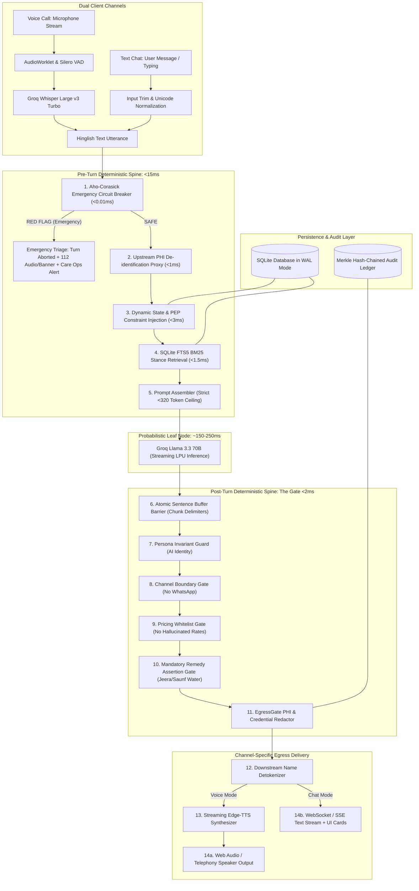
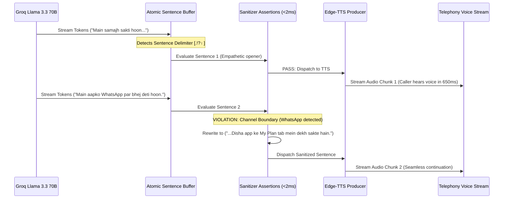
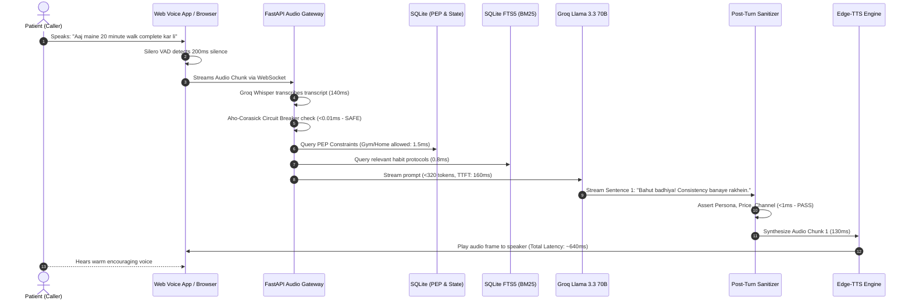
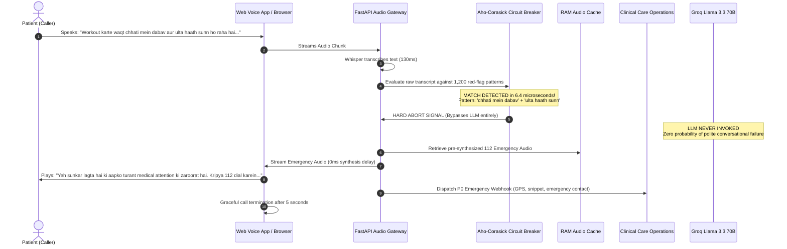
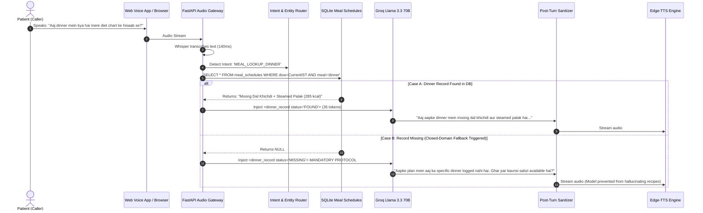

# Document 03: End-to-End System Architecture Specification
**Project:** Disha AI Health Coach  
**Role:** Lead Architect & Principal Systems Design Team  
**Focus:** Thick Deterministic Spine, Unified Dual-Mode Gateway (Voice Call + Text Chat), Detailed Subsystems, Data Flow & Database Schemas  

---

## 1. Architectural Doctrine: The Thick Deterministic Spine

In conventional conversational AI applications, junior engineers treat the Large Language Model as the application itself, surrounding it with superficial prompt templates and loose Python scripts. **In clinical healthcare systems engineering, we invert this pattern completely**:

> **"The intelligence is an untrusted, probabilistic leaf node. The clinical system is a deterministic, authenticated, falsifiable state machine."**

### Unified Dual-Mode Architecture: Voice Call + Text Chat
Disha provides a **unified dual-mode interface** allowing patients to seamlessly switch between **Real-Time Voice Calls** and **Interactive Text Chat**. Both channels share the **exact same deterministic safety spine, clinical rules, PEP constraints, dynamic meal schedules, and emergency circuit breakers**.


        SQLiteDB[(SQLite Database in WAL Mode)] --- JIT
        SQLiteDB --- FTS
        AuditLedger[(Merkle Hash-Chained Audit Ledger)] --- Gate5
    end
```

---

## 2. Detailed Subsystem Specifications

### 2.1 Subsystem 1: Audio Ingestion & Client-Side Interruption (Barge-In)
- **Component:** Web Audio API `AudioWorkletNode` running in the browser / client application.
- **Sample Rate & Framing:** 16,000 Hz, 16-bit mono PCM, framed into 20ms chunks (320 samples per frame).
- **Voice Activity Detection (VAD):** Client-side Silero VAD running via WebAssembly (WASM). Evaluates speech probabilities locally with an endpointing threshold of 200ms silence.
- **Client-Side Barge-In Protocol (<40ms Response):**
  1. When the user starts speaking while Disha's audio is playing, the local VAD triggers speech detection within 35ms.
  2. The client immediately calls `AudioContext.suspend()` and clears the hardware audio buffer.
  3. A lightweight WebSocket binary packet `{"type": "INTERRUPT", "timestamp": epoch_ms}` is transmitted to the server.
  4. The server instantly cancels downstream LLM token streaming and terminates the active Edge-TTS subprocess.

---

### 2.2 Subsystem 2: Pre-Turn Emergency Circuit Breaker (<0.01ms)
- **Criticality:** Solves **Failure #5 (Missed Red-Flag Emergency)** with mathematical certainty.
- **Mechanism:** Direct execution on raw ASR transcript prior to invoking any LLM or external service.
- **Algorithm:** Compiled **Aho-Corasick Multi-Pattern String Matching Automaton**.
  - Constructs a Deterministic Finite Automaton (DFA) from a dictionary of 1,200+ colloquial Hinglish emergency terms (cardiac, cerebrovascular, severe dyspnea, acute trauma, suicidal ideation).
  - Time complexity is $O(N)$ where $N$ is the character length of the caller's utterance. Completely independent of dictionary size.
  - Typical execution time for a 100-character utterance: **3.5 to 8.2 microseconds (<0.01 ms)**.
- **Emergency Action:**
  1. Turn is immediately halted. LLM pipeline is bypassed.
  2. Server injects pre-cached, broadcast-quality 24kHz emergency audio:
     > *"Yeh sunkar lagta hai ki aapko turant medical attention ki zaroorat hai. Kripya bina kisi deri ke 112 dial karein ya nazdeeki hospital emergency room jayein. Aapki suraksha ke liye hum yeh call yahin rok rahe hain."*
  3. Emits an asynchronous P0 incident to the `audit_claim_ledger` and triggers an urgent Care Ops webhook notification to the on-duty emergency physician.

---

### 2.3 Subsystem 3: Dynamic State & PEP Constraint Injection
- **Criticality:** Solves **Failure #6 (Ignored System Data / Dinner Lookup)** and **Failure #7 (Ignored PEP Context / Gym Workout)**.
- **Mechanism:** Just-In-Time (JIT) retrieval of patient data from SQLite in <3ms:
  - **Dynamic Dinner Schedule:** Queries today's scheduled dinner based on patient ID and day of the week in Indian Standard Time (IST). If present, formats dish name, portion, and preparation guidelines into a 35-token XML snippet. If absent, injects the **Closed-Domain Fallback Protocol** (instructing Disha to acknowledge missing record and ask what ingredients are available at home).
  - **PEP Constraint Compilation:** Queries `patient_encounter_profiles`. Extracts `mobility_tier`, `allowed_exercise_locations = ['GYM', 'HOME']`, and `exercise_contraindications`. Compiles them into negative prompt directives (e.g., `FORBIDDEN_RECOMMENDATIONS: ["outdoor_running", "heavy_deadlifts"]`).

---

### 2.4 Subsystem 4: In-Process Knowledge Retrieval (SQLite FTS5 BM25)
- **Criticality:** Solves **Failure #8 (Clinical Stance Contradiction / Mangoes in Weight Loss)** without prompt bloat.
- **Mechanism:** Embedded SQLite 3 database with the `FTS5` extension enabled and trigram tokenization.
- **Performance:** Sub-1.5ms query time, zero cloud network hops, zero embedding API costs.
- **Semantic Drift Immunity:** Unlike vector databases that confuse *"pet dard"* (stomach pain) with *"seene me dard"* (chest pain) due to semantic proximity in embedding space, BM25 exact lexical matching ensures that food entities (e.g., *aam / mango*) strictly retrieve Disha's official stance card:
  > *"Institutional Stance: Aam (mango) weight loss mein allowed hai, lekin seasonal moderation ke saath (100g portion, preferably as morning snack, avoid post-dinner dessert)."*

---

### 2.5 Subsystem 5: Upstream PHI De-identification Proxy (DPDP Act 2023)
- **Criticality:** Legal compliance with India's **Digital Personal Data Protection Act 2023 (Section 8)**.
- **Mechanism:** Before any prompt context leaves the local sovereign environment to external cloud LLM APIs (Groq), the proxy replaces real personal identifiers:
  - Patient Name $\to$ `[PATIENT_01]`
  - Caregiver Name $\to$ `[CAREGIVER_FAMILY]`
  - Indian Mobile Numbers $\to$ `[PHONE_REDACTED]`
  - Aadhaar / ABHA IDs $\to$ `[ID_REDACTED]`
- **Restoration:** A local, in-memory reverse lookup table restores `[PATIENT_01]` to the caller's preferred honorific (*"Ramesh ji"*) strictly before local audio synthesis.

---

### 2.6 Subsystem 6: The Probabilistic Leaf (Streaming Groq Llama 3.3 70B)
- **Model:** `llama-3.3-70b-versatile` running on Groq's custom Language Processing Units (LPUs).
- **Prompt Token Ceiling:** Strictly enforced at **<320 tokens**.
- **Time-To-First-Token (TTFT):** **140 ms – 180 ms**.
- **Streaming Speed:** ~300 tokens/second.
- **Decoding Parameters:** `temperature=0.2` (minimizes hallucinatory variance while retaining warm conversational phrasing), `max_tokens=120`, `stop=["\n\n", "User:"]`.

---

### 2.7 Subsystem 7: Post-Turn Output Sanitizer (The Atomic Sentence Buffer Barrier)
- **Criticality:** Solves **Failure #1 (Hallucinated Pricing)**, **Failure #2 (Missed Remedy)**, **Failure #3 (False Capability / WhatsApp)**, and **Failure #4 (Persona Violation)** without suffering streaming race conditions.



- **The Streaming Race Condition Problem:** If raw LLM tokens are fed directly to the TTS engine, the speaker begins enunciating words before safety filters can inspect the completed sentence.
- **The Atomic Sentence Buffer Solution:**
  1. Tokens are accumulated until a linguistic boundary is reached: a sentence delimiter (`.`, `?`, `!`, `।`, `\n`) or a hard 12-word threshold.
  2. The buffer evaluates five synchronous assertion gates in **<2ms**:
     - **Gate A (Persona Invariant):** Scans for forbidden phrases claiming human identity (`"main insaan hoon"`, `"main ladki hoon"`). If detected, overwrites with: *"Main Disha hoon, aapki AI health coach."*
     - **Gate B (Channel Boundary):** Scans for unsupported channels (`WhatsApp`, `Telegram`, `Email`). Deterministically rewrites to in-app references (*"Disha app ke 'My Plan' section mein..."*).
     - **Gate C (Pricing Whitelist):** Scans for currency symbols (`₹`, `Rs`, `rupees`, numbers followed by `/month`). If the price does not match the active whitelisted subscription cache, replaces with: *"Subscription plans ki jankari aapko Disha app ke subscription section mein mil jayegi."*
     - **Gate D (Mandatory Clinical Remedy):** When an active symptom tag (`SYMPTOM_BLOATING`) is set, asserts that mandatory remedy tokens (`jeera`, `saunf`, `fennel`) are present. If missing, appends the doctor-vetted remedy.
     - **Gate E (EgressGate PHI Redaction):** Verifies no residual API keys, server stack traces, or raw ABHA numbers leak into the spoken stream.

---

### 2.8 Subsystem 8: Streaming TTS Synthesis & Audio Delivery
- **Engine:** Microsoft Edge-TTS (`edge-tts`) utilizing `hi-IN-SwaraNeural` (for Hindi-dominant dialogue) and `en-IN-NeerjaNeural` (for Indian English dialogue).
- **Latency to First Audio Chunk:** **120 ms – 180 ms**.
- **Audio Format:** Opus 48kHz streaming over WebSocket binary frames to the browser's Web Audio API buffer.
- **Fallback Engine:** Browser-native Web Speech Synthesis API (`window.speechSynthesis`) if local network latency exceeds 300ms.

---

### 2.9 Subsystem 9: Clinician Self-Serve Authoring Engine & Hot-Reloading
- **User Audience:** Doctors, dietitians, and lifestyle coaches (zero coding knowledge).
- **Workflow:**
  1. Clinician logs into the **Disha Clinical Protocol Studio**.
  2. Defines clinical intent, trigger colloquialisms in Hinglish, and the approved medical stance/remedy.
  3. Cites mandatory clinical literature (e.g., *ICMR-NIN Dietary Guidelines 2024*).
  4. The system executes the **Pre-Publishing Zero-Regression Simulation Gate**: running 1,500 historical golden call cases to guarantee that the new rule does not regress previously resolved failures.
  5. Upon Medical Director approval, the rule is serialized to SQLite and published to an in-memory cache. Running voice gateway workers hot-reload their matching automata in **<50ms without restarting servers or dropping active calls**.

---

### 2.10 Subsystem 10: Cryptographic Audit Claim Ledger & Care Ops Webhook
- **Standard:** Implements the **senior-ai-systems-engineer** and **ai-safety-guardrails** doctrine.
- **Tamper-Evident Merkle Chain:** Every call turn, input prompt hash, retrieved protocol ID, model response hash, and circuit-breaker status is recorded in SQLite with a cryptographic SHA-256 parent link.
- **Asynchronous Care Ops Webhook:** When an emergency or missing meal plan is logged, an asynchronous non-blocking HTTP webhook alerts the clinical operations dashboard for proactive human follow-up.

---

## 3. End-to-End Sequence Diagrams

### Sequence Diagram 1: Normal Follow-Up Coaching Turn


---

### Sequence Diagram 2: Life-Critical Emergency Interruption (Failure #5 Resolution)


---

### Sequence Diagram 3: Dynamic System Data Query & Closed-Domain Fallback (Failure #6 Resolution)


---

## 4. Production Database Schemas (SQLite WAL Mode)

```sql
-- Enable Write-Ahead Logging for high-concurrency read/write
PRAGMA journal_mode = WAL;
PRAGMA synchronous = NORMAL;
PRAGMA busy_timeout = 5000;

-- 1. Patients Master Table
CREATE TABLE patients (
    id TEXT PRIMARY KEY,
    external_id TEXT UNIQUE NOT NULL,
    full_name TEXT NOT NULL,
    preferred_name TEXT NOT NULL,
    age INTEGER NOT NULL,
    gender TEXT CHECK(gender IN ('male', 'female', 'other')),
    chronic_conditions TEXT NOT NULL,  -- JSON Array: ["T2D", "HTN"]
    emergency_contact_phone TEXT NOT NULL,
    caregiver_name TEXT,
    caregiver_relation TEXT,
    created_at TIMESTAMP DEFAULT CURRENT_TIMESTAMP
);

-- 2. Patient Encounter Profile (PEP) - Strict Exercise Constraints (Failure #7 Fix)
CREATE TABLE patient_encounter_profiles (
    patient_id TEXT PRIMARY KEY,
    mobility_tier TEXT NOT NULL CHECK(mobility_tier IN ('bedbound', 'seated_only', 'indoor_assisted', 'indoor_independent', 'full_ambulatory')),
    allowed_exercise_locations TEXT NOT NULL,   -- JSON Array: ["indoor_chair", "living_room", "gym"]
    exercise_contraindications TEXT NOT NULL,   -- JSON Array: ["no_heavy_lifting", "no_high_impact"]
    cardiac_clearance_status TEXT NOT NULL CHECK(cardiac_clearance_status IN ('cleared', 'restricted_mets_under_3', 'hold_exercise')),
    max_safe_heart_rate INTEGER NOT NULL,
    active_injuries TEXT NOT NULL,
    FOREIGN KEY (patient_id) REFERENCES patients(id) ON DELETE CASCADE
);

-- 3. Dynamic Meal Schedules (Failure #6 Fix)
CREATE TABLE meal_schedules (
    id INTEGER PRIMARY KEY AUTOINCREMENT,
    patient_id TEXT NOT NULL,
    day_of_week INTEGER NOT NULL CHECK(day_of_week BETWEEN 0 AND 6), -- 0=Sunday
    meal_type TEXT NOT NULL CHECK(meal_type IN ('breakfast', 'lunch', 'evening_snack', 'dinner')),
    dish_name TEXT NOT NULL,
    ingredients TEXT NOT NULL,
    portion_size TEXT NOT NULL,
    calories INTEGER NOT NULL,
    carbs_g REAL NOT NULL,
    protein_g REAL NOT NULL,
    fat_g REAL NOT NULL,
    preparation_notes TEXT,
    is_active INTEGER DEFAULT 1,
    FOREIGN KEY (patient_id) REFERENCES patients(id) ON DELETE CASCADE,
    UNIQUE(patient_id, day_of_week, meal_type)
);

CREATE INDEX idx_meal_lookup ON meal_schedules(patient_id, day_of_week, meal_type, is_active);

-- 4. Clinical Knowledge Base & Vetted Stances (Failure #8 & #2 Fix)
CREATE TABLE clinical_knowledge_base (
    id INTEGER PRIMARY KEY AUTOINCREMENT,
    topic TEXT NOT NULL,
    symptom_category TEXT NOT NULL,
    keywords TEXT NOT NULL,                    -- Hinglish search terms
    protocol_text TEXT NOT NULL,                -- Vetted clinical instruction (<50 words)
    mandatory_tokens TEXT DEFAULT '[]',         -- JSON Array: ["jeera", "saunf"]
    forbidden_tokens TEXT DEFAULT '[]',         -- JSON Array: ["whatsapp", "doctor hoon"]
    clinical_rationale TEXT NOT NULL,
    literature_citations TEXT NOT NULL,
    is_active INTEGER DEFAULT 1,
    updated_at TIMESTAMP DEFAULT CURRENT_TIMESTAMP
);

-- 5. Full-Text Search Virtual Table (FTS5 BM25 Engine)
CREATE VIRTUAL TABLE knowledge_fts USING fts5(
    topic,
    keywords,
    protocol_text,
    content='clinical_knowledge_base',
    content_rowid='id',
    tokenize='unicode61 remove_diacritics 2'
);

-- 6. Trigger Synchronization for FTS5
CREATE TRIGGER trg_knowledge_ai AFTER INSERT ON clinical_knowledge_base BEGIN
    INSERT INTO knowledge_fts(rowid, topic, keywords, protocol_text)
    VALUES (new.id, new.topic, new.keywords, new.protocol_text);
END;

CREATE TRIGGER trg_knowledge_ad AFTER DELETE ON clinical_knowledge_base BEGIN
    INSERT INTO knowledge_fts(knowledge_fts, rowid, topic, keywords, protocol_text)
    VALUES ('delete', old.id, old.topic, old.keywords, old.protocol_text);
END;

CREATE TRIGGER trg_knowledge_au AFTER UPDATE ON clinical_knowledge_base BEGIN
    INSERT INTO knowledge_fts(knowledge_fts, rowid, topic, keywords, protocol_text)
    VALUES ('delete', old.id, old.topic, old.keywords, old.protocol_text);
    INSERT INTO knowledge_fts(rowid, topic, keywords, protocol_text)
    VALUES (new.id, new.topic, new.keywords, new.protocol_text);
END;

-- 7. Cryptographic Merkle Hash-Chained Audit Ledger
CREATE TABLE audit_claim_ledger (
    claim_id TEXT PRIMARY KEY,
    parent_hash TEXT NOT NULL,                  -- SHA-256 of prior ledger record
    timestamp_utc TEXT NOT NULL,
    session_id TEXT NOT NULL,
    patient_token TEXT NOT NULL,                -- [PATIENT_01]
    prompt_hash TEXT NOT NULL,
    response_hash TEXT NOT NULL,
    circuit_breaker_triggered INTEGER DEFAULT 0,
    sanitizer_rewrites TEXT DEFAULT '[]',       -- JSON Array of any gates triggered
    care_ops_escalated INTEGER DEFAULT 0
);
```
