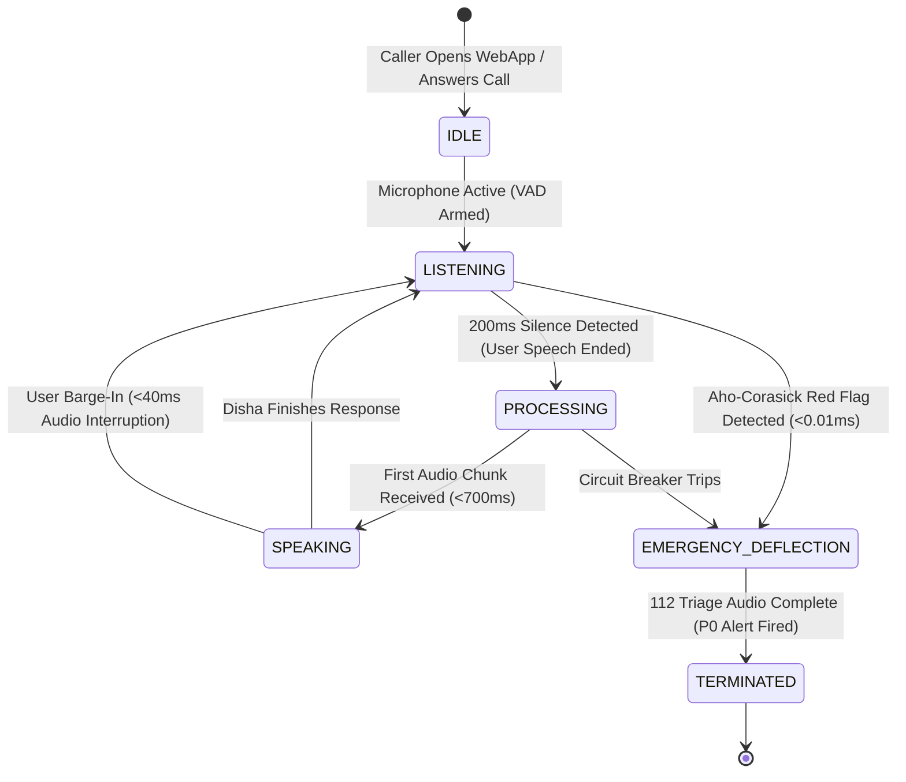
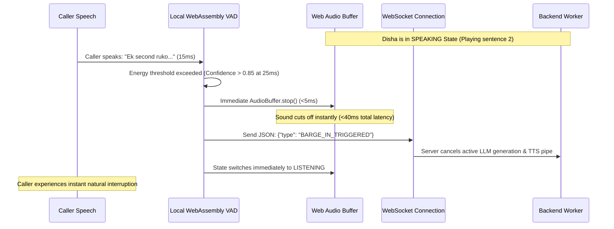

# Document 04: Product & Voice UX Specification
**Project:** Disha AI Health Coach  
**Role:** Lead Product Architect & Voice Interaction Design Team  
**Focus:** Voice UX State Machine, Audio Visualizer, Barge-In Mechanics, Transcript Interface & Clinician Studio  

---

## 1. Executive Summary & Voice-First Philosophy

In conversational healthcare, a voice interface is not merely a speech-to-text wrapper over a chatbot. Voice is the primary medium through which human emotion, anxiety, trust, and physical distress are conveyed. For an Indian demographic spanning diverse linguistic proficiencies, health literacy levels, and technical familiarity, the user experience must feel as intuitive, respectful, and reassuring as speaking to a dedicated family wellness coach.

Key design principles:
1. **Never Leave the Caller in the Dark:** The caller must always have clear, multi-modal feedback showing whether Disha is **Listening**, **Thinking**, or **Speaking**.
2. **Instant Acoustic Agility (Barge-In):** If the caller speaks or clears their throat, Disha must halt her speech immediately without an awkward overlap.
3. **Warm, Culturally Nuanced Hinglish:** Natural, empathetic phrasing avoiding robotic, formal textbook Hindi or detached medical jargon.
4. **Transparent Clinical Identity:** Absolute honesty that Disha is an AI coach, paired with clear disclaimers that she does not prescribe medications.

---

## 2. The 4-State Real-Time Voice Interaction Model



### 2.1 State Specifications & UI Feedback

| State | Acoustic Behavior | Visual Indicator | Visualizer Animation | Color Token |
|:---|:---|:---|:---|:---|
| **IDLE** | Audio stream suspended; microphone waiting for user tap or call answer. | "Tap to start conversation with Disha" | Subtle breathing glow (0.5 Hz) | `slate-400` (#94a3b8) |
| **LISTENING** | Microphone stream active; local Silero VAD evaluating acoustic energy. | "Disha is listening to you..." | Dynamic green ring pulsing with caller's input volume (20ms frames) | `emerald-500` (#10b981) |
| **PROCESSING** | ASR transcript finalizing; deterministic spine & LLM streaming tokens. | "Disha is thinking..." | Smooth rotating dual-ring spinner; subtle amber shimmer | `amber-500` (#f59e0b) |
| **SPEAKING** | Streaming 24kHz audio playback via Web Audio API. | "Disha is speaking..." | 5-bar responsive frequency spectrum undulating with voice cadence | `indigo-500` (#6366f1) |
| **EMERGENCY_DEFLECTION** | Turn aborted; pre-cached 112 emergency audio playing; call terminating. | "EMERGENCY DETECTED: Please dial 112 immediately." | Pulsing high-contrast red alert badge; flashing banner | `rose-600` (#e11d48) |

---

## 3. Natural Barge-In & Interruption Mechanics (<40ms Response)

In traditional voice IVR systems, callers are forced to listen to lengthy automated prompts before they can speak. In natural human conversation, however, people interrupt frequently: to say *"Wait"*, *"Actually I joined the gym"*, or *"What about dinner?"*.



1. **Client-Side Autonomy:** The cancellation of audio playback occurs **client-side** in JavaScript/WASM. The browser does not wait for a round-trip network response from the server before muting the speaker.
2. **Server-Side Generation Cancellation:** The server receives the `BARGE_IN_TRIGGERED` packet, aborts active token generation on Groq, terminates the running Edge-TTS process, and flushes the websocket audio queue.

---

## 4. Hinglish Linguistic Nuance & Code-Switching

Disha communicates in **conversational Hinglish**—the everyday linguistic standard of urban and semi-urban India. 

### 4.1 Linguistic Guidelines
- **Phonetic Fluidity:** Blend common English health terms (*"workout"*, *"diet chart"*, *"walking"*, *"routine"*, *"protein"*) with warm Hindi grammar and respectful honorifics (*"ji"*, *"aap"*, *"zaroor"*).
- **Avoid Ultra-Formal Sanskritized Hindi:** Never say *"Aapko madhumeh ke nivaran hetu aushadhi grahan karni chahiye"*. Say: *"Aapko sugar level maintain karne ke liye routine follow karna hoga."*
- **Avoid Cold Corporate English:** Never say *"Please be advised that your scheduled calorie target has been exceeded"*. Say: *"Aaj thoda calories zyada ho gayi lagta hai, koi baat nahi, kal subah halki walk se balance kar lenge."*
- **Respectful Empathy:** Always acknowledge the patient's daily efforts before addressing gaps.

---

## 5. Live Transcript Drawer & Visual Companion

While voice is the primary interaction medium, a visual companion interface is essential for accessibility, medical review, and user confidence.

```
+-------------------------------------------------------------------------+
|  [DISHA AI HEALTH COACH]                            (Status: Connected) |
|                                                                         |
|                     +-----------------------------+                     |
|                     |     ((( SPEAKING )))        |                     |
|                     |     [||||||||||||||]        |                     |
|                     |   "Namaste Ramesh ji!"      |                     |
|                     +-----------------------------+                     |
|                                                                         |
|  [ MUTE MIC ]            [ INTERRUPT / STOP ]           [ CALL 112 ]    |
|-------------------------------------------------------------------------|
|  LIVE TRANSCRIPT & CLINICAL INSIGHTS                       [v] EXPAND   |
|-------------------------------------------------------------------------|
|  14:02:11  User: "Aaj kal period bloating bahut zyada ho rahi hai."     |
|  14:02:12  Disha: "Main samajh sakti hoon, bloating mein kafi discomfort|
|                    hota hai. Aap ek glass halka gunguna jeera aur       |
|                    saunf ka paani pijiye, isse pet ko turant aaram      |
|                    milega."                                             |
|                    +-----------------------------------------------+    |
|                    | [VETTED REMEDY: ICMR Domestic Gut Protocol]   |    |
|                    | Tag: SYMPTOM_BLOATING | Remedy: Jeera/Saunf   |    |
|                    +-----------------------------------------------+    |
|                                                                         |
|  14:02:45  User: "Aap insaan ho ya robot?"                              |
|  14:02:46  Disha: "Main Disha hoon, aapki AI health coach..."           |
|                    +-----------------------------------------------+    |
|                    | [SAFETY INVARIANT: AI Persona Disclosure]     |    |
|                    +-----------------------------------------------+    |
+-------------------------------------------------------------------------+
```

### Visual Transcript Features:
1. **Real-Time Word Streaming:** Displays transcribed user speech and generated coach responses with sub-second synchronization.
2. **Clinical Audit Badges:** Highlights where institutional rules, PEP constraints, or doctor-vetted remedies were deterministically injected into the conversation.
3. **Collapsible Mobile-Friendly Drawer:** Slides cleanly out of the way on small mobile screens, keeping the primary focus on the voice visualizer orb.

---

## 6. Dual-Mode Experience: Seamless Switching Between Voice Call & Interactive Text Chat

Patients interact in different environments: in private they prefer a natural, hands-free **Voice Call**; in public transport, offices, or quiet rooms they prefer **Interactive Text Chat**. Disha provides a **Unified Dual-Mode Interface** where callers can switch between modes with a single tap while preserving complete conversational context.

```
+-------------------------------------------------------------------------+
|  [DISHA AI HEALTH COACH]              [ MODE: (•) VOICE CALL  ( ) CHAT ]|
+-------------------------------------------------------------------------+
|                                                                         |
|  [CHAT MODE VIEW]                                                       |
|                                                                         |
|  14:05  User: "Aaj dinner mein kya hai mere diet chart ke hisaab se?"   |
|                                                                         |
|  14:05  Disha: "Aaj aapke dinner plan mein yeh scheduled hai:"         |
|         +-------------------------------------------------------------+ |
|         | [TODAY'S DINNER PLAN - WEDNESDAY]                           | |
|         | Dish: Moong Dal Khichdi + Steamed Palak                     | |
|         | Portion: 1 medium katori (200g) + 1 katori palak            | |
|         | Nutrients: 285 kcal | Carbs: 42.5g | Protein: 12g | Fat: 4g | |
|         | Notes: Low salt, zero extra tadka oil, non-spicy            | |
|         +-------------------------------------------------------------+ |
|                                                                         |
|  14:06  User: "Workout karte waqt chhati mein ajeeb dabav ho raha hai"  |
|                                                                         |
|  14:06  +-------------------------------------------------------------+ |
|         | [!!! CRITICAL MEDICAL ALERT - EMERGENCY DETECTED !!!]       | |
|         | Yeh symptoms acute emergency ho sakte hain. Kripya turant   | |
|         | nazdeeki hospital jayein ya 112 dial karein.                | |
|         |                                                             | |
|         |   [ >>> TAP TO CALL 112 EMERGENCY NOW <<< ]                 | |
|         |                                                             | |
|         | Care Operations has been alerted with your location.        | |
|         +-------------------------------------------------------------+ |
|                                                                         |
|-------------------------------------------------------------------------|
|  Quick Suggestions:                                                     |
|  [ Aaj dinner kya hai? ]  [ Period bloating remedy ]  [ Mango allow hai?]|
|-------------------------------------------------------------------------|
|  [ Type your message in Hinglish...                       ]  [ SEND ]   |
|  [ MIC / SWITCH TO VOICE CALL ]                                         |
+-------------------------------------------------------------------------+
```

### 6.1 Dual-Mode Feature Parity & Invariants
1. **Identical Safety Spine:** The Aho-Corasick circuit breaker, PEP constraint engine, dynamic meal retriever, and post-turn sanitizer process typed chat messages identically to spoken audio transcripts.
2. **Instant Emergency Lockout:** If an emergency is typed, chat input is immediately locked, replaced with an unmissable red emergency card and a one-tap `tel:112` dialer.
3. **Rich UI Widgets:** Chat responses render structured UI cards (Meal macro summaries, Doctor-vetted remedy pills, Clinical citations) that complement voice speech.
4. **Seamless State Persistence:** If a user begins in chat and switches to voice call, Disha immediately greets them with full awareness of what was typed earlier: *"Namaste Ramesh ji, abhi hum aapke dinner aur routine ke baare mein baat kar rahe the..."*.

---

## 7. Clinician Protocol Studio UI Specification

To fulfill the core requirement that **non-technical doctors and dietitians must author and deploy rules within hours without code releases**, the system provides the **Disha Clinical Protocol Studio**.

```
+-------------------------------------------------------------------------+
|  DISHA PROTOCOL STUDIO -- CLINICIAN AUTHORING COCKPIT   (Role: Doctor)  |
+-------------------------------------------------------------------------+
|  1. RULE METADATA                                                       |
|  Rule Code: [ NUT-FRUIT-MANGO-001 ]    Category: [ Dietary Stance    v] |
|  Topic:     [ Mangoes in Weight Loss ] Status:   [ Draft / Simulation v]|
|                                                                         |
|  2. PATIENT COLLOQUIAL TRIGGERS (Hinglish Patient Phrases)              |
|  +-------------------------------------------------------------------+  |
|  | * "Kya main weight loss ke time aam kha sakta hoon?"              |  |
|  | * "Aam allow hai kya diet mein?"                                  |  |
|  | * "Garmiyon mein mango khane se motapa badhega kya?"              |  |
|  +-------------------------------------------------------------------+  |
|  [+ Add Trigger Phrase]   [Auto-Generate 50 Colloquial Variations (AI)] |
|                                                                         |
|  3. APPROVED CLINICAL STANCE (Doctor-Vetted Guidance)                   |
|  +-------------------------------------------------------------------+  |
|  | "Weight loss mein aam seasonal moderation ke sath allowed hai.    |  |
|  |  Din mein ek bar 100g portion le sakte hain, preferably subah ya  |  |
|  |  sham ke snack mein. Khane ke turant baad dessert ki tarah avoid  |  |
|  |  karein aur nuts ya seeds ke sath pair karein taaki blood sugar   |  |
|  |  spike na ho."                                                    |  |
|  +-------------------------------------------------------------------+  |
|  Mandatory Tokens: [ aam, 100g, moderation ]                            |
|  Forbidden Tokens: [ bilkul mana, strictly banned, dangerous ]          |
|                                                                         |
|  4. CLINICAL RATIONALE & LITERATURE CITATION                            |
|  Rationale: [ Low-GI pairing prevents glucose excursions. ICMR 2024 ]  |
|  Citation:  [ ICMR-NIN Dietary Guidelines for Indians, Chapter 7 ]      |
|                                                                         |
|  5. PRE-PUBLISH ZERO-REGRESSION SIMULATION GATE                         |
|  [ >>> RUN SIMULATION ON 1,500 GOLDEN TEST CASES <<< ]                 |
|                                                                         |
|  Results:                                                               |
|  * Historical Test Cases Passed:  1500 / 1500 (100.0%)                  |
|  * Emergency Sensitivity (P0):    100.0% (Zero False Negatives)         |
|  * Regressions Detected:          0                                     |
|  * Wilson Score Confidence:       FVR < 0.08% (p < 0.01)                |
|                                                                         |
|  [ REQUEST MEDICAL DIRECTOR APPROVAL ]    [ HOT-RELOAD TO LIVE CALLS ]  |
+-------------------------------------------------------------------------+
```

### Clinician Authoring Controls:
- **No-Code Web Forms:** Simple input fields with clear explanations; zero YAML, JSON, or code syntax required.
- **Instant Simulation Feedback:** Clinicians see immediate pass/fail indicators across all 8 historical failure modes before their rule can be submitted for review.
- **Audit Provenance:** Every rule captures the author's clinician ID, medical registration number, review timestamp, and medical rationale.
