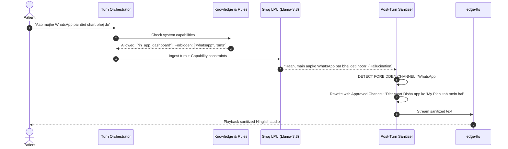
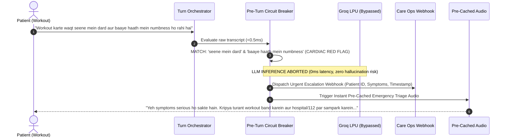
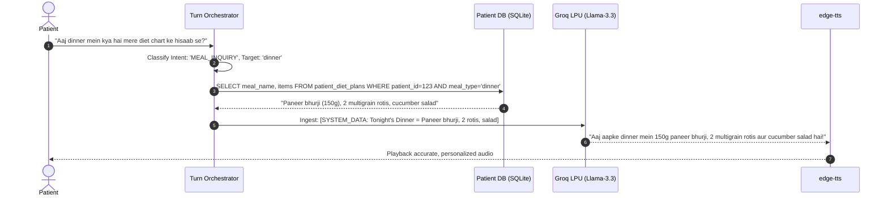

# 04. Product Architecture — Disha Clinical Voice AI

## 1. Architectural Philosophy: The Deterministic Safety Spine

A common failure in conversational AI is treating the Large Language Model as the entire system, attempting to solve edge cases, safety rules, and patient context through ever-growing, brittle system prompts. 

Disha AI implements the **"Thick Deterministic Spine, Thin Probabilistic Leaf"** architectural doctrine:

> **"The LLM is an untrusted, probabilistic reasoning leaf node. The system is a deterministic, authenticated, falsifiable clinical state machine."**

```
┌────────────────────────────────────────────────────────────────────────────────────────┐
│                        THICK DETERMINISTIC SPINE (FastAPI / SQLite)                     │
│                                                                                        │
│  User Audio ──> [VAD] ──> [Whisper STT] ──> [Ingestion Tag Stripper & PHI Anonymizer] │
│                                                    │                                   │
│                                                    ▼                                   │
│                              [Dual-Track Emergency Circuit Breaker]                    │
│                              • Track 1: Fast Regex/Aho-Corasick (<0.005ms)             │
│                              • Track 2: Phonetic & Colloquial Lexicon Expansion        │
│                                                    │                                   │
│                     ┌──────────────────────────────┴─────────────────────────┐         │
│                     │ Emergency Detected?                                    │         │
│                     ├───────────────────────────────────┬────────────────────┤         │
│                     │ YES (e.g. Chest Pain)             │ NO                 │         │
│                     ▼                                   ▼                    │         │
│             [0ms Deterministic Audio]            [Hybrid RAG Engine (RRF)]   │         │
│             [Multi-Channel Escalation:           • SQLite FTS5 (BM25: 0.6)   │         │
│              Webhook + SMS Fallback]             • FastEmbed Cosine (0.4)    │         │
│                                                  • Dynamic Patient DB        │         │
│                                                  • PEP Profile Rules         │         │
│                                                         │                    │         │
│                                                         ▼                    │         │
│                                            ┌─────────────────────────┐       │         │
│                                            │  PROBABILISTIC LEAF     │       │         │
│                                            │  Groq Llama-3.3-70B     │       │         │
│                                            └────────────┬────────────┘       │         │
│                                                         │                    │         │
│                                                         ▼                    │         │
│                                            [Atomic Sentence Buffer Barrier]  │         │
│                                            [Post-Turn Output Sanitizer]      │         │
│                                            • AI Persona Enforcer (AI Coach)  │         │
│                                            • Broad Capability Filter (No WA) │         │
│                                            • Mandatory Remedy Verifier       │         │
│                                            • Price Sanity Checker            │         │
│                                                         │                    │         │
│                                                         ▼                    │         │
│                                            [edge-tts Streamer] ──> Audio Out │         │
└────────────────────────────────────────────────────────────────────────────────────────┘
```

---

## 2. High-Level Subsystems & Component Responsibilities

### 1. Client / Telephony Gateway
- **WebRTC / WebSocket Interface:** Bidirectional low-latency audio streaming channel.
- **Clinician Simulation Web Client:** Interactive browser sandbox providing real-time microphone input, turn latency waterfall visualization, retrieved knowledge inspection, and live guardrail status.

### 2. Real-Time Turn Orchestrator (FastAPI)
- Manages the active call lifecycle, turn state machine, audio buffering, and asynchronous task coordination.
- Maintains the conversational turn state (`turn_id`, `call_id`, `dialogue_history`, `active_symptoms`).

### 3. Safety & Guardrail Engine
- **Pre-Turn Emergency Triage:** Ultra-fast (<0.5ms) compiled pattern matching against acute symptoms. Completely bypasses the LLM on critical emergencies.
- **Post-Turn Output Sanitizer:** Validates every generated sentence before it reaches audio synthesis, catching hallucinated capabilities (WhatsApp), persona violations (claims to be human), or ungrounded prices.

### 4. Hybrid Knowledge Retrieval Engine
- **SQLite Database with FTS5:** High-speed full-text search across clinician-authored rules, remedies, and stances.
- **FastEmbed In-Process Vector Engine:** Computes 384-dimensional multilingual embeddings using ONNX Runtime on CPU (<10ms).
- **Patient Context Resolver:** Pulls active meal plans (`patient_diet_plans`) and exercise constraints from the Patient Encounter Profile (`patient_pep`).

### 5. Probabilistic Reasoning Core
- **Prompt Assembler:** Constructs an ephemeral turn prompt containing only the core persona, dialogue history (last 3 turns), and the top 2 retrieved knowledge snippets (<250 tokens total).
- **Inference Engine:** Dispatches streaming requests to Groq Cloud LPUs (`llama-3.3-70b-versatile` or `llama-3.1-8b-instant`).

### 6. Streaming Audio Synthesizer
- **`edge-tts` Pipeline:** Converts text sentences into high-fidelity Indian-accented neural audio chunks (`hi-IN-SwaraNeural`), streaming binary audio over WebSockets to the client as sentences finish.

### 7. Clinical Authoring Studio & Zero-Regression Gate
- **Clinician Web Portal:** Vue/React/Tailwind interface allowing clinicians to manage rules, stances, and system parameters without code changes.
- **Pre-Publishing Simulation Harness:** Executes candidate rules against a pinned golden test suite before database commit, blocking any rule that causes regressions.

---

## 3. Detailed Data Flow by Failure Class

### Failure Class A: Wrong Statements (e.g. WhatsApp, Human Persona)


### Failure Class B: Missed Actions (e.g. Chest Pain Emergency)


### Failure Class C: Missing Facts (e.g. Dinner Diet Chart)


---

## 4. Prompt Assembly & Context Budget

To prevent the common anti-pattern of prompt bloat (stuffing 5,000 tokens of clinical rules into every turn), Disha AI enforces strict token partitioning:

| Section | Content | Token Budget | Invalidation / Cache Strategy |
| :--- | :--- | :--- | :--- |
| **System Core** | Persona invariant, AI identity disclosure, Hinglish voice style. | 80 tokens | Pinned & immutable. |
| **PEP Profile** | Active patient constraints (allowed exercise, food preference, conditions). | 50 tokens | Loaded once at session start. |
| **Retrieved Context** | Top 1–2 matched clinical rules / stances / diet data. | 70 tokens | JIT dynamically fetched per turn. |
| **Turn History** | Last 2 conversational turns (User + Assistant). | 80 tokens | Rolling window. |
| **Negative Constraints** | Disallowed channels (No WhatsApp, no prescription drugs). | 30 tokens | Pinned & immutable. |
| **TOTAL PROMPT** | **Complete Turn Context** | **~310 tokens** | **Minimal compute, ultra-fast TTFT** |

---

## 5. Architectural Enhancements from ECC Specialist Reviews

### 5.1. Atomic Sentence Buffer Barrier (Preventing Audio Stream Race Conditions)
To prevent audio leaks where an unverified response begins streaming before a post-turn violation is detected:
1. The orchestrator accumulates streaming LLM tokens into an **Atomic Sentence Buffer** until a terminal sentence boundary (`.`, `?`, `!`, `।`, or newline) is encountered.
2. The complete sentence string is synchronously passed through the **Post-Turn Sanitizer** (<0.5ms).
3. If an identity claim, unsupported channel (WhatsApp), or missing mandatory remedy (*jeera/saunf*) is flagged, the sentence is rewritten/intercepted before TTS synthesis.
4. Only validated sentences are passed to `edge-tts`. Because Groq generates ~300 tokens/sec, accumulating a 12-word sentence takes ~40ms, adding imperceptible latency while guaranteeing zero audio leakage.

### 5.2. Reciprocal Rank Fusion (RRF) for Hybrid Retrieval
Knowledge retrieval merges lexical BM25 from SQLite FTS5 and dense semantic similarity from FastEmbed ONNX using Reciprocal Rank Fusion:
$$\text{Score}(d) = \frac{w_{\text{fts}}}{k + \text{rank}_{\text{fts}}(d)} + \frac{w_{\text{vec}}}{k + \text{rank}_{\text{vec}}(d)}$$
Where $k=60$, $w_{\text{fts}} = 0.6$, and $w_{\text{vec}} = 0.4$. Candidates below a strict relevance threshold $\tau = 0.012$ are pruned, ensuring that noisy, irrelevant rules never consume the 70-token retrieved context budget.

### 5.3. Upstream Pre-LLM PHI De-Identification Proxy
Before any turn prompt is assembled or dispatched to external LLM endpoints:
- The patient's legal name, phone number, and identifiable contact details are replaced with ephemeral synthetic tokens (e.g. `[PATIENT_FIRST_NAME]`).
- All Aadhaar, PAN, and 14-digit Ayushman Bharat Health Account (ABHA) IDs are redacted by the Tier 1 EgressGate.
- Only clinically necessary variables (age, gender, dietary preferences, comorbidity flags) reach the LLM.

### 5.4. Closed-Domain Grounding & Uncertainty Fallback
To prevent the model from guessing when requested records are missing:
- If a patient asks about structured data (e.g. diet plan, lab report) and the database returns zero records, the context explicitly injects: `[SYSTEM_DATA: Record not found]`.
- The system prompt enforces an immutable closed-domain refusal: *"If a requested meal or clinical fact is not present in VERIFIED SYSTEM FACTS, do not invent. State politely in Hinglish that the record is not available and advise consulting the dietitian in the Disha app."*

