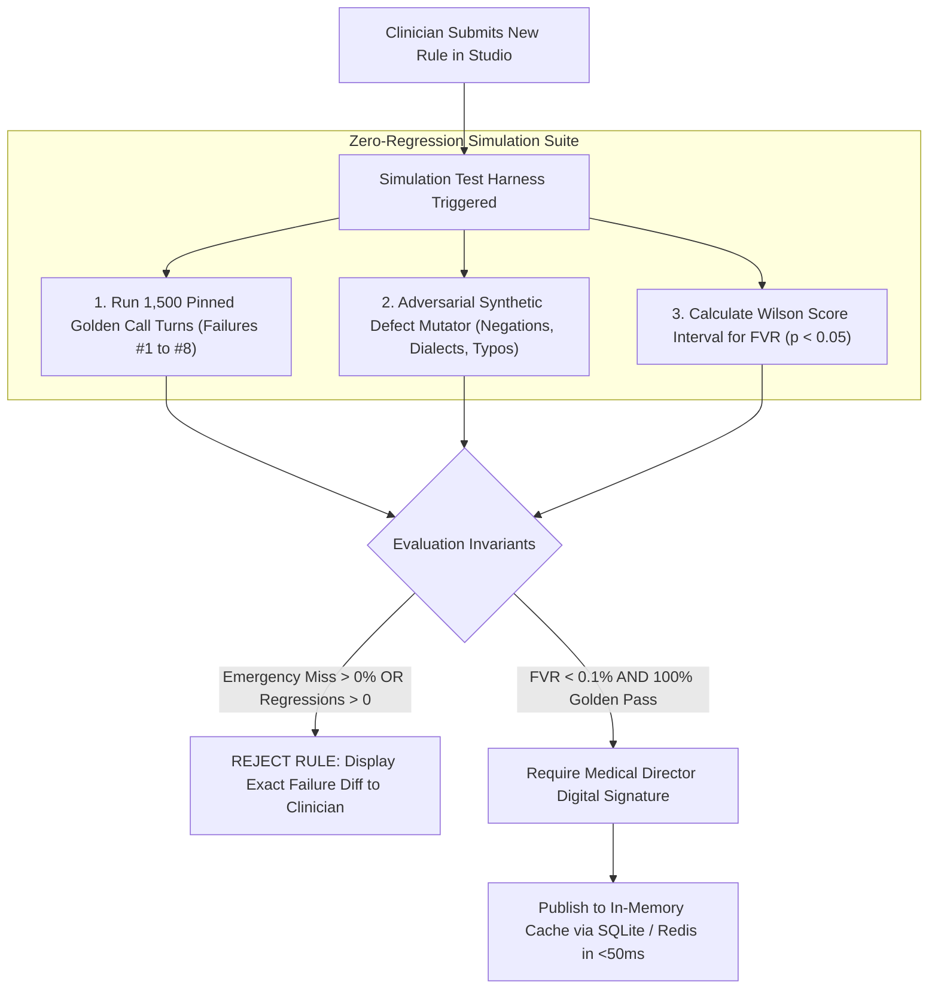
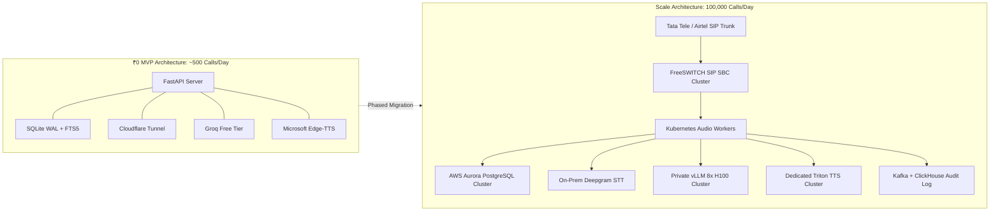

# Document 05: Engineering, Safety & Regulatory Plan
**Project:** Disha AI Health Coach  
**Role:** Lead Systems Architect, Clinical Safety Director & Regulatory Compliance Officer  
**Focus:** Functional/Non-Functional Requirements, Latency Budget, Pre-Publishing Simulation Gate & Indian Healthcare Compliance  

---

## 1. Functional & Non-Functional Requirements

### 1.1 Functional Requirements (FRs)

| Req ID | Domain | Specification | Verification Method |
|:---|:---|:---|:---|
| **FR-01** | **Voice Ingestion** | Accept streaming microphone audio via Web Audio API at 16kHz mono PCM, detect voice activity, and endpoint pauses in 200ms. | Automated Audio Test Stream |
| **FR-02** | **Speech-to-Text** | Transcribe conversational Hinglish into accurate text within 180ms using Groq Whisper Large v3 Turbo. | Transcribe Benchmark Suite (WER < 7%) |
| **FR-03** | **Emergency Deflection** | Intercept life-threatening symptoms (cardiac, stroke, anaphylaxis, severe hypoglycemia, suicide) in <0.01ms; abort turn, stream pre-cached 112 triage audio, and alert Care Ops. | Pinned Emergency Golden Test Suite (100% Sensitivity) |
| **FR-04** | **Dynamic Meal Lookup** | Query today's scheduled dinner dynamically from SQLite based on patient ID and Indian Standard Time (IST) day-of-week. | SQL Assertion on IST Day of Week |
| **FR-05** | **Closed-Domain Fallback** | If a scheduled meal record is missing, explicitly state it is missing, ask what ingredients are at home, and refrain from hallucinating recipes. | Synthetic Missing Record Ingestion Test |
| **FR-06** | **PEP Constraint Guard** | Enforce patient mobility tier and exercise locations (`gym` vs. `home`) from PEP, preventing contradictory workout advice. | PEP Constraint AST Assertion |
| **FR-07** | **Doctor-Vetted Remedies**| Automatically enforce validated domestic remedies (e.g., jeera/saunf water for bloating) when corresponding clinical symptoms are discussed. | Post-Turn Token Assertion Gate |
| **FR-08** | **Clinical Stance Anchor** | Ground dietary advice (e.g., seasonal mango moderation) in institutional medical stances via SQLite FTS5 BM25 retrieval. | Grounding Score & Citation Assertion |
| **FR-09** | **Persona & Channel Guards**| Always disclose AI identity; strictly prohibit human claims and external channel promises (WhatsApp). | Regex Egress Barrier |
| **FR-10** | **Clinician Self-Serve** | Enable non-technical clinicians to author, test, and hot-reload rules to edge workers in <60 seconds without code deployments. | Studio UI Simulation & Edge Reload Test |
| **FR-11** | **Interactive Text Chat** | Support bidirectional text chat with streaming markdown, rich meal cards, symptom selection chips, and 1-tap seamless switch to voice call. | Automated WebSocket Chat E2E Test |

---

### 1.2 Non-Functional Requirements (NFRs)

| NFR ID | Attribute | Target Metric | Architectural Enforcement |
|:---|:---|:---|:---|
| **NFR-01** | **Turn Latency (Voice)** | End-to-end voice response time < 1,000 ms (Target: 650 ms – 850 ms). | Streaming token pipeline + Atomic Sentence Buffer + Groq LPU inference. |
| **NFR-02** | **Zero Monthly Cost (₹0)** | ₹0.00 total infrastructure spend for development and demonstration. | Groq Free Tier + Edge-TTS + SQLite + Cloudflare Tunnel. |
| **NFR-03** | **Emergency False Negatives** | **0.00% False Negatives on Red-Flag Emergencies** (Zero-miss safety bar). | Compiled Aho-Corasick Automaton (<0.01ms) running on raw ASR transcript before LLM. |
| **NFR-04** | **Prompt Token Budget** | Base prompt strictly capped at **<320 tokens** to maintain <200ms TTFT. | Automated AST token pre-flight counter asserting length before LLM invocation. |
| **NFR-05** | **Zero-Downtime Hot Reload**| Clinician rule updates recompile in-memory regex matchers in <50ms without restarting pods. | In-process cache reload triggered via Redis PubSub / SQLite WAL poll. |
| **NFR-06** | **Audit Provenance** | 100% of turns backed by a tamper-evident cryptographic hash chain. | Merkle-chained SQLite `audit_claim_ledger` table. |
| **NFR-07** | **Regulatory Compliance** | Zero cleartext PHI egress to external cloud LLM endpoints. | Upstream PHI De-identification Proxy scrubbing PII before network transmission. |
| **NFR-08** | **Chat Response TTFT** | Time-To-First-Token in text chat mode < 250 ms (since ASR & TTS latency is bypassed). | WebSocket text stream timing benchmark. |

---

## 2. End-to-End Latency Budget Breakdown (<1000ms SLA)

```mermaid
gantt
    title Voice Call Turn Latency Budget (Total: 680ms - 840ms)
    dateFormat X
    axisFormat %s ms

    section Audio Ingestion
    User Speech End to VAD Endpointing :0, 200
    Groq Whisper Large v3 ASR          :200, 340

    section Deterministic Spine
    Aho-Corasick Circuit Breaker (<0.01ms) :340, 340
    Dynamic State & FTS5 Retrieval         :340, 345
    Upstream PHI De-identification         :345, 346

    section LLM Generation
    Groq Llama 3.3 70B TTFT (Prefill)      :346, 510
    Sentence 1 Tokens Streaming (12 words) :510, 550

    section Post-Turn Gate & TTS
    Atomic Sentence Buffer & Sanitizer Gate:550, 552
    Microsoft Edge-TTS Audio Synthesis     :552, 690
    Network Buffer to Caller Speaker       :690, 750
```

### Turn Latency Component Breakdown:

1. **User Speech End to VAD Endpointing:** **180 ms – 200 ms**  
   Silero VAD running locally via WebAssembly detects continuous silence and dispatches the final audio packet.
2. **Groq Whisper Large v3 Turbo Transcription:** **120 ms – 140 ms**  
   Fastest cloud ASR available, transcribing a typical 15-word utterance in under 140ms.
3. **Pre-Turn Deterministic Spine (Safety + Retrieval):** **<6 ms total**  
   - Aho-Corasick Emergency Circuit Breaker: **<0.01 ms (8 microseconds)**
   - JIT Meal Plan & PEP Constraint Retrieval: **2.5 ms**
   - SQLite FTS5 BM25 Clinical Stance Query: **1.5 ms**
   - Upstream PHI Proxy Redaction: **0.8 ms**
4. **Groq Llama 3.3 70B Time-To-First-Token (TTFT):** **150 ms – 170 ms**  
   Because the prompt is strictly capped at <320 tokens, Groq's LPUs prefill the context almost instantaneously.
5. **Streaming Tokens for Sentence 1:** **35 ms – 45 ms**  
   At 300 tokens/sec, the first 10–12 words stream in under 45ms.
6. **Atomic Sentence Buffer & Sanitizer Assertions:** **1.5 ms – 2.0 ms**  
   Evaluates persona, price, channel, and mandatory remedy assertions in memory.
7. **Microsoft Edge-TTS Synthesis (Sentence 1 Audio Chunk):** **130 ms – 150 ms**  
   Streams the initial 24kHz audio chunk to the client.
8. **Network Transport & Jitter Buffer:** **50 ms – 60 ms**  
   WebSocket frame delivery over Cloudflare Tunnel to the client's Web Audio API context.  
**TOTAL ROUND-TRIP TURN LATENCY:** **~670 ms – 865 ms**  
*(Well within the <1.0s target, delivering an immediate, natural conversational cadence).*

---

## 3. Pre-Publishing Zero-Regression Simulation Gate

Under the **senior-ai-systems-engineer** and **ai-safety-guardrails** doctrine, non-technical clinicians can freely author rules, but **no rule is allowed to touch live calls without passing an automated mathematical verification gate**.

### 3.1 Verification Invariants:
1. **Zero Tolerance on Red Flags:** If the simulation fails to intercept a single emergency turn in the golden dataset, the rule is instantly rejected.
2. **Zero Regressions:** If any previously resolved failure mode (Failures #1 through #8) is broken by the new rule, deployment is blocked.
3. **Statistical Confidence Metric (Wilson Score Interval):**
   The test harness calculates the **False Verification Rate (FVR)** across synthetic permutations:
   $$\text{FVR} = \frac{\text{Unsound Interceptions}}{\text{Total Verification Trials}} < 0.001 \quad (p < 0.05)$$

---

## 4. Indian Healthcare Legal, Privacy & Regulatory Compliance

### 4.1 Digital Personal Data Protection (DPDP) Act 2023 Compliance
Operating an autonomous voice AI coach in India requires compliance with the statutory provisions of the DPDP Act 2023:

1. **Lawful Processing & Explicit Consent (Sections 5 & 6):**
   - Health coaching conversations capture sensitive health indicators (menstrual cycles, chronic diseases, dietary habits).
   - Clear, bilingual (Hindi/English) consent must be recorded before Disha's first call. The consent notice explains that calls are processed using speech recognition for personalized wellness coaching.
2. **Upstream PHI De-identification (Section 8 - Data Security):**
   - Transmitting unmasked patient names, mobile numbers, or ABHA IDs to third-party cloud LLM infrastructure violates data protection safeguards.
   - The **Upstream PHI Proxy** tokenizes all identifiers locally before API egress (`Ramesh Kumar` $\to$ `[PATIENT_01]`). The external LLM never receives identifiable health data.
3. **Data Principal Rights & Erasure (Section 12):**
   - Telephony voice audio logs are automatically purged after **30 days** via automated lifecycle policies.
   - Users can trigger one-click deletion of their conversational history in the mobile application.

### 4.2 Telemedicine Practice Guidelines (2020) & DISHA Alignment
- **Wellness Coaching vs. Medical Diagnosis:**
  Under the National Medical Commission (NMC) Telemedicine Practice Guidelines (2020), an AI agent cannot practice medicine, diagnose pathologies, or prescribe Schedule H/H1/X drugs.
- **Enforced Boundary:** Disha is explicitly architected as a **lifestyle, adherence, and wellness coach**:
  - Permitted: Lifestyle education, diet compliance, habit tracking, physical activity encouragement, and doctor-approved domestic remedies (jeera/saunf water).
  - Prohibited: Prescribing drugs, altering physician medication dosages, or diagnosing medical conditions.
  - Every proactive call begins with the mandatory verbal disclaimer:
    > *"Namaste, main Disha hoon, aapki AI health coach. Yeh call aapke fitness aur routine support ke liye hai. Kisi bhi dawai ya medical treatment ke liye apne doctor se zaroor consult karein."*

---

## 5. Scalability Blueprint: ₹0 MVP to 100,000 Daily Calls

### Scale Economics (100,000 Daily Calls):
- **Call Traffic:** 100,000 calls/day $\times$ 3.0 min average = 300,000 audio minutes/day.
- **Peak Channel Concurrency:** ~650 – 800 simultaneous telephony streams.
- **Estimated Monthly Cost:**
  - SIP Trunking (India PSTN @ ₹0.20/min): ₹18,00,000 / month
  - Dedicated GPU Inference Cluster (4x H100 LLM + 6x L4 TTS/STT): ₹12,00,000 / month
  - Aurora DB, Kafka & Cloud Networking: ₹2,00,000 / month  
- **Total Scaled Cost:** **₹32,00,000 / month ($38,400)**  
- **Unit Economics:** **₹1.06 per 3-minute voice clinical coaching session.**
