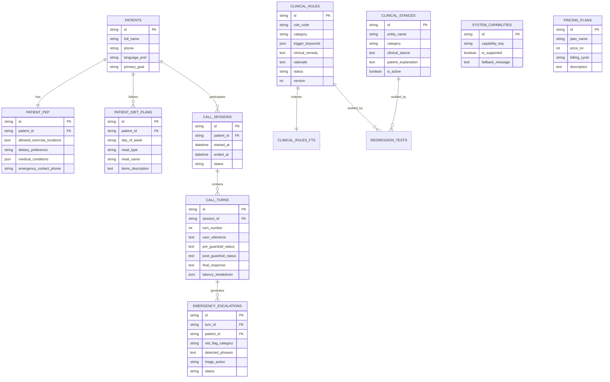

# 06. Database Design — Disha Clinical Voice AI

## 1. Database Architecture & Storage Engine

Disha AI uses an embedded **SQLite 3 database with Full-Text Search 5 (FTS5)**. 

### Why SQLite is the Optimal Zero-Cost Choice
1. **Zero Infrastructure Cost:** Runs completely in-process within the Python application; no cloud database hosting charges or external connection pooling required.
2. **ACID Transactions & High Concurrency:** Running SQLite in `WAL` (Write-Ahead Logging) mode allows unlimited non-blocking concurrent readers (e.g., active calls reading clinical rules and diet charts) while clinicians write or update rules.
3. **Sub-Millisecond Read Performance:** Local disk/OS page cache lookups take **< 0.1ms** for indexed queries and **< 1.5ms** for full-text BM25 matching.
4. **Single-File Portability:** The entire database exists as a single file (`disha_clinical.db`), enabling trivial point-in-time backups, version control, and regression testing against clean snapshots.

---

## 2. Entity-Relationship (ER) Diagram



---

## 3. Detailed Table Schemas (DDL)

### 3.1. Clinical Knowledge & Stances

```sql
-- Core clinical rules authored by doctors and dietitians
CREATE TABLE IF NOT EXISTS clinical_rules (
    id TEXT PRIMARY KEY,
    rule_code TEXT UNIQUE NOT NULL,                -- e.g. 'RULE_BLOATING_REMEDY'
    category TEXT NOT NULL,                        -- 'symptom_remedy', 'diet_protocol', 'exercise_safety'
    trigger_keywords TEXT NOT NULL,                -- JSON array: ["bloating", "pet phoolna", "gas", "period bloating"]
    trigger_patterns TEXT NOT NULL,                -- Regex patterns for matching
    clinical_remedy TEXT NOT NULL,                 -- Approved remedy: "Warm jeera-saunf water twice a day"
    rationale TEXT NOT NULL,                       -- Clinical justification
    author_name TEXT NOT NULL,                     -- Doctor/Dietitian name
    status TEXT NOT NULL DEFAULT 'active',         -- 'draft', 'active', 'archived'
    version INTEGER NOT NULL DEFAULT 1,
    created_at TIMESTAMP DEFAULT CURRENT_TIMESTAMP,
    updated_at TIMESTAMP DEFAULT CURRENT_TIMESTAMP
);

-- SQLite FTS5 Virtual Table for Sub-Millisecond Search
CREATE VIRTUAL TABLE IF NOT EXISTS clinical_rules_fts USING fts5(
    rule_code,
    category,
    trigger_keywords,
    clinical_remedy,
    content='clinical_rules',
    content_rowid='rowid'
);

-- Clinical stances on controversial dietary topics
CREATE TABLE IF NOT EXISTS clinical_stances (
    id TEXT PRIMARY KEY,
    entity_name TEXT UNIQUE NOT NULL,              -- e.g. 'mangoes', 'intermittent_fasting', 'whey_protein'
    category TEXT NOT NULL,                        -- 'nutrition', 'supplements', 'lifestyle'
    clinical_stance TEXT NOT NULL,                 -- "Seasonal moderation: 1/2 mango (100g) mid-morning. Do not ban."
    patient_explanation TEXT NOT NULL,             -- Friendly Hinglish coaching response
    is_active BOOLEAN NOT NULL DEFAULT 1,
    updated_at TIMESTAMP DEFAULT CURRENT_TIMESTAMP
);
```

### 3.2. System Boundaries & Pricing Ground Truth

```sql
-- Explicit system capabilities to prevent false promises (e.g. No WhatsApp)
CREATE TABLE IF NOT EXISTS system_capabilities (
    id TEXT PRIMARY KEY,
    capability_key TEXT UNIQUE NOT NULL,           -- 'whatsapp_delivery', 'sms_notifications', 'in_app_diet_chart'
    is_supported BOOLEAN NOT NULL DEFAULT 0,
    allowed_channel_name TEXT,
    fallback_message TEXT NOT NULL,                -- "Diet chart Disha mobile app ke 'My Plan' tab mein available hai"
    updated_at TIMESTAMP DEFAULT CURRENT_TIMESTAMP
);

-- Ground truth business pricing catalog to prevent pricing hallucinations
CREATE TABLE IF NOT EXISTS pricing_plans (
    id TEXT PRIMARY KEY,
    plan_code TEXT UNIQUE NOT NULL,                -- 'BASIC_CARE', 'PREMIUM_COACH'
    plan_name TEXT NOT NULL,
    price_inr INTEGER NOT NULL,                    -- 0 for basic follow-ups, 1499 for premium
    billing_cycle TEXT NOT NULL,                   -- 'free_with_doctor', 'monthly'
    description TEXT NOT NULL,
    is_active BOOLEAN NOT NULL DEFAULT 1
);
```

### 3.3. Patient Records, PEP & Dynamic Diet Data

```sql
-- Patient core demographic profile
CREATE TABLE IF NOT EXISTS patients (
    id TEXT PRIMARY KEY,
    full_name TEXT NOT NULL,
    phone TEXT NOT NULL,
    gender TEXT,
    age INTEGER,
    primary_goal TEXT NOT NULL,                    -- 'weight_loss', 'hba1c_reduction', 'pcos_reversal'
    created_at TIMESTAMP DEFAULT CURRENT_TIMESTAMP
);

-- Personalized Exercise & Eating Plan (PEP)
CREATE TABLE IF NOT EXISTS patient_pep (
    id TEXT PRIMARY KEY,
    patient_id TEXT UNIQUE NOT NULL REFERENCES patients(id),
    allowed_exercise_locations TEXT NOT NULL,      -- JSON: ["gym", "home", "outdoors"]
    target_activity TEXT NOT NULL,                 -- "Strength training 3x/week + 8k steps"
    dietary_preference TEXT NOT NULL,              -- "Vegetarian", "Eggetarian"
    medical_conditions TEXT NOT NULL,              -- JSON: ["hypertension", "PCOS"]
    emergency_contact_name TEXT NOT NULL,
    emergency_contact_phone TEXT NOT NULL,
    updated_at TIMESTAMP DEFAULT CURRENT_TIMESTAMP
);

-- Dynamic weekly meal plans authored by dietitians
CREATE TABLE IF NOT EXISTS patient_diet_plans (
    id TEXT PRIMARY KEY,
    patient_id TEXT NOT NULL REFERENCES patients(id),
    day_of_week TEXT NOT NULL,                     -- 'Monday', 'Tuesday', ..., 'Sunday'
    meal_type TEXT NOT NULL,                       -- 'breakfast', 'lunch', 'dinner', 'snack'
    meal_name TEXT NOT NULL,
    items_description TEXT NOT NULL,               -- "Paneer bhurji (150g), 2 multigrain rotis, cucumber salad"
    calories INTEGER,
    updated_at TIMESTAMP DEFAULT CURRENT_TIMESTAMP,
    UNIQUE(patient_id, day_of_week, meal_type)
);
```

### 3.4. Call Sessions, Turns & Audit Logs

```sql
-- Individual voice call sessions
CREATE TABLE IF NOT EXISTS call_sessions (
    id TEXT PRIMARY KEY,
    patient_id TEXT NOT NULL REFERENCES patients(id),
    started_at TIMESTAMP DEFAULT CURRENT_TIMESTAMP,
    ended_at TIMESTAMP,
    status TEXT NOT NULL DEFAULT 'ACTIVE',         -- 'COMPLETED', 'EMERGENCY_HALTED', 'ABORTED'
    total_turns INTEGER DEFAULT 0,
    p95_latency_ms REAL
);

-- Immutable audit ledger of every conversational turn
CREATE TABLE IF NOT EXISTS call_turns (
    id TEXT PRIMARY KEY,
    session_id TEXT NOT NULL REFERENCES call_sessions(id),
    turn_number INTEGER NOT NULL,
    user_utterance TEXT NOT NULL,
    pre_guardrail_status TEXT NOT NULL,            -- 'PASS', 'EMERGENCY_TRIGGERED'
    retrieved_rule_codes TEXT,                     -- JSON array of rule codes injected
    raw_llm_response TEXT,
    post_guardrail_status TEXT NOT NULL,           -- 'CLEAN', 'INTERCEPTED_WHATSAPP', 'INTERCEPTED_PERSONA'
    final_response TEXT NOT NULL,
    latency_breakdown TEXT NOT NULL,               -- JSON: {vad_ms, stt_ms, rag_ms, llm_ttft_ms, tts_ttfb_ms, total_ms}
    created_at TIMESTAMP DEFAULT CURRENT_TIMESTAMP
);

-- Clinical emergency escalation alerts
CREATE TABLE IF NOT EXISTS emergency_escalations (
    id TEXT PRIMARY KEY,
    turn_id TEXT NOT NULL REFERENCES call_turns(id),
    patient_id TEXT NOT NULL REFERENCES patients(id),
    red_flag_category TEXT NOT NULL,               -- 'cardiovascular', 'respiratory'
    detected_phrases TEXT NOT NULL,
    triage_action_taken TEXT NOT NULL,
    care_ops_notified BOOLEAN DEFAULT 0,
    status TEXT NOT NULL DEFAULT 'PENDING',        -- 'PENDING', 'DOCTOR_CALLED', 'RESOLVED'
    created_at TIMESTAMP DEFAULT CURRENT_TIMESTAMP
);

-- Synthetic Regression Test Benchmark
CREATE TABLE IF NOT EXISTS regression_test_suite (
    id TEXT PRIMARY KEY,
    test_code TEXT UNIQUE NOT NULL,
    failure_category TEXT NOT NULL,                -- 'wrong_statement', 'missed_action', 'missing_fact'
    input_utterance TEXT NOT NULL,
    patient_context TEXT NOT NULL,                 -- JSON context
    expected_phrases TEXT NOT NULL,                -- JSON: ["jeera", "saunf"]
    forbidden_phrases TEXT NOT NULL,               -- JSON: ["whatsapp", "human", "₹999"]
    should_emergency_halt BOOLEAN DEFAULT 0,
    is_active BOOLEAN DEFAULT 1
);
```
