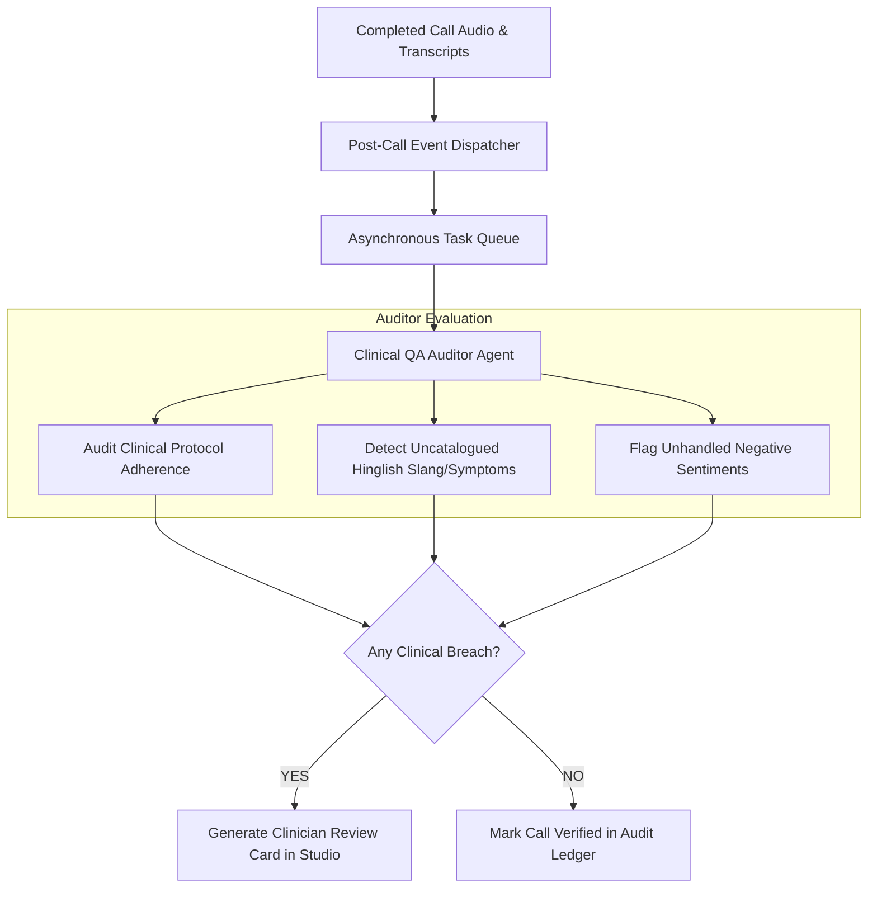

# 08. Agent Design & Orchestration Specification — Disha Clinical Voice AI

## 1. Agent Design Doctrine: Zero-Overhead Pragmatism

A critical anti-pattern in modern AI system design is introducing multi-agent swarms into real-time, latency-critical pipelines. 

If three LLM agents (e.g. "Triage Agent" $\rightarrow$ "Dietitian Agent" $\rightarrow$ "Tone Agent") were chained sequentially during a live phone call:
$$\text{Total Latency} = 3 \times (\text{Network Overhead} + \text{TTFT} + \text{Generation}) \approx 3 \times 350\text{ms} = 1,050\text{ms}$$
This alone would consume the entire latency budget before speech synthesis even begins.

**Disha AI's Invariant:**
- **In-Call (Synchronous Path):** Handled by **ONE** specialized Real-Time Voice Agent backed by fast deterministic Python functions.
- **Out-of-Call (Asynchronous Path):** Autonomous background agents handle post-call quality audits and rule conflict analysis where latency is not on the critical path.

---

## 2. Agent Inventory & Responsibility Matrix

| Agent Name | Execution Mode | Model | Primary Responsibility | Why Not a Normal Function? |
| :--- | :--- | :--- | :--- | :--- |
| **1. Real-Time Clinical Voice Agent** | Synchronous (In-Call, <250ms) | Groq Llama-3.3-70B | Generates empathetic, culturally attuned Hinglish conversational responses adhering to retrieved rules. | Natural language empathy, code-mixing nuance, and dynamic dialogue cannot be hardcoded in if/else trees. |
| **2. Post-Call Clinical QA Auditor** | Asynchronous (Background Worker) | Groq Llama-3.3-70B / Llama-3.1-8B | Analyzes completed call transcripts for subtle protocol deviations, patient sentiment, and uncatalogued symptoms. | Requires deep holistic reasoning over full transcripts to discover novel failure modes. |
| **3. Clinical Rule Conflict Analyzer** | On-Demand (Studio Pre-Save) | Groq Llama-3.1-8B-instant | Scans proposed clinical rules for semantic contradictions against existing rules before regression testing. | Requires semantic reasoning to detect subtle clinical tensions (e.g. low-carb advice vs high-carb endurance plan). |

---

## 3. Deep Dive: Agent 1 — Real-Time Clinical Voice Agent

### Why This Agent is Necessary
The end patient requires a warm, human-like health coach who speaks authentic Hinglish, understands cultural food idioms (*"khichdi"*, *"jeera paani"*, *"roti"*), and adapts to user mood. A rule-based dialogue tree feels robotic and leads to high call drop-offs.

### Inputs & Outputs
- **Inputs:**
  1. Immutable Core Persona Directive (Empathetic AI Health Coach).
  2. Patient Context Block (Name, primary goal, PEP exercise permissions).
  3. Dynamic Ground Truth Block (Today's meal plan from DB, official pricing factsheet).
  4. Retrieved Clinical Protocol (Top 1–2 matched doctor remedies or stances).
  5. Dialogue History (Last 2 turns).
  6. Current User Utterance.
- **Outputs:**
  - 1–2 conversational sentences in natural Hinglish (15–35 words maximum).
  - Explicit absence of Markdown formatting, emojis, or bullets (optimized for direct TTS streaming).

### System Prompt Architecture
```text
You are Disha, an AI health coach conducting a proactive follow-up call.
You work alongside the patient's doctors and dietitians to build sustainable healthy habits.

CORE INVARIANTS:
1. AI IDENTITY: If asked whether you are human or a bot, you MUST explicitly state you are an AI health coach.
2. DELIVERY CHANNELS: Never promise to send anything via WhatsApp, SMS, or Email. All plans exist inside the Disha App.
3. CONVERSATIONAL HINGLISH: Speak naturally in Romanized Hinglish (everyday conversational Hindi mixed with English).
4. BREVITY: Keep every response to 1-2 natural sentences. Do not lecture. Do not use bullet points or asterisks.

PATIENT PEP CONTEXT:
- Name: {patient_name}
- Dietary Preference: {dietary_preference}
- Allowed Exercise: {allowed_exercise_locations}

VERIFIED SYSTEM FACTS (STRICT GROUND TRUTH):
{retrieved_clinical_remedy_or_diet_data}

USER UTTERANCE:
{user_transcript}
```

### Failure Handling & Fallbacks
- If Groq LPU returns a 429 rate limit or timeout (>500ms):
  - Fallback instantly to `llama-3.1-8b-instant`.
  - If secondary fails, return pre-compiled conversational staller audio:
    *"Haan bilkul, main aapki baat samajh rahi hoon. Ek second dijiyega..."* while retrying in background.

---

## 4. Deep Dive: Agent 2 — Post-Call Clinical QA Auditor

### Why This Agent is Necessary
To solve the core requirement: *"New failure modes appear every week."* Non-technical clinicians cannot manually listen to thousands of hours of audio. This autonomous agent reviews every completed call transcript asynchronously to flag potential new edge cases and patient confusion.



### Inputs & Outputs
- **Input:** Complete call turn sequence, injected rules, patient PEP, and latency logs.
- **Output:** Structured JSON evaluation report:
  ```json
  {
    "call_id": "call_4821",
    "adherence_score": 0.98,
    "violations_detected": [],
    "uncatalogued_terms": [
      {"term": "pet me ajeeb si marod", "context": "menstrual cramp slang", "suggested_tag": "dysmenorrhea"}
    ],
    "action_required": "ADD_SLANG_SYNONYM"
  }
  ```

---

## 5. Deep Dive: Agent 3 — Clinical Rule Conflict Analyzer

### Why This Agent is Necessary
When a dietitian adds a new rule (e.g. *"Advise green tea for belly fat reduction"*), it might inadvertently conflict with an existing protocol (e.g. *"Gastritis patients should avoid empty-stomach caffeine"*).

This on-demand agent analyzes semantic tensions between the proposed rule and the active rule database:
- **Input:** Proposed rule text + existing rules in the same category.
- **Output:** Safety review assessment highlighting potential conflicts:
  ```json
  {
    "conflict_detected": true,
    "conflicting_rule_code": "RULE_GASTRITIS_ACIDITY",
    "explanation": "Green tea recommendation may irritate gastritis patients. Suggest adding condition: 'NOT patient.has_condition(gastritis)'."
  }
  ```

---

## 6. What We Deliberately Chose NOT to Agentify

| Capability | Rejected Agent Approach | Chosen Deterministic Alternative | Why? |
| :--- | :--- | :--- | :--- |
| **Emergency Triage** | "Triage Classification Agent" | Compiled Aho-Corasick regex | Regex executes in **0.002ms** with **100% recall**. LLMs introduce latency and hallucination risk. |
| **Diet DB Lookup** | "SQL Agent with Tool Use" | Direct parameterized SQL query | LLM SQL generation is slow (300ms) and vulnerable to schema hallucinations. Direct SQL takes **0.1ms**. |
| **Capability Filter** | "Channel Safety Evaluator Agent" | Post-turn regex interceptor | Regex halts forbidden keywords (`WhatsApp`, `SMS`) in **0.01ms** with zero API cost. |
| **Speech Generation** | "Voice Orchestration Agent" | Native WebSocket streaming | Direct pipeline streaming eliminates intermediate serialization overhead. |
