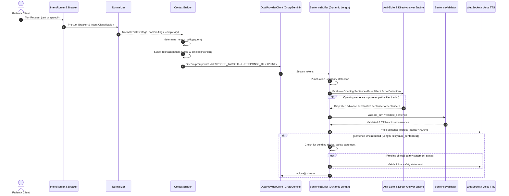

# AI Response Quality, Anti-Echo, and Length Control Architecture

## Executive Overview

As part of Disha AI's clinical and conversational excellence initiative, the reasoning and response lifecycle has been re-architected to guarantee high-quality, patient-centric coaching without robotic cliches, question parroting, or rigid length constraints.

### Core Architectural Principles
1. **Zero Parroting / Anti-Echo Invariant**: The assistant must never repeat or paraphrase the patient's question back to them (e.g. *"I understand you have been feeling tired after work..."*, *"Aapne poocha ki pet mein dard hai..."*).
2. **Direct Answer First**: Sentence 1 must deliver the substantive answer or primary actionable advice directly, eliminating introductory empathy fluff and repetitive greetings.
3. **Dynamic Response Length Targeting**: Response length is tailored dynamically based on user intent and query complexity rather than forcing every turn into a rigid sentence count.
4. **Context Relevance Discipline**: Meals and diet schedules are only discussed if the patient explicitly asked about food; workouts and gym routines are only brought up if the patient asked about physical activity.
5. **Lean Prompt Architecture**: Structural discipline is enforced programmatically in the Python pipeline (`anti_echo.py`, `normalizer.py`, `context_builder.py`, `sentence_buffer.py`, `validator.py`) rather than bloating the LLM system prompt.

---

## Response Lifecycle Architecture



---

## Detailed Component Implementation

### 1. Anti-Echo Engine (`disha_core/engine/anti_echo.py`)

The Anti-Echo Engine provides two layers of protection: **clause-level stripping** and **turn-level filler removal**.

#### A. Clause-Level Echo Stripping (`strip_echo_prefix`)
Removes introductory inquiry prefixes and parroting dependent clauses across English, Hinglish, and Hindi (Devanagari):
- **Hinglish / Hindi**:
  - `Aapne poocha ki...`
  - `Aapne bataya ki...`
  - `Aapne kaha ki...`
  - `Jaise ki aapne poocha...`
  - `Aap keh rahe hain ki...`
  - `Jahan tak aapke sawaal ki baat hai...`
  - `आपने पूछा कि...`
- **English**:
  - `Regarding your question about...`
  - `To answer your question regarding...`
  - `As you mentioned...`
  - `You asked about / if / whether...`
  - `In response to your question...`

When a match is stripped, any trailing conjunction (e.g. *", toh"*, *", so"*, *", therefore"*) is removed, and the remaining substantive clause is capitalized cleanly:
> **Input:** *"Aapne poocha ki pet mein dard hai, toh sabse pehle thoda gunguna paani piyein."*  
> **Output:** *"Sabse pehle thoda gunguna paani piyein."*

#### B. Turn-Opening Filler Removal (`is_pure_echo_or_filler`)
Detects sentences that contain only empathy fluff or question repetitions without actionable advice:
- *"I understand you have been feeling tired after work."*
- *"Main samajh sakti hoon ki aap kaisa mehsoos kar rahe hain."*
- *"Sunkar bura laga ki aapki tabiyat theek nahi hai."*

In `validated_sentences`, if the opening sentence is identified as pure filler, it is omitted from streaming egress, promoting the substantive guidance in sentence 2 to **Sentence 1**.

#### C. Redundant Greeting Suppression (`strip_all_greetings`)
On turns where conversation history exists (`has_history=True`), robotic and redundant greetings (*"Namaste! Main Disha hoon"*, *"Aapka swagat hai"*) are stripped automatically.

---

## Dynamic Response Length Policy

Rather than forcing all turns into an arbitrary 3-sentence limit, Disha AI implements dynamic length targeting via `LengthPolicy`.

| Query Category | Trigger Conditions | Min Sentences | Max Sentences | Purpose |
| :--- | :--- | :---: | :---: | :--- |
| **Emergency** | `is_emergency=True` or triage trigger | 1 | 2 | Immediate, direct life-safety instructions without conversational fluff. |
| **Factual / Lookup** | Pricing, identity, definitions, simple yes/no queries (`is_simple_factual`) | 1 | 2 | Crisp, accurate direct answer (e.g. ₹0 follow-ups, ₹1,499 nutritionist plan). |
| **Everyday Coaching** | Habit building, walking, sleep tips, hydration, routines (default) | 2 | 4 | Actionable, empathetic step-by-step coaching guidance. |
| **Complex Health** | Multiple symptoms, chronic condition interactions, unexplained severe symptoms | 3 | 5 | Structured explanation with clinical safety guidance and practical next steps. |
| **Detailed Request** | Explicit request for detail (*"explain in detail"*, *"vistar se samjhao"*, *"step by step"*) | 3 | 7 | Comprehensive breakdown honoring the user's explicit request. |

### Essential Clinical Safety Invariant
When the sentence budget (`max_sentences`) is reached, `sentence_buffer.py` checks if the immediate next sentence from the model is a clinical safety referral (e.g. *"Agar dard badhta hai toh turant doctor se consult karein"* or hospital/112 referral). If present, the clinical safety disclaimer is **always emitted** before aborting the stream. Clinical safety information is never truncated.

---

## Context Relevance & Direct-Answer Discipline

To keep the LLM focused on answering the patient's immediate question without unprompted lectures:

1. **Domain Relevance Detection** (`disha_core/engine/normalizer.py`):
   - `is_meal_query`: Detects if the user asked about food, meals, recipes, or nutrition.
   - `is_exercise_query`: Detects if the user asked about workouts, gym, running, or exercise.

2. **Lean Context XML Injection** (`disha_core/engine/context_builder.py`):
   - If `meal_relevant` is `False`, specific meal items from `patient_diet_schedules` are omitted from the prompt.
   - If `exercise_relevant` is `False`, `PEP_PERMISSIONS` are annotated as background safety bounds only.
   - Injected discipline instruction:
     ```xml
     <RESPONSE_DISCIPLINE answer_first="true" prompted_for_meals="false" prompted_for_exercise="false"/>
     <RESPONSE_TARGET category="coaching" min_sentences="2" max_sentences="4"/>
     ```

3. **No Prompt Bloat**:
   - The root system prompt (`SYSTEM_PROMPT`) remains clean, concise, and focused on Disha's voice and essential safety invariants.
   - Dynamic operational boundaries are passed in structured turn payloads and enforced by deterministic Python pipeline validators.

---

## Automated Verification & Test Coverage

All quality, anti-echo, and length control directives are verified through automated unit and integration tests in `disha_core/tests/test_reasoning_and_quality.py`:

```
disha_core/tests/test_reasoning_and_quality.py::AntiEchoQualityTests
  - test_strip_echo_prefix_hinglish_inquiry                PASSED
  - test_strip_echo_prefix_english_inquiry                 PASSED
  - test_strip_echo_prefix_hindi_devanagari                PASSED
  - test_pure_empathy_filler_detection                     PASSED
  - test_filter_response_sentences_promotes_direct_answer  PASSED
  - test_filter_response_sentences_suppresses_greetings    PASSED
  - test_affirmative_answers_not_mutilated                 PASSED

disha_core/tests/test_reasoning_and_quality.py::ResponseLengthPolicyTests
  - test_factual_query_length_policy                       PASSED
  - test_coaching_query_length_policy                      PASSED
  - test_complex_health_query_length_policy                PASSED
  - test_detailed_query_length_policy                     PASSED
  - test_emergency_length_policy                           PASSED

disha_core/tests/test_reasoning_and_quality.py::StreamingSentenceBufferQualityTests
  - test_factual_query_streaming_enforces_max_length       PASSED
  - test_anti_echo_in_stream_skips_filler_and_answers      PASSED
  - test_safety_disclaimer_preserved_at_boundary           PASSED

disha_core/tests/test_reasoning_and_quality.py::ContextRelevanceTests
  - test_user_query_domain_detection                       PASSED
  - test_render_payload_includes_discipline_tags           PASSED
```

**Full Test Suite Status**:
- `disha_core/tests/test_invariants.py`: 48/48 PASSED
- `disha_core/tests/test_reasoning_and_quality.py`: 17/17 PASSED
- `disha_core/tests/test_voice_pipeline.py`: 12/12 PASSED
- **Total `disha_core` test suite: 77/77 PASSED (100%)**.
