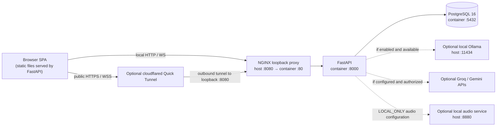
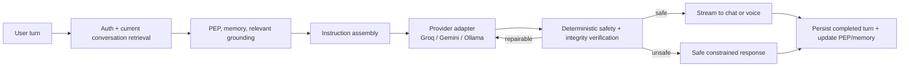

# Current Runtime Architecture

This document describes repository-observed behavior. It is not a clinical safety certification or a claim that every optional provider or production deployment is running.

## System context

The deployment guide distinguishes the repository-root Compose stack, the more constrained `disha_core/compose.yaml` stack, and the optional `scripts/local-models.sh` runner. Cloudflare provides ingress only; it does not run the app, database, or inference services. The emergency response advises the user to contact emergency services; the application does not place a call or dispatch a care-team webhook.

## Request channels and shared processing

| Channel | Route | Behavior |
|---|---|---|
| Chat | `POST /chat` | JSON response |
| Chat stream | `POST /chat/stream` | Server-Sent Events with sentence events and completion metadata |
| Voice/text WebSocket | `/voice` and `/ws/conversation` | Authenticated WebSocket; accepts audio bytes or JSON text/interrupt messages |
| Registration | `POST /auth/register` and `/auth/onboarding` | Creates account/profile and a bearer token |
| Login | `POST /auth/login` | Authenticates credentials and returns a bearer token |

Chat and voice invoke the shared turn logic in `disha_core.main._turn_sentences` (voice reaches it through `execute_voice_turn`). In broad terms it:

1. Applies routing, language handling, and the emergency breaker.
2. Authenticates normal patient turns and loads PEP fields, active facts/slots, recent journal messages, and a prescribed meal row when requested.
3. Retrieves approved health-knowledge chunks for grounded health, food, and exercise advice.
4. Withholds advice when required knowledge is absent, a prescribed meal is unavailable, or the exercise checks find a known risk or insufficient context.
5. Streams language generation through sentence validation and returns response status plus retrieval metadata where applicable.

The breaker is a pattern-based guard. It is not proof of complete red-flag recall. A triggered response is generated locally and may tell the user to call 112; no emergency-services integration is present.

## Conversational behavior architecture

`data/behavior_rules.yaml` is the single model-facing behavior source. It has two sections: core behavior and clinical safety. The old planner/perception “move” is no longer in the live chat path; passive disclosure extraction and deterministic safety gates remain.

Precedence is: deterministic safety/data integrity, clinical safety, current user intent, relevant context/PEP, core behavior, then specialised task instructions. Runtime context is data, not a second behavior prompt. Chat and voice share the same context and policy; voice keeps sentence-level validation for latency. RAG retrieves only relevant approved knowledge for the current question, while profile data is supplied as context rather than mixed into the retrieval query.

The retired live responsibilities were heuristic perception, scheduled onboarding-question injection, forced move selection, zero-echo style blocking, and strict final regeneration constrained to a selected move. They caused unrelated questions, repeated acknowledgements, and competing authorities. Safety breakers, medication/diagnosis boundaries, tenant isolation, persistence, disclosure extraction, and provider failover remain deterministic.

The focused behavior conformance set is [`tests/evals/conversational_behavior_cases.json`](../tests/evals/conversational_behavior_cases.json). It covers greeting, returning PEP, short replies, refusal, topic change, correction, Hinglish, meal planning, routine topics, repetition, prompt disclosure, emergency red flags, unsupported grounding, and chat-to-voice continuity. It is a scenario set for multi-run model evaluation, not a claim of clinical efficacy.

## Knowledge, meals, and exercise

- `disha_core.engine.retriever` reads `clinical_guideline_chunks`, backed by `clinical_knowledge_base`, and filters to `approval_status = 'approved'`. It uses PostgreSQL text-search ranking and trigram similarity; it does not use vector embeddings, pgvector, or reciprocal-rank fusion.
- General advice is grounded in the returned approved chunks. Response metadata includes retrieved chunk IDs and retrieval status; IDs identify supplied records, not sentence-level proof that generated text is entailed.
- A prescribed meal is a distinct lookup in `patient_diet_schedules`, for the user's active approved row, day, and meal slot (`breakfast`, `lunch`, or `dinner`). It is not generated from general nutrition knowledge. Missing or pending rows are not replaced with an invented prescription.
- General recipe composition and exact calorie/macronutrient calculation are not established runtime services in this repository.
- Exercise checks can recognize selected symptoms and explicit profile restrictions and fail closed. They do not evaluate every condition/activity pairing or select routines/alternatives; see [Knowledge/RAG](architecture/04_rag_ingestion_and_retrieval.md).

## User context and short-term conversation

- `patient_profiles` stores account and user-supplied profile fields; `patient_pep` contains focus, concern, language, dietary, and safety-related fields. Patient-reported information is not equivalent to clinician verification.
- The onboarding journey code extracts disclosures and persists them to profile, PEP, `memory_items`, `patient_temporal_facts`, or habit/episode tables according to field mapping. The login/register request schema accepts some values (including stage, clearance, and movement-limit fields) that the registration service does not currently persist into clinician-style PEP fields. Do not assume those values have been captured or verified.
- The current turn context reads active PEP/facts/slots and the latest 16 journal messages. The process-local history is keyed by patient and capped at 16 messages; completed turns are appended to `patient_turn_journal`. Current shared turn calls use the default session unless a caller supplies a session/call identifier.
- The database journal is ordinary application persistence, not a database-enforced immutable audit log. See [Memory and PEP](MEMORY_AND_PEP.md) for the limits and table roles.

## Voice processing

The WebSocket accepts a completed audio clip per binary message (or JSON/base64 audio), transcribes it, then runs the shared turn pipeline. Unless `LOCAL_ONLY` is enabled, transcription uses Groq only when the health-data processing flag and credentials are available. In local-only mode it uses `LOCAL_STT_URL` (default loopback port 8880). TTS selection is configurable: Qwen3-TTS uses `QWEN3_TTS_URL`; Edge-TTS is a separate cloud egress path gated by its authorization flag. See [Voice Pipeline](VOICE_PIPELINE.md).

The WebSocket supports cancellation/interruption, but code does not implement continuous frame-by-frame streaming ASR or the VAD/Silero timing claims in older designs.

## Persistence

PostgreSQL stores profiles, access-token hashes, PEP, meal schedules, approved knowledge, short-term journal rows, and structured memory/journey data. `disha_core/db/schema.sql` installs `pg_trgm` and ordinary text indexes/views; the current knowledge lookup combines text search and trigram similarity. PostgreSQL initialization SQL is applied only to a new data volume by Docker's entrypoint.

The audit queue is separate from patient conversational context; do not infer a tamper-proof ledger, guaranteed durability, or compliance certification from table names or historical documentation.

## Refresh and interrupted-response reliability

The database is the source of truth for the active conversation. `GET /chat/conversation` resolves the authenticated user's unarchived conversation without creating one, returns messages in sequence order, and hydrates the browser before a new turn can be sent. Chat turns use `client_msg_id` for idempotent user/assistant records; streaming creates the assistant record first and updates it as the stream completes or is interrupted. Non-stream requests persist the user message before model generation. Non-empty interrupted assistant content remains visible on the next hydration instead of being silently discarded. Chat and voice use the same active conversation and shared turn context, while channel metadata remains available for observability.

## Runtime status and evidence

The repository includes unit/integration tests and controlled fakes. A passing test does not establish clinical efficacy, live corpus quality, provider availability, or semantic faithfulness of external model output. Deployment checks and their exact scope are recorded in [Deployment](DEPLOYMENT.md).
