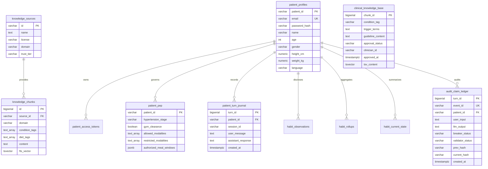

# Data Architecture and Clinical Knowledge (DATA)

This document describes the clinical data sources, relational schema, indexing strategies, data lifecycle constraints, and conversational memory storage in Disha AI.

## 1. Clinical Data Sources and Provenance

Disha AI grounds lifestyle guidance in verified clinical and nutritional datasets:

| Dataset / Source | Authority | Domain | Chunks | Trust Tier |
|---|---|---|---|---|
| Ayurvedic Pharmacopoeia of India (API) | Ministry of Ayush | Integrative Health / Home Remedies | 362 | Tier 1 |
| PCOS Indian Diet Guidelines | Hugging Face Verified Clinical Dietitians | Women's Metabolic Health | 87 | Tier 2 |
| Dietary Guidelines for Indians (2024) | ICMR - National Institute of Nutrition (NIN) | Clinical Nutrition & Sodium Limits | 23 | Tier 1 |
| National Health Portal Treatment Protocols | MoHFW | Primary Care Protocols | 6 | Tier 1 |
| Indian Food Composition Tables (IFCT 2017) | ICMR - NIN | Nutrient & Calorie Breakdown | 2 | Tier 1 |
| Primary Care Guidelines for Hypertension | World Health Organization (WHO) | Cardiovascular Risk Management | 2 | Tier 1 |

All guidelines ingested into `knowledge_chunks` require strict provenance tracking linking every chunk to its registered entry in `knowledge_sources`.

### Distinction Between Knowledge Tables
The system maintains two distinct clinical knowledge tables in PostgreSQL:
- **`clinical_knowledge_base`**: 478 clinician-reviewed guideline chunks with `approval_status` (draft/approved), clinician ID validation, trigger terms, and condition tags queried by the primary runtime RAG retriever (`retrieve_chunks()`).
- **`knowledge_chunks`**: 482 structured domain reference chunks across 6 authorities (362 API, 87 PCOS, 23 ICMR-NIN, 6 MoHFW, 2 IFCT, 2 WHO) linked to `knowledge_sources`.
- Combined, the database maintains **960 total chunks** across both tables. Historical documentation referring to "900+ chunks" counts both knowledge tables together.

## 2. Relational Entity-Relationship Diagram



## 3. Database Schema and Constraints

### 3.1 Clinical Knowledge Base (`clinical_knowledge_base`)
Stores curated clinical guidance chunks subject to strict length and clinician approval constraints:
- `approval_status`: Enforced by check constraint `CHECK (approval_status IN ('draft', 'approved', 'rejected'))`.
- Length limit: Enforced by check constraint `CHECK (cardinality(regexp_split_to_array(btrim(guideline_content), E'\\s+')) < 50)`. Every guideline must contain fewer than 50 words to avoid cognitive overload and prompt bloat.
- Approval rule: Enforced by check constraint `CHECK (approval_status <> 'approved' OR (clinician_id IS NOT NULL AND approved_at IS NOT NULL))`.
- Full-text search index: GIN index on `tsv_content` generated from `trigger_terms || ' ' || context_header || ' ' || guideline_content`.
- Fuzzy search index: GIN index on `trigger_terms` using `gin_trgm_ops` from the `pg_trgm` extension.

### 3.2 Clinical Guideline View (`clinical_guideline_chunks`)
```sql
CREATE OR REPLACE VIEW clinical_guideline_chunks AS
SELECT * FROM clinical_knowledge_base;
```
The application runtime queries this view to decouple table schema refactoring from the retrieval engine.

### 3.3 Patient Profile & Physical Exercise Prescription (`patient_pep`)
Stores clinician-authorized permissions and health stage metrics:
- `hypertension_stage`: Validated as 'Stage 1', 'Stage 2', 'Prehypertension', or 'Normal'.
- `gym_clearance`: Boolean flag. If false, high-intensity exercise queries trigger immediate safe deflection.
- `restricted_modalities`: Array of forbidden exercises (e.g., `heavy weights`, `HIIT`, `valsalva`).
- `allowed_modalities`: Array of permitted exercises (e.g., `brisk walking`, `light yoga`).

## 4. Clinical Knowledge Ingestion Pipeline

Ingestion operates through idempotent scripts:
1. Load raw guideline CSVs or JSON payloads (`disha_core/db/ingest_open_datasets.py` and `ingest_autonomous_datasets.py`).
2. Deduplicate contents via exact text matching on `guideline_content`.
3. Validate word count (< 50 words) and ensure condition tags match authorized medical taxonomies.
4. Insert into `clinical_knowledge_base` with `approval_status = 'approved'` and clinician audit ID.
5. Mirror into `knowledge_chunks` linking to the source record in `knowledge_sources`.

## 5. Conversational Memory Architecture

Conversational memory is partitioned across 4 distinct retention tiers:

1. **Short-Term Session History**:
   - Stored in `patient_turn_journal`.
   - The last 4 to 6 turns hydrate during turn execution to resolve pronouns and conversational thread.
2. **Habit Observations**:
   - Stored in `habit_observations` with timestamp and unit (e.g., `systolic_bp: 130 mmHg`, `steps: 5000`).
   - Observations roll up daily into `habit_rollups` and `habit_current_state`.
3. **Structured Patient Profile**:
   - Durable biometrics and dietary preferences stored in `patient_profiles`.
   - Rehydrated on session startup via `/patient/home` or `/patient/profile`.
4. **Audit Trail**:
   - Cryptographic append-only chain in `audit_claim_ledger`.
   - Retained permanently for compliance and safety auditability.
