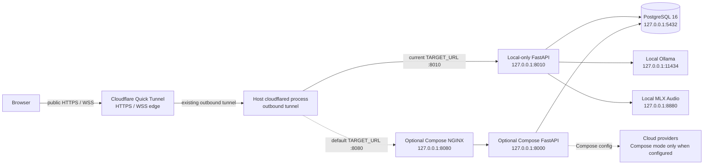

# Deployment and Local Services

This guide distinguishes configuration in the repository from a point-in-time check of the working host. It does not certify the deployment as production-ready.

## Host-to-tunnel topology



The tunnel is ingress only. The browser reaches Cloudflare over HTTPS/WSS; `cloudflared` makes the outbound connection and forwards traffic to the configured local target. The current running tunnel targets the local-only API on port `8010`. PostgreSQL and inference remain outside Cloudflare. The root Compose/Nginx mode remains available on port `8080`; the watchdog's generic default remains that port, so use `make tunnel-local` for the local-only runner. The emergency breaker can return advice to contact 112; the repository does not dial 112 or dispatch an emergency webhook.

## Compose configurations

There are multiple Compose files with different purposes; they are not interchangeable:

| Configuration | Services and host ports | Notes |
|---|---|---|
| Root [`docker-compose.yml`](../docker-compose.yml) | `postgres` 5432, `backend` 8000, `proxy` 8080, bound to loopback | This is the root stack observed running during the 2026-11-09 review. It enables provider authorization flags in its backend environment and enables Ollama integration; actual provider calls still depend on keys, network access, and code checks. |
| [`disha_core/compose.yaml`](../disha_core/compose.yaml) | `postgres` 5432 and `nginx` 8080 bound to loopback; API is private to the Compose network | Constrained local stack described in [`disha_core/README.md`](../disha_core/README.md). Provider authorization defaults are false. |
| [`docker-compose.prod.yml`](../docker-compose.prod.yml) | PostgreSQL, Laya, backend, and proxy; proxy publishes host ports 80/443 | A deployment sketch, not a production security baseline: it contains a default password fallback and wildcard CORS and does not by itself configure production secrets, TLS termination, identity, clinical review, or tested cloud controls. |

Each Compose setup has its own volumes and settings. Do not remove persistent database volumes as a schema-upgrade method. PostgreSQL executes `disha_core/db/schema.sql` only when its data directory is first initialized; later schema changes need reviewed migrations.

## Cloudflare TryCloudflare watchdog

`scripts/tunnel-watchdog.sh` checks the local `/health` endpoint, starts `cloudflared`, extracts the generated `*.trycloudflare.com` hostname for a Quick Tunnel, and writes the current URL to `agent/TUNNEL_URL.txt` and `.env.local`. It defaults to `TARGET_URL=http://127.0.0.1:8080`; use `make tunnel-local` (or set `TARGET_URL=http://127.0.0.1:8010`) for the local-only runner. Environment settings can instead select a named tunnel or custom domain. Quick Tunnel URLs are temporary and can change after restart. The URL is public, not a credential.

```sh
./scripts/tunnel-watchdog.sh
make tunnel-local
./scripts/tunnel-watchdog.sh --status
./scripts/tunnel-watchdog.sh --stop
```

`make tunnel` is also available. A public HTTPS URL can make browser microphone APIs available in secure contexts, but it does not add authentication, privacy review, or production hardening. Do not expose a stack until its authentication, provider data egress, CORS, secrets, and clinical-data handling have been reviewed.

## Local model and audio options

`scripts/local-models.sh` is a separate optional runner for Apple Silicon macOS. Its `start|stop|status` commands manage Ollama on loopback `11434`, an MLX Audio server on loopback `8880`, the root Compose PostgreSQL service, and a standalone FastAPI process on loopback `8010` by default. It sets `LOCAL_ONLY=true`, directs transcription/synthesis to local endpoints, and disables cloud LLM authorization for that local process. It requires the tools and environment listed by the script and may download models on first use.

This runner is not the same topology as the root Compose stack: the tunnel watchdog still defaults to port `8080`, not the local model runner's API port `8010`. Port 8880 and local transcription are used only when that local service and configuration are active. Do not infer the local MLX service is running because the launcher exists. In local-only mode the process has `LOCAL_ONLY=true` and unsets Groq/Gemini API keys; its LLM provider set contains only local Ollama. A local-only failure does not fall back to a cloud provider.

In the non-local configuration:

- The LLM adapter can use configured Ollama, Groq, or Gemini paths subject to provider flags, credentials, and internal fallback rules. This guide does not change or override that behavior.
- Voice transcription uses Groq Whisper only when the health-data processing flag and API key are present; in `LOCAL_ONLY` mode it requires a local STT endpoint.
- Qwen3-TTS uses `QWEN3_TTS_URL`; Edge-TTS is a separate externally hosted path requiring its own authorization flag. In local-only mode the Qwen endpoint must resolve locally and cloud TTS fallback is disabled.

See [`disha_core/config.py`](../disha_core/config.py), [`disha_core/llm/client.py`](../disha_core/llm/client.py), and [`disha_core/voice.py`](../disha_core/voice.py) for current settings and checks.

## Configuration and security notes

- Database credentials are `DB_HOST`, `DB_PORT`, `DB_NAME`, `DB_USER`, and `DB_PASSWORD` (or `DATABASE_URL`). The container uses `POSTGRES_*` initialization variables.
- LLM access is configured with `GROQ_API_KEY`, `GROQ_MODEL`, `GEMINI_API_KEY`, `GEMINI_MODEL`, and `OLLAMA_*`. Authorization/usage settings default false in `disha_core/config.py`; the root Compose file explicitly overrides several flags to true.
- Audio egress has separate flags: `GROQ_HEALTH_DATA_PROCESSING_APPROVED`, `EDGE_TTS_HEALTH_DATA_PROCESSING_APPROVED`, and `QWEN3_TTS_HEALTH_DATA_PROCESSING_APPROVED`.
- `CORS_ALLOWED_ORIGINS` is environment-defined. CORS is not authentication; the root Compose value is `*`, so that setting should not be mistaken for an access-control boundary.
- `docker-compose.prod.yml` contains a sample default password and wildcard CORS. Do not expose those defaults as a production boundary.
- `agent/TUNNEL_URL.txt` is generated runtime state and is ignored by Git. Vercel's static-preview login and readiness routes fail closed because they do not connect to the authenticated Disha backend; the supported live path described here is the host-local application behind the tunnel.

## Point-in-time runtime check

On 2026-11-09, the host was checked before and after starting the local-only runner:

- The root Compose PostgreSQL, backend, and proxy were running. The local-only runner uses the existing PostgreSQL service and named data volume; no database volume was deleted or recreated.
- The local-only FastAPI process on `127.0.0.1:8010` returned healthy `/health` and `/ready` responses. The public browser root returned HTTP 200, and the public `/health` and `/ready` endpoints returned success through the active TryCloudflare URL in `agent/TUNNEL_URL.txt`.
- Ollama on `127.0.0.1:11434` completed direct generation, and Disha's `DualProviderClient` in `LOCAL_ONLY` mode generated a response with exactly one provider (local Ollama).
- MLX Audio on `127.0.0.1:8880` loaded the Whisper-large-v3 Turbo and Svara TTS models. A synthetic speech sample was transcribed locally as `Dish a local audio test.` The inference endpoints are bound to loopback; the public tunnel routed `/v1/models` and `/api/tags` to the Disha API and returned 404.
- Svara TTS **is not verified through the HTTP service**: a synthetic `/v1/audio/speech` request returned HTTP 200 with no audio, and the server raised `RuntimeError: There is no Stream(gpu, 0) in current thread.` The same Svara model generated a WAV successfully through the `mlx_audio.tts.generate` CLI. Trying MLX Audio 0.6.4 produced the same server-side failure as 0.6.2, so the startup script's 0.6.2 pin was retained. Treat server-mode TTS and the full voice path as blocked until the MLX worker/model stream issue is resolved.

These are connectivity and synthetic-model checks, not a real authenticated chat/voice session or proof of conversation continuity/persistence across restart. The DB was not restarted to avoid interrupting or risking existing user data. The URL and process state are transient; repeat the checks before relying on them. Do not claim production security or clinical validation from these checks.

## Useful checks

```sh
docker compose ps
curl -fsS http://127.0.0.1:8080/health
curl -fsS http://127.0.0.1:8000/health
./scripts/tunnel-watchdog.sh --status
scripts/local-models.sh status
```

`/health` checks application-to-database connectivity. `/ready` also checks classifier readiness and can fail even when `/health` succeeds. Neither endpoint proves that external LLM/audio providers are reachable or that a user interaction is safe.
