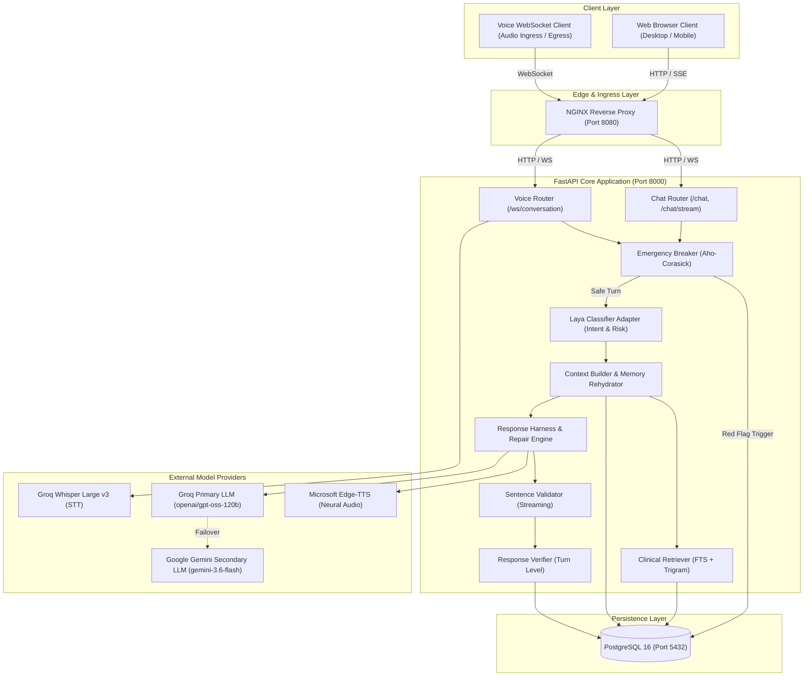
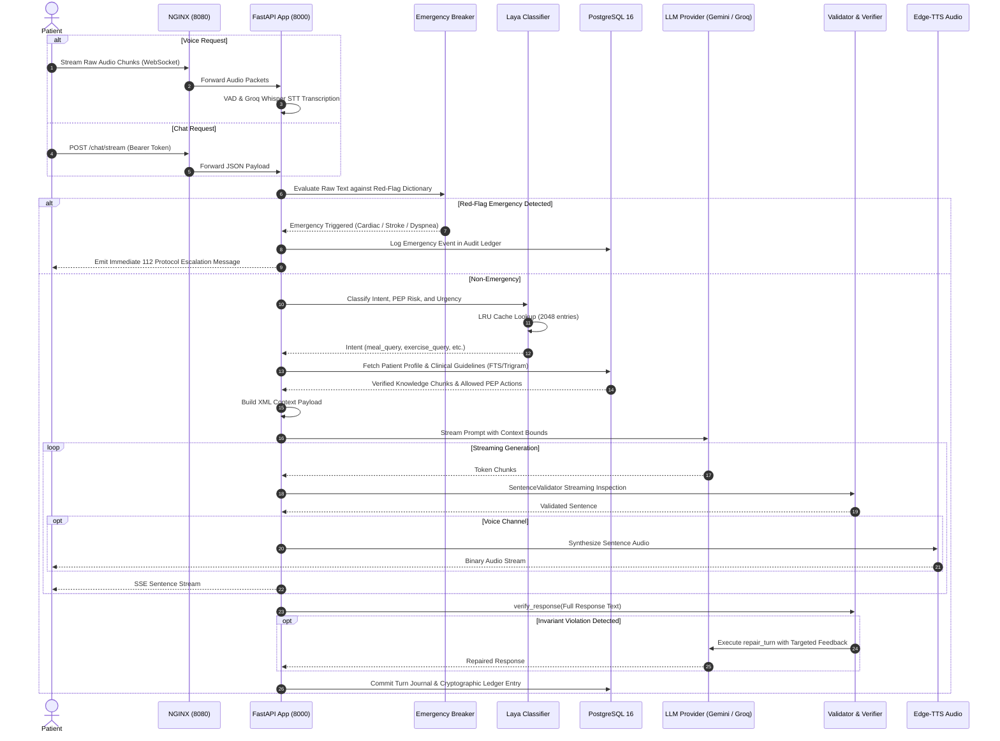
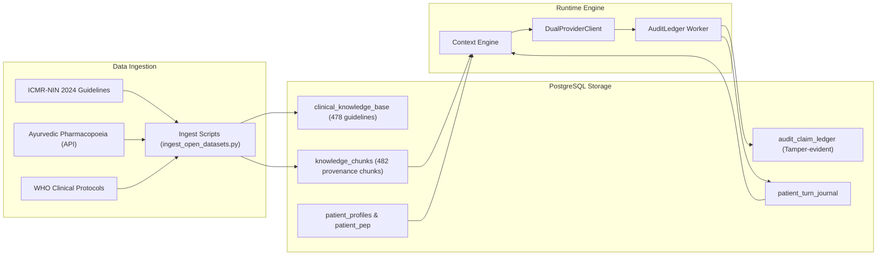

# High-Level Architecture (HLD)

Disha AI provides real-time conversational lifestyle coaching across text and voice channels for patients managing hypertension and type-2 diabetes. The platform grounds conversational responses in clinical guidelines from the Indian Council of Medical Research (ICMR) and the Ministry of Ayush.

## 1. System Context and Component Boundaries

The system separates deterministic clinical boundary enforcement from probabilistic natural language generation. Safety checks, intent routing, and patient profile retrieval execute before language model invocation. Post-generation validators inspect responses before transmission to the user.

## 2. End-to-End Request Path

Both text chat and voice streams follow an identical deterministic spine. Emergency safety evaluation occurs at ingress prior to classification or retrieval.

## 3. Data Flow Architecture

The data flow separates administrative configuration, patient profile updates, clinical guideline indexing, and runtime telemetry.

## 4. Network Topology and Port Allocations

The service runs across three containers defined in `docker-compose.yml`:

| Port | Service | Protocol | Access Scope | Purpose |
|---|---|---|---|---|
| 8080 | proxy (NGINX) | HTTP / WebSocket | Public / Local Host | Reverse proxy, static web asset hosting, rate limiting, and SSL termination |
| 8000 | backend (FastAPI) | HTTP / WebSocket | Internal Container Network | Core application runtime and API router |
| 5432 | postgres (PostgreSQL 16) | PostgreSQL Wire | Local Host / Internal | Database storing knowledge chunks, patient profiles, turn journal, and audit ledger |

### External Network Dependencies

| Destination | Protocol | Purpose | Timeout | Failure Mode |
|---|---|---|---|---|
| `generativelanguage.googleapis.com` | HTTPS | Primary LLM generation (Google Gemini 1.5 Flash) | 10.0s | Fallback to Groq secondary model via circuit breaker |
| `api.groq.com` | HTTPS | STT transcription (Whisper) & Secondary LLM (Llama 3.3 70B) | 8.0s | Return deterministic offline error response |
| Microsoft Edge-TTS Service | WebSocket / WSS | Streaming speech audio synthesis | 5.0s | Silent fallback to client text display |
