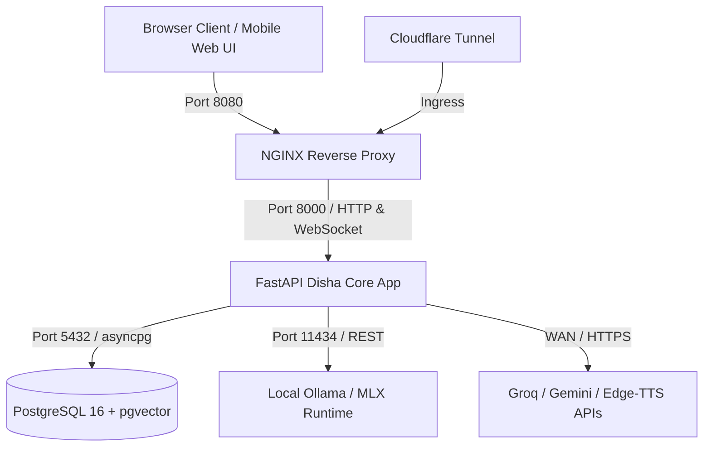
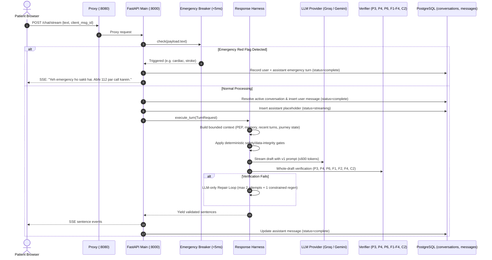

# Disha AI — How It Works (System Architecture & Execution Tour)

- **Document:** `docs/HOW_IT_WORKS.md`
- **Revision:** Behavior Spec v1 Certified
- **Status:** Verified from Live Codebase & Running Container Stack

---

## 1. System Topology & Network Ports

Disha AI runs as a containerized stack managed via `docker-compose.yml` and local scripts:

### Port Assignments
- **8080:** NGINX reverse proxy (`disha_core-proxy-1`), serving static frontend assets (`disha_core/frontend/`) and proxying API/WebSocket traffic.
- **8000:** FastAPI Python application (`disha_core-backend-1`), running `uvicorn disha_core.main:app`.
- **5432:** PostgreSQL 16 database (`disha_core-postgres-1`) with `pgvector` extension enabled.
- **11434:** Optional local Ollama inference service (`Qwen2.5-7B-Instruct`).

---

## 2. Conversational Turn Execution Paths

### 2.1 Chat Path (`POST /chat/stream` & `POST /chat`)
Located in `disha_core/main.py:415-510` and `disha_core/harness/harness.py`:

### 2.2 Voice Path (`/voice` & `/ws/conversation`)
Located in `disha_core/main.py:628-830` and `disha_core/voice.py`:
1. **Audio Ingestion:** Browser sends a completed audio clip or text turn over WebSocket.
2. **STT (Speech-To-Text):** Configured Groq Whisper or local STT endpoint transcribes completed audio clips.
4. **LLM Generation:** Real-time generation through `ResponseHarness`.
5. **Sentence-by-Sentence TTS:** Sentences stream to Edge-TTS (`hi-IN-SwaraNeural`) for Hindi/Hinglish or Qwen3-TTS for English.
6. **Barge-in Support:** Client sends `interrupt` control frames; server immediately cancels active generation and drops TTS buffers.

---

## 3. Database Persistence & Continuity (Contract 2 / Spec M1)

Implemented in `disha_core/services/chat_service.py` and `disha_core/db/schema.sql`:
- **`conversations` table:** Maintains one active conversation per user via unique partial index `uq_active_user_conversation (user_id) WHERE (archived = FALSE)`.
- **`messages` table:** Stores every turn chronologically (`seq`), tagged with `channel` (`chat` or `voice`), `role`, `content`, `status` (`streaming`, `complete`, `aborted`), and `client_msg_id`.
- **Page Refresh Hydration:** Frontend calls `GET /chat/conversation`. If active messages exist, the UI re-hydrates the exact transcript and conversation ID. If the stream was interrupted, aborted status preserves partial output without duplication.
- **Multi-Tenant Isolation:** All queries filter on authenticated `patient_id` from Bearer token claims.

---

## 4. PEP & Memory Stores

- **`patient_profiles` table:** Core demographic, preferred language (`hinglish`, `english`, `hindi`), and registration state.
- **`patient_pep` table:** Personal Experience Profile storing dietary preferences, diagnosed conditions, physical restrictions, and primary health goals.
- **`patient_temporal_facts` table:** Epistemic facts with status (`active`, `superseded`) and validity timestamps.
- **Extraction Path:** Disclosure extraction runs in the shared turn path so the current turn and PEP/memory updates stay consistent; it is bounded by the same database connection lifecycle.

---

## 5. First-Run Language Selection (Section 2)

- **Interactive UI Modal:** Implemented in `disha_core/frontend/app.js:1260-1340`.
- On first launch (when `localStorage['disha_language_chosen']` is empty and no prior messages exist), a modal offers:
  1. **Hinglish** (Roman script, casual code-mixed)
  2. **हिन्दी** (Devanagari script)
  3. **English** (Plain casual English)
- Selecting updates `patient_profiles.language` via `PUT /patient/profile` and sets UI copy and STT/TTS routing.
- Returning users skip the modal immediately.

---

## 6. Safety & Emergency Circuit Breaker (C3)

- **Engine:** `EmergencyBreaker` in `disha_core/pipeline/breaker.py`.
- **Latency:** Deterministic regex and lookup evaluation in **< 5 milliseconds**.
- **Catalog:** `data/red_flags.yaml` and `data/red_flags.json`.
- **Coverage:** Acute cardiac symptoms, stroke signs, severe hemorrhage, respiratory failure, suicide ideation.
- **Action:** Immediately halts pipeline, bypasses all LLM calls, commits emergency log to database, and outputs official helpline referral (**112** in India or Tele-MANAS **14416**).

---

## 7. Configuration & Secrets Model

- **Settings Class:** `disha_core/config.py` using Pydantic `Settings.from_env()`.
- **Compatibility Flag:** `BEHAVIOR_SPEC_V1` is retained for callers that pass the old argument, but the runtime always uses the single `data/behavior_rules.yaml` policy. It does not restore a second legacy behavior system.
- **Hygiene Enforcement:** `scripts/hardcode-check` scans AST and regex patterns across the codebase to ensure zero secrets, API keys, or raw passwords are committed.

