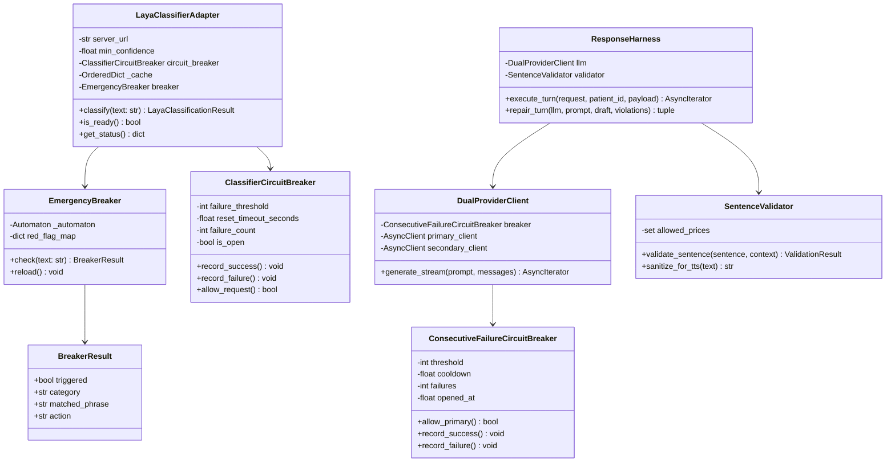

# Low-Level Design (LLD)

This document details the internal components, class hierarchies, sequence lifecycles, and data contracts that govern Disha AI.

## 1. Component Architecture and Class Hierarchy



## 2. Core Modules

### 2.1 Emergency Breaker (`disha_core/pipeline/breaker.py`)
- **Algorithm**: Aho-Corasick string matching compiled using `pyahocorasick`.
- **Latency**: Measured median latency of 3.69 µs across 100 benchmark emergency prompts.
- **Precedence**: Runs on raw input text prior to ML classification and LLM invocation across both chat and voice endpoints.
- **Trigger Behavior**: If triggered, immediately aborts pipeline execution and returns the standardized 112 emergency escalation response.

### 2.2 Classifier Adapter (`disha_core/classifier/adapter.py`)
- **Model**: ConvAI Innovations Laya multilingual model (`laya==0.4.27`).
- **Execution Mode**:
  - Remote HTTP dispatch via `httpx` when `LAYA_SERVER_URL` is set.
  - In-process PyTorch CPU execution (`torch.inference_mode()`) when `LAYA_SERVER_URL` is empty.
  - Deterministic safety fallback (`_fallback_classification`) when dependencies or server are offline.
- **Gating**:
  - Minimum confidence gate: `0.40`. Scores below 0.40 trigger conservative rule fallback.
  - Audit threshold: `0.70`. Scores below 0.70 or with ambiguous margin (< 0.15) enqueue turns to `ReviewQueueManager` for clinician audit.
- **Circuit Breaker**: `ClassifierCircuitBreaker` opens after 3 consecutive failures; reset timeout is 30.0 seconds.
- **Cache**: LRU `OrderedDict` with capacity of 2,048 entries. Measured cache hit lookup is 0.04 µs.

### 2.3 Context Builder & Clinical Retriever (`disha_core/engine/`)
- **Retriever (`retriever.py`)**:
  - Queries the PostgreSQL view `clinical_guideline_chunks`.
  - Tri-level search: Exact trigger terms match, PostgreSQL full-text search (`tsvector`), and Trigram fuzzy similarity (`pg_trgm`).
  - Cache: Compound LRU cache keyed by `(patient_id, sha256(query))` with capacity of 1,024 entries.
- **Context Builder (`context_builder.py`)**:
  - Loads patient biometrics (`patient_profiles`), active prescriptions (`patient_pep`), and recent conversation history (`patient_turn_journal`).
  - Renders XML-bounded context blocks (`<PATIENT_PROFILE>`, `<PEP_PERMISSIONS>`, `<CLINICAL_GROUNDING>`).
  - Strips internal stage checklists to prevent conversational lectures.

### 2.4 Response Harness, Validator & Verifier
- **ResponseHarness (`disha_core/harness/harness.py`)**:
  - Orchestrates prompt assembly, dual-provider streaming, streaming sentence validation, and turn-level verification.
- **SentenceValidator (`disha_core/pipeline/validator.py`)**:
  - Operates on streaming sentence chunks.
  - Replaces doctor claims, drug dosage alterations, ungrounded pricing, and channel boundary leaks using compiled regex substitutions.
- **Response Verifier (`disha_core/harness/verifier.py`)**:
  - Operates on the full accumulated turn text.
  - Enforces 6 structural invariants:
    1. Identity: No claims of being a doctor or human physician.
    2. Capabilities: No offers of external channels (WhatsApp/email/phone call).
    3. Grounding: No ungrounded pricing or diagnostic claims.
    4. Memory: No invented recollection of unrecorded patient history.
    5. Question discipline: Maximum of one question per turn.
    6. Non-repetition: Prevention of n-gram repetition loops.
  - Triggers `repair_turn` with specific feedback if any invariant fails.

### 2.5 LLM Gateway (`disha_core/llm/client.py`)
- **Client**: `DualProviderClient` manages dual-provider routing with Groq (`openai/gpt-oss-120b` or configured `qwen/qwen3.8-27b`) as primary provider and Google Gemini (`gemini-3.6-flash` or configured `gemini-3.1-flash-lite`) as instant secondary failover.
- **Circuit Breaker**: `ConsecutiveFailureCircuitBreaker` opens after 2 consecutive provider errors, enforcing a 30-second cooldown before testing a half-open probe.

### 2.6 Voice Session Handler (`disha_core/voice.py`)
- **Protocol**: WebSocket connection on `/ws/conversation`.
- **Ingress**: Client streams 16kHz PCM audio. Server applies energy-based VAD.
- **Transcription**: Transcribes speech via Groq Whisper Large v3 Turbo with language detection (Hinglish/English/Hindi).
- **Audio Output**: Validated sentences stream to Microsoft Edge-TTS (`en-IN-NeerjaNeural` or `hi-IN-SwaraNeural`). Encoded MP3 bytes stream back to the client over WebSocket.
- **Barge-In**: Detects user speech during audio playback, immediately cancels active TTS streaming, and records interrupted offset.

## 3. Wire Formats and Schemas

### 3.1 Chat Stream Request & Event Protocol

#### Request (`POST /chat/stream`)
```json
{
  "text": "Maine subah 30 minute walk ki.",
  "conversation_id": "conv_4f81c9a2"
}
```

#### Response Stream (Server-Sent Events)
```text
event: sentence
data: {"index": 0, "text": "Bahut badiya! Daily walk blood pressure control mein madad karti hai."}

event: done
data: {"status": "accepted", "evidence_ids": ["chunk_icmr_102"], "conversation_id": "conv_4f81c9a2"}
```

### 3.2 Turn State Model (`disha_core/models/schemas.py`)
```python
class TurnState(BaseModel):
    patient_id: str
    user_input: str
    predicted_intent: str = "general_coaching"
    confidence: float = 1.0
    breaker_status: str = "passed"
    validator_status: str = "accepted"
    retrieval_status: str = "hit"
    evidence_ids: list[str] = Field(default_factory=list)
    latency_ms: float = 0.0
```

### 3.3 Audit Ledger Schema (`disha_core/compliance/ledger.py`)
```sql
CREATE TABLE audit_claim_ledger (
    turn_id BIGSERIAL PRIMARY KEY,
    event_id VARCHAR(64) UNIQUE NOT NULL,
    patient_id VARCHAR(64) NOT NULL,
    user_input TEXT NOT NULL,
    llm_output TEXT NOT NULL,
    breaker_status VARCHAR(32) NOT NULL,
    validator_status VARCHAR(32) NOT NULL,
    prev_hash VARCHAR(64) NOT NULL,
    current_hash VARCHAR(64) NOT NULL,
    created_at TIMESTAMPTZ NOT NULL DEFAULT NOW()
);
```
Each entry computes `current_hash = SHA256(event_id + patient_id + user_input + llm_output + breaker_status + validator_status + prev_hash)`, providing a cryptographic tamper-evident verification chain.

## 4. Prompt Assembly and Token Budget

### 4.1 Prompt Assembly Pipeline
The runtime prompt assembly follows a cache-friendly static-to-dynamic layout:
1. **Static System Prompt (`_SPEC_V1_PROMPT`)**: Compiled from `data/behavior_rules.yaml` (474 tokens). Contains role persona, clinical safety constraints (C1-C4), core behavior rules (P1-P6, F1-F6, M1-M3), and language mode. Forms an immutable static prefix at the head of every request for hardware KV prefix caching (Groq 50% read discount, Gemini up to 90% read discount).
2. **Just-In-Time (JIT) Per-Intent XML Blocks**: Rendered by `render_context_xml()`. Dynamically injects only intent-relevant blocks while strictly preserving essential clinical safety facts (allergies, diagnoses, medications, pregnancy, age band, PEP limits) on all coaching turns. Conversational turns (greetings, chitchat, app meta) omit `<PEP>`, `<DIET_SLOT>`, and `<CLINICAL_GROUNDING>`.
3. **Retrieved Clinical Knowledge**: Verified guidelines from `retrieve_chunks()` (fusing pg_trgm and tsvector with Reciprocal Rank Fusion, $k=60$) capped to Top-1 or Top-2 chunks formatted as `<CLINICAL_GROUNDING>`. When zero chunks meet relevance thresholds, `<CLINICAL_GROUNDING status="NOT_FOUND"/>` is injected to prevent ungrounded hallucinations.
4. **Conversation Discipline & History**: Response length target (`<RESPONSE_TARGET>`), active conversation turns windowed to the last 4 turns (8 messages), and current `<USER_UTTERANCE>`.

### 4.2 Empirical Token Budget (Before vs. After Optimization)

Measured across real simulated turns (intents × patients × history lengths × languages) using Qwen2.5 BPE:

| Payload Section | Before (Tokens) | % Contribution | After (Tokens) | Net Savings | Primary Optimization Mechanism |
| :--- | :---: | :---: | :---: | :---: | :--- |
| **Conversation History** | 471.7 | 25.3% | 185.0 | -60.8% | Tightened rolling window to last 4 turns (8 messages); stripped verbose note attributes |
| **Slot Values & Facts** | 380.3 | 20.4% | 140.0 | -63.2% | JIT per-intent pruning; omitted lifestyle slots on pure conversational turns |
| **Behaviour Policies** | 323.0 | 17.3% | 150.0 | -53.6% | Deduplicated overlapping rules; consolidated P2/P7 and F2/F6; free-app alignment |
| **Safety Constraints** | 180.0 | 9.7% | 110.0 | -38.9% | Consolidated C1-C4 rules with deterministic code enforcement in `breaker.py` |
| **Patient Profile & PEP** | 232.3 | 12.5% | 115.0 | -50.5% | Compressed PEP permissions; pruned empty tags; JIT omission on non-coaching turns |
| **Retrieved RAG Chunks** | 158.0 | 8.5% | 45.0 | -71.5% | Capped to Top 1–2 chunks with 0.06 text score threshold; RRF (k=60) ranking |
| **System Persona / Prompt** | 83.0 | 4.5% | 75.0 | -9.6% | Deduplicated persona lines; immutable prefix cached across turns |
| **User Utterance & Bounds** | 34.5 | 1.8% | 34.5 | 0.0% | Preserved verbatim |
| **Total Prompt Input (Avg)** | **1,862.8** | **100%** | **812.0** | **-56.4%** | **Overall prompt reduction: 1,050.8 tokens/turn saved** |
| **Greetings / Chitchat Input** | **1,795.3** | **100%** | **689.0** | **-61.6%** | **Stripped non-conversational XML; lightweight language context only** |
| **Configured Max Output Tokens**| **256** | — | **120** | **-53.1%** | **Aligned with real completion distribution (median 72 tokens, P90 123 tokens)** |
