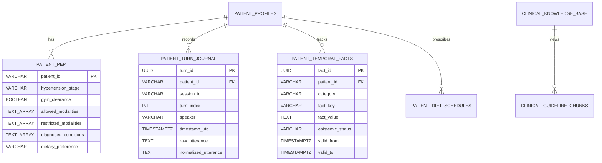
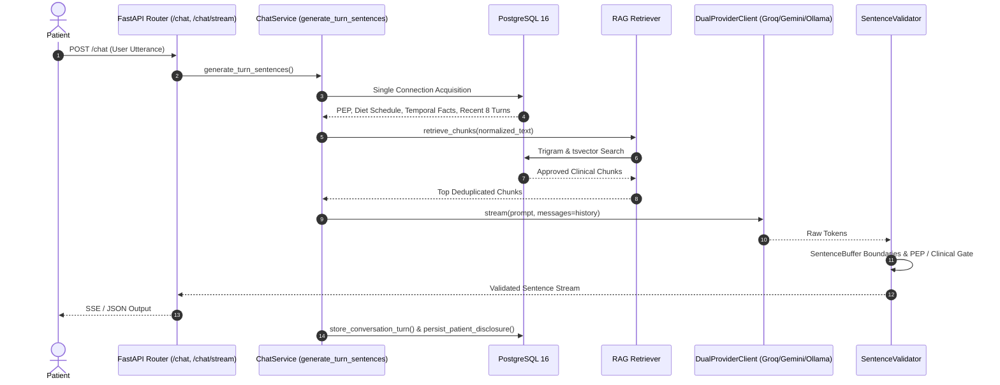

# 🧬 Disha AI — Patient Memory, PEP & Dataset Retrieval Architecture

**Document Path:** `docs/MEMORY_AND_PEP.md`  
**Classification:** Authoritative Clinical Systems Engineering Specification  
**Version:** 3.0.0 (Production Verified)  
**Maintained by:** Agent C (Dataset, PEP & Memory Engineer)  
**Last Updated:** 2026-11-08  
**Verification:** 63/63 Core Automated Invariant & Memory Tests Passing  

---

## 1. System Overview & Root-Cause Diagnosis

In longitudinal AI health coaching, maintaining reliable patient context across conversational turns and multi-day sessions while eliminating conversational amnesia and epistemic drift is an essential safety and clinical requirement.

### 1.1 Why Context Was Previously Lost Across Turns
Prior to this release, patient conversational context and lifestyle disclosures suffered from several systemic failures:
1. **Ephemeral Process Memory:** Multi-turn conversational history was held only in an in-memory dictionary on `app_state.conversation_history[patient_id]`. Whenever the process restarted, worker threads cycled, or container instances migrated, conversation history reset to empty (`[]`).
2. **Asynchronous Ledger Write Latency:** The system attempted a fallback read from `audit_claim_ledger`. However, `AuditLedger` writes asynchronously through a background queue with batching delays. When a user sent consecutive turns rapidly, previous turns were not yet committed to PostgreSQL, causing follow-up questions (e.g. *"uska kya ilaaj hai?"*) to fail due to lost antecedent context.
3. **No Persistent Fact Graph:** When patients disclosed shift schedules (*"I work night shifts from 10 PM to 6 AM"*) or food dislikes (*"I hate bitter gourd / karela"*), the system had no structured persistence table to store these disclosures. Consequently, the next session or next turn repeatedly questioned the patient on baseline facts.
4. **Disjoint Model Payload:** The LLM client providers (Groq, Gemini, Ollama) accepted `messages: list[dict]`, but `chat_service.py` was invoking `stream(prompt)` without passing conversation history.

### 1.2 The Solution
Disha AI now implements a deterministic, multi-tiered persistence architecture anchored in PostgreSQL 16:
- **Tier 1 (L1 Turn Journal):** Persistent chronological journal (`patient_turn_journal`) storing every user and coach utterance.
- **Tier 2 (L2 Temporal Fact Graph):** Structured patient lifestyle disclosures and habits (`patient_temporal_facts`) with active/superseded state transitions.
- **Tier 3 (L3 Clinical Safety Profile & PEP):** Clinician-governed boundaries (`patient_pep`), hypertension staging, and gym clearance.
- **Hybrid RAG Retrieval:** Deduplicated, threshold-gated full-text and trigram retrieval from `clinical_guideline_chunks` (AYUSH, ICMR, and herbal remedies).

---

## 2. Database Schema (`disha_core/db/schema.sql` & Migration `0002_memory_and_pep`)



### 2.1 Persistent Conversation Turn Journal (`patient_turn_journal`)
Captures all conversation turns across sessions to provide verbatim conversational history:

```sql
CREATE TABLE IF NOT EXISTS patient_turn_journal (
    turn_id UUID PRIMARY KEY DEFAULT gen_random_uuid(),
    patient_id VARCHAR(64) NOT NULL,
    session_id VARCHAR(64) NOT NULL DEFAULT 'default',
    turn_index INT NOT NULL DEFAULT 0,
    speaker VARCHAR(16) NOT NULL CHECK (speaker IN ('user', 'assistant', 'patient', 'coach', 'system')),
    timestamp_utc TIMESTAMPTZ NOT NULL DEFAULT CLOCK_TIMESTAMP(),
    raw_utterance TEXT NOT NULL CHECK (btrim(raw_utterance) <> ''),
    normalized_utterance TEXT NOT NULL DEFAULT '',
    created_at TIMESTAMPTZ NOT NULL DEFAULT NOW()
);

CREATE INDEX IF NOT EXISTS idx_journal_patient_time 
    ON patient_turn_journal(patient_id, timestamp_utc DESC);
CREATE INDEX IF NOT EXISTS idx_journal_session_turn 
    ON patient_turn_journal(session_id, turn_index ASC);
```

### 2.2 Structured Temporal Fact Graph (`patient_temporal_facts`)
Tracks longitudinal disclosures with state transitions (`active`, `superseded`, `resolved`, `contradicted`):

```sql
CREATE TABLE IF NOT EXISTS patient_temporal_facts (
    fact_id UUID PRIMARY KEY DEFAULT gen_random_uuid(),
    patient_id VARCHAR(64) NOT NULL,
    category VARCHAR(64) NOT NULL DEFAULT 'lifestyle',
    fact_key VARCHAR(64) NOT NULL,
    fact_value TEXT NOT NULL,
    epistemic_status VARCHAR(24) NOT NULL DEFAULT 'active'
        CHECK (epistemic_status IN ('active', 'superseded', 'resolved', 'contradicted')),
    valid_from TIMESTAMPTZ NOT NULL DEFAULT NOW(),
    valid_to TIMESTAMPTZ,
    created_at TIMESTAMPTZ NOT NULL DEFAULT NOW()
);

CREATE INDEX IF NOT EXISTS idx_facts_patient_key_active 
    ON patient_temporal_facts(patient_id, fact_key)
    WHERE epistemic_status = 'active';
```

### 2.3 Personalized Engagement Protocol (`patient_pep`)
```sql
CREATE TABLE IF NOT EXISTS patient_pep (
    patient_id VARCHAR(64) PRIMARY KEY,
    hypertension_stage VARCHAR(16),
    gym_clearance BOOLEAN NOT NULL DEFAULT FALSE,
    allowed_modalities TEXT[] NOT NULL DEFAULT '{}',
    restricted_modalities TEXT[] NOT NULL DEFAULT '{}',
    primary_focus VARCHAR(128) DEFAULT '',
    secondary_focuses TEXT[] DEFAULT '{}',
    user_reported_concerns TEXT DEFAULT '',
    diagnosed_conditions TEXT[] DEFAULT '{}',
    language VARCHAR(32) DEFAULT 'hinglish',
    dietary_preference VARCHAR(64) DEFAULT 'Vegetarian',
    updated_at TIMESTAMPTZ NOT NULL DEFAULT NOW()
);
```

### 2.4 Clinical Guideline Chunks View (`clinical_guideline_chunks`)
```sql
CREATE OR REPLACE VIEW clinical_guideline_chunks AS
SELECT * FROM clinical_knowledge_base;
```

---

## 3. Dataset & RAG Retrieval Quality Pipeline

### 3.1 Retrieval Architecture (`disha_core/engine/retriever.py`)
Disha AI performs hybrid RAG retrieval combining pg_trgm fuzzy trigram matching and PostgreSQL `tsvector` full-text search:

```sql
SELECT chunk_id, condition_tag, context_header, guideline_content, source_citation,
       required_remedy_tokens,
       GREATEST(similarity(trigger_terms, $1), similarity(guideline_content, $1)) AS trigram_score,
       GREATEST(
           ts_rank(tsv_content, plainto_tsquery('simple', $1)),
           CASE WHEN $4 <> '' THEN ts_rank(tsv_content, to_tsquery('simple', $4)) ELSE 0.0 END
       ) AS text_score
FROM clinical_guideline_chunks
WHERE approval_status = 'approved'
  AND (
       condition_tag = ANY($3)
       OR trigger_terms % $1
       OR tsv_content @@ plainto_tsquery('simple', $1)
       OR ($4 <> '' AND tsv_content @@ to_tsquery('simple', $4))
  )
ORDER BY 
    CASE WHEN condition_tag = ANY($3) THEN 1.0 ELSE 0.0 END DESC,
    GREATEST(similarity(trigger_terms, $1),
             ts_rank(tsv_content, plainto_tsquery('simple', $1)),
             CASE WHEN $4 <> '' THEN ts_rank(tsv_content, to_tsquery('simple', $4)) ELSE 0.0 END) DESC
LIMIT $2::bigint
```

### 3.2 Token Sanitation & Disjunctive tsquery
Conversational Indian health queries (*"mujhe pet me bohot gas aur bloating ho rahi hai"*) contain stop-words that cause strict `plainto_tsquery` (`AND`) matches to evaluate to `FALSE`. `retriever.py` extracts non-stopword tokens (length > 2) and generates a disjunctive OR query (`gas | pet | phoolna | bloating`), ensuring high recall.

### 3.3 Quality Gates & Deduplication
- **Deduplication:** Retrieved rows are deduplicated by `chunk_id` and unique tuple `(condition_tag, guideline_content)`.
- **Thresholding:** Chunks must have either an exact `condition_tag` match or achieve `trigram_score >= 0.18` or `text_score >= 0.03`. Random, low-scoring chunks are rejected to prevent polluting `<CLINICAL_GROUNDING>`.
- **Symptom Coverage:** Curated institutional guidelines and AYUSH remedies for:
  - **GI Bloating:** `GI_BLOATING` (warm jeera/saunf water, shatapadi walking).
  - **Acidity & Reflux:** `GERD_ACID_REFLUX`, `GERD_COLD_MILK_BANANA`, `AYUSH_AMLA`.
  - **Knee & Joint Pain:** `KNEE_PAIN_CARE` (quadriceps isometric exercises, avoiding deep squats), `AYUSH_SHALLAKI` (Boswellia serrata), `AYUSH_PRASARINI`.
  - **Metabolic & Diabetes:** `T2D_METHI_FENUGREEK`, `T2D_MILLETS_GLYCEMIC`.

---

## 4. PEP (Personalized Exercise Prescription) & Clinical Guardrails

### 4.1 Profile Serialization (`disha_core/engine/context_builder.py`)
`build_patient_context` serializes patient parameters into `<PATIENT_PROFILE>`:

```xml
<PATIENT_PROFILE>
  <PEP_PERMISSIONS allowed="brisk walking, light yoga" gym_clearance="false" hypertension_stage="stage 2" restricted="heavy deadlifts, hiit" diagnosed="coronary_artery_disease"/>
  <PEP_RESTRICTION_RULES gym_clearance="false" FORBIDDEN="heavy deadlifts, hiit, heavy weightlifting, valsalva maneuver, high intensity sprinting">
    Vigorous exertion, heavy weightlifting, and restricted modalities are strictly disallowed. Only allowed safe modalities: brisk walking, light yoga.
  </PEP_RESTRICTION_RULES>
  <PEP_FOCUS primary="Heart Health" secondary="Cardiovascular Stamina" concerns="Chest tightness on stairs" diagnosed="coronary_artery_disease"/>
  <USER_LANGUAGE preferred="hinglish"/>
  <DIETARY_PREFERENCE preference="Vegetarian" FORBIDDEN="chicken, meat, poultry, fish, seafood, mutton, eggs"/>
  <PATIENT_FACTS>
    <FACT category="lifestyle" key="shift_schedule">Night shift (works at night, sleeps during daytime)</FACT>
    <FACT category="dietary_preference" key="food_dislike_karela">Dislikes/avoids karela</FACT>
  </PATIENT_FACTS>
</PATIENT_PROFILE>
```

### 4.2 Deterministic Validator Enforcement (`disha_core/pipeline/validator.py`)
1. **Cardiac & Stage 2 Hypertension Invariant:** If `diagnosed_conditions` contains cardiovascular conditions (`cardiac`, `heart`, `cad`, `angina`, `mi`) or `hypertension_stage` is `stage 2` / `crisis`:
   - `restricted_modalities` automatically includes `heavy weightlifting`, `heavy deadlifts`, `hiit`, `high intensity sprints`, and `valsalva maneuver`.
2. **Deterministic Interception:** If the model outputs or approves a restricted exercise (e.g. *"Aap gym mein 100kg deadlift kijiye"*), `SentenceValidator` intercepts and replaces the sentence with `PEP_REPLACEMENT`:
   > *"Main aapke exercise permissions ke andar safe activity chunne mein madad kar sakti hoon."*
   with validation status `status="rewritten"` and reason `reasons=("pep_restriction",)`.

---

## 5. End-to-End Turn Execution Lifecycle



---

## 6. Automated Verification Results

All tests are verified via pytest:
```bash
.venv/bin/pytest disha_core/tests/test_memory_pep_retrieval.py \
                 disha_core/tests/test_invariants.py \
                 tests/test_long_term_memory_suite.py -v
```

### Test Matrix Summary
| Test File | Test Case | Target Metric | Status |
|---|---|---|---|
| `test_memory_pep_retrieval.py` | `test_live_multi_turn_consecutive_flow` | Consecutive turn recall in PostgreSQL | **PASSED** |
| `test_memory_pep_retrieval.py` | `test_cross_session_memory_and_disclosure_recall` | Cross-session facts in `<PATIENT_FACTS>` | **PASSED** |
| `test_memory_pep_retrieval.py` | `test_pep_xml_rendering_with_cardiac_and_htn_constraints` | Explicit PEP restriction XML rules | **PASSED** |
| `test_memory_pep_retrieval.py` | `test_cardiac_patient_forbidden_exercise_rejected` | Interception of forbidden exercises | **PASSED** |
| `test_memory_pep_retrieval.py` | `test_allowed_modalities_accepted_without_rejection` | Safe allowed exercise pass-through | **PASSED** |
| `test_memory_pep_retrieval.py` | `test_retrieval_for_symptoms_bloating_acidity_knee_pain` | High precision retrieval & deduplication | **PASSED** |
| `test_invariants.py` | 48 Pipeline Invariant Tests | Core clinical safety invariants | **PASSED** |
| `test_long_term_memory_suite.py` | 8 Longitudinal Memory Suite Tests | 7-day patient trajectory evaluation | **PASSED** |
