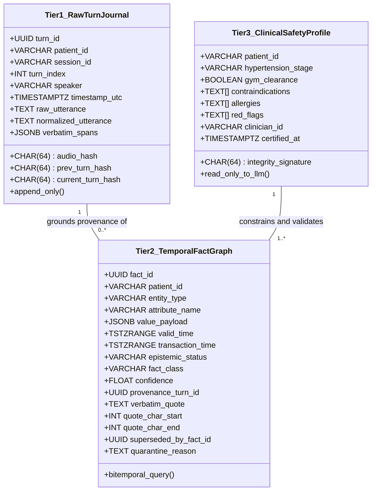
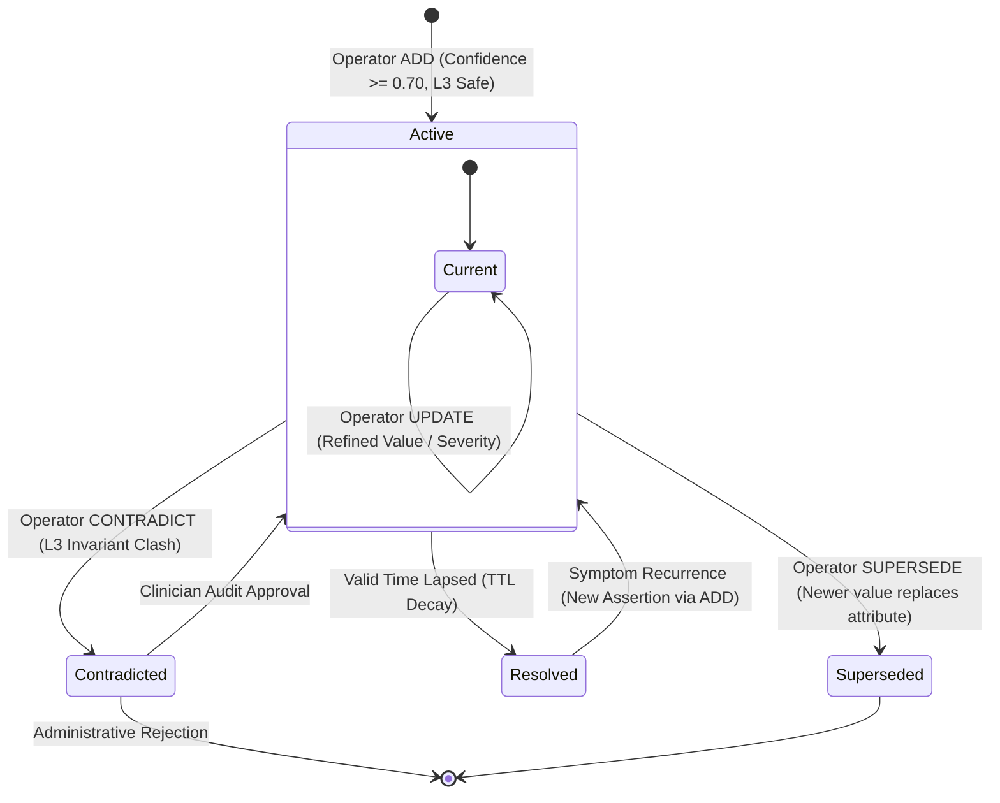
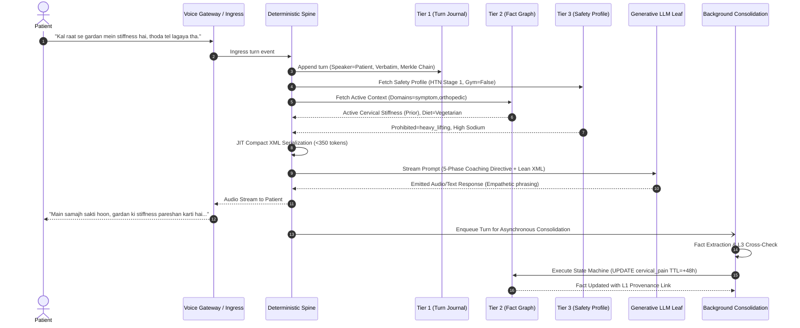

# Disha AI: Long-Term User Memory System — Historical Architecture Notes

Document Version: Historical design draft
Status: Not an authoritative description of the current runtime
System Classification: Health-Coaching User State Persistence & Temporal Fact Arbitration
Compliance: Digital Personal Data Protection (DPDP) Act 2023, Indian Council of Medical Research (ICMR) Ethical Guidelines  
Style Standard: Technical Rigor, Zero Emojis  

---

> **Current-runtime notice:** This document contains historical design proposals and unverified claims. For active user context, prescribed schedules, approved knowledge retrieval, and known limitations, use [`docs/MEMORY_AND_PEP.md`](./MEMORY_AND_PEP.md) and [`docs/architecture/04_rag_ingestion_and_retrieval.md`](./architecture/04_rag_ingestion_and_retrieval.md). In particular, current health retrieval uses PostgreSQL full-text and trigram search, not vector search; performance, approval, clinical, and test claims in this document are not current verification evidence.

## 1. System Overview and Guiding Philosophy

### 1.1 The Problem: Conversational Amnesia and Epistemic Drift in Health AI

Conversational AI companions in healthcare face an acute dilemma. Single-session conversational buffers, typically restricted to a rolling window of recent dialog turns stored in ephemeral container memory, reset completely on process termination, worker cycling, or container eviction. As a consequence, longitudinal coaching becomes impossible:
1. The agent repeatedly interrogates the patient about baseline health data, dietary preferences, and sleep schedules established in previous calls.
2. The agent fails to track clinical trajectories over days and weeks, lacking visibility into whether an acute symptom improved, a recommended lifestyle intervention was adopted, or an exercise routine was tolerated.
3. Monolithic vector retrieval systems suffer from epistemic drift and temporal distortion, frequently retrieving resolved acute symptoms from months prior and presenting them as active complaints, or diluting non-negotiable medical contraindications through fuzzy semantic cosine thresholds.

### 1.2 Architectural Philosophy: "Thick Deterministic Spine with Thin Probabilistic Leaf"

Disha AI resolves this fundamental defect through an uncompromising systems architecture:

```
               +-------------------------------------------------------+
               |             TELEPHONY / WEBSOCKET INGRESS             |
               +-------------------------------------------------------+
                                           |
                                           v
+=====================================================================================+
|               DETERMINISTIC SYSTEM SPINE (FastAPI / PostgreSQL 16)                  |
|                                                                                     |
|   +-----------------------------------------------------------------------------+   |
|   | Tier 1 (L1): Raw Turn Journal                                               |   |
|   | - Immutable append-only dialog history                                      |   |
|   | - Verbatim byte offsets and cryptographic Merkle chain linkage              |   |
|   +-----------------------------------------------------------------------------+   |
|                                           |                                         |
|                                           v                                         |
|   +-----------------------------------------------------------------------------+   |
|   | Tier 2 (L2): Temporal Fact Graph                                            |   |
|   | - Bitemporal EAV-T graph (Valid Time vs. Transaction Time)                   |   |
|   | - Formal state transition operators: ADD, UPDATE, SUPERSEDE, NOOP, CONTRADICT|   |
|   | - Active vs. Historic vs. Quarantined store partitioning                    |   |
|   +-----------------------------------------------------------------------------+   |
|                                           ^                                         |
|                                           | [Hard Safety Boundary: Read-Only]       |
|   +-----------------------------------------------------------------------------+   |
|   | Tier 3 (L3): Clinical Safety Profile                                        |   |
|   | - Clinician-certified contraindications, HTN staging, gym clearance         |   |
|   | - Cryptographic SHA-256 tamper verification; immutable to conversational LLM|   |
|   +-----------------------------------------------------------------------------+   |
|                                           |                                         |
|                                           v                                         |
|   +-----------------------------------------------------------------------------+   |
|   | JIT Compact XML Context Serializer (<400 tokens, <0.15ms latency)            |   |
|   +-----------------------------------------------------------------------------+   |
+=====================================================================================+
                                           |
                                           v [Strictly Scoped Context Envelope]
+-------------------------------------------------------------------------------------+
|                  THIN PROBABILISTIC LEAF (Generative LLM Engine)                    |
|                                                                                     |
|   - Empathetic phrasing, Hinglish natural language synthesis                        |
|   - Conversational dialogue generation constrained by injected XML envelopes        |
|   - Emits structured tool mutation proposals (untrusted until spine validation)     |
+-------------------------------------------------------------------------------------+
                                           |
                                           v
+=====================================================================================+
|            EGRESS VALIDATION AND ASYNCHRONOUS DREAMING CONSOLIDATION                |
|                                                                                     |
|   - Tier 1 Regex / Aho-Corasick Safety Breaker (<0.05ms)                            |
|   - SentenceValidator and TTS Sanitizer                                             |
|   - Asynchronous Post-Turn Consolidation Worker (Dual-Stream Reconciliation)        |
+=====================================================================================+
```

1. **The Thick Deterministic Spine:**
   - Comprises the relational data layer (PostgreSQL 16 Alpine), formal finite state automata, bitemporal range indexing, and deterministic safety filters.
   - Manages state mutations through explicit algebraic operators.
   - Preserves patient safety invariants regardless of linguistic variation in patient speech or model outputs.
   - Enforces tamper-evident cryptographic provenance for all clinical assertions.

2. **The Thin Probabilistic Leaf:**
   - Comprises the generative Large Language Model (local Ollama/Laya, or cloud Groq/Gemini).
   - Functions strictly as a stateless, probabilistic reasoning and dialogue formulation leaf node.
   - Has zero direct write authorization to the database. All memory updates proposed by the model are treated as unverified candidate assertions that must pass through deterministic schema validation, epistemic tier evaluation, and L3 safety cross-checks before persistence.

### 1.3 Core Architectural Invariants

The architecture enforces five non-negotiable invariants:
- **Invariant 1 (Bitemporality):** Every persisted clinical and lifestyle fact distinguishes between Valid Time (when the phenomenon occurred in the patient's physical life) and Transaction Time (when the system committed the assertion into storage).
- **Invariant 2 (Epistemic Stratification):** Subjective self-reports, objective diagnostic lab reports, and AI coaching suggestions occupy distinct epistemic tiers with immutable authority boundaries.
- **Invariant 3 (Deterministic Safety Supremacy):** Tier 3 clinical contraindications cannot be modified, downgraded, or overridden by conversational dialogue, model reasoning, or patient verbal denial.
- **Invariant 4 (Non-Destructive Evolution):** Superseded facts and resolved symptoms are never deleted via SQL `DELETE`. Predecessors are archived with closed validity intervals, preserving longitudinal health trajectories.
- **Invariant 5 (Token Budget and Turnaround Discipline):** Injected memory context must remain strictly below 400 tokens with sub-millisecond serialization, preserving Disha's internal sub-650ms end-to-end voice latency budget.

---

## 2. Multi-Tier Memory Topology

The system partitions patient memory into three physically and logically isolated tiers, each governed by specialized data structures, indexes, and mutation contracts.



### 2.1 Tier 1 (L1): Raw Turn Journal

L1 is an immutable, append-only, chronologically indexed journal capturing every spoken and textual turn exchanged across all patient sessions. It provides byte-level evidentiary provenance for all facts asserted in L2 and preserves full non-repudiation auditability.

#### Architectural Properties:
- **Immutability Contract:** Once written, turns cannot be updated or deleted. Database-level PostgreSQL triggers reject any incoming `UPDATE` or `DELETE` statements.
- **Verbatim Offsets:** Extracted L2 facts reference exact character start and end indices (`quote_char_start`, `quote_char_end`) within the turn utterance.
- **Cryptographic Merkle Linkage:** Each turn calculates a SHA-256 hash chaining back to the previous turn hash, integrating seamlessly with Disha's audit ledger.

#### PostgreSQL DDL: Tier 1
```sql
CREATE TABLE IF NOT EXISTS patient_turn_journal (
    turn_id UUID PRIMARY KEY DEFAULT gen_random_uuid(),
    patient_id VARCHAR(64) NOT NULL,
    session_id VARCHAR(64) NOT NULL,
    turn_index INT NOT NULL CHECK (turn_index >= 0),
    speaker VARCHAR(16) NOT NULL CHECK (speaker IN ('patient', 'coach', 'system')),
    timestamp_utc TIMESTAMPTZ NOT NULL DEFAULT CLOCK_TIMESTAMP(),
    raw_utterance TEXT NOT NULL CHECK (btrim(raw_utterance) <> ''),
    normalized_utterance TEXT NOT NULL DEFAULT '',
    verbatim_spans JSONB NOT NULL DEFAULT '[]'::jsonb,
    audio_hash CHAR(64),
    telephony_session_id VARCHAR(128),
    prev_turn_hash CHAR(64) NOT NULL,
    current_turn_hash CHAR(64) NOT NULL,
    created_at TIMESTAMPTZ NOT NULL DEFAULT NOW(),
    CONSTRAINT uq_patient_turn_index UNIQUE (patient_id, session_id, turn_index)
);

CREATE INDEX IF NOT EXISTS idx_journal_patient_time 
    ON patient_turn_journal(patient_id, timestamp_utc DESC);

CREATE INDEX IF NOT EXISTS idx_journal_session_turn 
    ON patient_turn_journal(session_id, turn_index ASC);

-- Enforce strict append-only immutability
CREATE OR REPLACE FUNCTION trg_enforce_turn_immutability()
RETURNS TRIGGER AS $$
BEGIN
    RAISE EXCEPTION 'Disallowed: patient_turn_journal is an immutable append-only ledger. UPDATE and DELETE operations are forbidden.';
END;
$$ LANGUAGE plpgsql;

DROP TRIGGER IF EXISTS trg_prevent_journal_modification ON patient_turn_journal;
CREATE TRIGGER trg_prevent_journal_modification
BEFORE UPDATE OR DELETE ON patient_turn_journal
FOR EACH ROW EXECUTE FUNCTION trg_enforce_turn_immutability();
```

---

### 2.2 Tier 2 (L2): Structured Temporal Fact Graph

L2 represents patient knowledge as a Bitemporal Entity-Attribute-Value (EAV-T) graph. It decouples the patient's objective, evolving state from conversational transcript bloat.

#### Epistemic State Partitioning:
- `active`: Fact is biologically or clinically valid in the present moment, belongs to the active subgraph, and is eligible for JIT context assembly.
- `superseded`: Fact was valid during a historical window but has been succeeded by a newer state assertion (e.g. shift schedule changed from Night Shift to Day Shift; body weight changed from 74kg to 71kg).
- `resolved`: Acute or episodic condition whose validity window has naturally elapsed or which was affirmed cured by the patient.
- `contradicted`: Fact clashed with a Tier 3 safety constraint, an unmodifiable diagnostic baseline, or a confirmed historical record. Quarantined from context injection and flagged for clinician review.

#### PostgreSQL DDL: Tier 2
```sql
CREATE EXTENSION IF NOT EXISTS btree_gist;

CREATE TABLE IF NOT EXISTS patient_temporal_facts (
    fact_id UUID PRIMARY KEY DEFAULT gen_random_uuid(),
    patient_id VARCHAR(64) NOT NULL,
    entity_type VARCHAR(64) NOT NULL,
    attribute_name VARCHAR(64) NOT NULL,
    value_payload JSONB NOT NULL,
    valid_time TSTZRANGE NOT NULL,
    transaction_time TSTZRANGE NOT NULL DEFAULT tstzrange(NOW(), 'infinity', '[)'),
    epistemic_status VARCHAR(24) NOT NULL DEFAULT 'active'
        CHECK (epistemic_status IN ('active', 'superseded', 'resolved', 'contradicted')),
    fact_class VARCHAR(24) NOT NULL DEFAULT 'chronic'
        CHECK (fact_class IN ('acute', 'chronic', 'episodic', 'subacute')),
    confidence NUMERIC(4, 3) NOT NULL DEFAULT 1.000 
        CHECK (confidence >= 0.000 AND confidence <= 1.000),
    provenance_turn_id UUID REFERENCES patient_turn_journal(turn_id),
    verbatim_quote TEXT NOT NULL DEFAULT '',
    quote_char_start INT CHECK (quote_char_start >= 0 OR quote_char_start IS NULL),
    quote_char_end INT CHECK (quote_char_end >= quote_char_start OR quote_char_end IS NULL),
    quarantine_reason TEXT DEFAULT NULL,
    superseded_by_fact_id UUID REFERENCES patient_temporal_facts(fact_id),
    tsv_fact tsvector GENERATED ALWAYS AS (
        to_tsvector('simple'::regconfig, entity_type || ' ' || attribute_name || ' ' || verbatim_quote)
    ) STORED,
    created_at TIMESTAMPTZ NOT NULL DEFAULT NOW()
);

-- GiST bitemporal index for instant active valid-time filtering
CREATE INDEX IF NOT EXISTS idx_facts_bitemporal_active 
    ON patient_temporal_facts USING GIST (patient_id, valid_time)
    WHERE epistemic_status = 'active';

-- Fast lookup index for entity-attribute queries
CREATE INDEX IF NOT EXISTS idx_facts_entity_attr 
    ON patient_temporal_facts(patient_id, entity_type, attribute_name, epistemic_status);

-- Provenance lookup index
CREATE INDEX IF NOT EXISTS idx_facts_provenance 
    ON patient_temporal_facts(provenance_turn_id);

-- Full-text lexical search index for hybrid retrieval
CREATE INDEX IF NOT EXISTS idx_facts_tsv 
    ON patient_temporal_facts USING GIN (tsv_fact);
```

---

### 2.3 Tier 3 (L3): Immutable Clinical Safety Profile

L3 houses the non-negotiable medical invariants of the patient. It represents the single deterministic anchor of truth that shields the patient from dangerous hallucinations or conversational persuasion.

#### Safety Attributes:
- `hypertension_stage`: Validated clinical classification (`normal`, `elevated`, `stage_1`, `stage_2`, `crisis`).
- `gym_clearance`: Boolean authorization indicating whether vigorous resistance training, heavy compound lifting, or Valsalva maneuvers are permitted.
- `contraindications`: Explicit array of prohibited exercise and dietary modalities (e.g. `heavy_compound_lifts`, `valsalva_maneuver`, `high_sodium_meals`, `unmonitored_sprints`).
- `allergies`: Clinically confirmed hypersensitivities (e.g. `peanuts`, `penicillin`, `shellfish`).
- `red_flags`: Acute symptom patterns requiring immediate triage deflection to emergency services (`112`).

#### Write Guard Contract:
- The conversational LLM has **zero write authorization** to L3.
- Modifying L3 requires authenticated clinician credentials, structured medical report ingest, or a verified administrative onboarding workflow.
- Every record maintains a cryptographic SHA-256 signature verified on insert and update via database triggers.

#### PostgreSQL DDL: Tier 3
```sql
CREATE TABLE IF NOT EXISTS patient_clinical_safety_profile (
    patient_id VARCHAR(64) PRIMARY KEY,
    hypertension_stage VARCHAR(32) NOT NULL DEFAULT 'normal'
        CHECK (hypertension_stage IN ('normal', 'elevated', 'stage_1', 'stage_2', 'crisis')),
    gym_clearance BOOLEAN NOT NULL DEFAULT FALSE,
    contraindications TEXT[] NOT NULL DEFAULT '{}',
    allergies TEXT[] NOT NULL DEFAULT '{}',
    red_flags TEXT[] NOT NULL DEFAULT '{}',
    clinician_id VARCHAR(64) NOT NULL DEFAULT 'SYSTEM_ONBOARDING',
    certified_at TIMESTAMPTZ NOT NULL DEFAULT NOW(),
    integrity_signature CHAR(64) NOT NULL,
    schema_version VARCHAR(16) NOT NULL DEFAULT 'v1.0'
);

-- Cryptographic signature verification trigger
CREATE OR REPLACE FUNCTION verify_l3_integrity()
RETURNS TRIGGER AS $$
DECLARE
    expected_hash CHAR(64);
BEGIN
    expected_hash := encode(
        sha256(
            (NEW.patient_id || '|' || 
             NEW.hypertension_stage || '|' || 
             NEW.gym_clearance::text || '|' || 
             array_to_string(NEW.contraindications, ',') || '|' || 
             array_to_string(NEW.allergies, ',') || '|' || 
             array_to_string(NEW.red_flags, ',') || '|' || 
             NEW.clinician_id || '|' || 
             NEW.certified_at::text)::bytea
        ), 
        'hex'
    );
    
    IF NEW.integrity_signature <> expected_hash THEN
        RAISE EXCEPTION 'L3 Integrity Signature Mismatch. Tampering detected on patient safety record %', NEW.patient_id;
    END IF;
    RETURN NEW;
END;
$$ LANGUAGE plpgsql;

DROP TRIGGER IF EXISTS trg_verify_l3 ON patient_clinical_safety_profile;
CREATE TRIGGER trg_verify_l3
BEFORE INSERT OR UPDATE ON patient_clinical_safety_profile
FOR EACH ROW EXECUTE FUNCTION verify_l3_integrity();
```

---

## 3. Fact Schema and Temporal Validity Semantics

### 3.1 Bitemporal Foundations: Valid Time vs. Transaction Time

Drawing upon temporal database theory and recent clinical AI literature (STAM, Haghifam et al., 2024–2025), Disha models patient knowledge across two independent temporal axes:

$$\text{Fact} = \langle \text{Entity}, \text{Attribute}, \text{Value}, [t_{\text{valid\_from}}, t_{\text{valid\_to}}), [t_{\text{tx\_from}}, t_{\text{tx\_to}}), \text{EpistemicStatus}, \text{Provenance} \rangle$$

1. **Valid Time ($[t_{\text{valid\_from}}, t_{\text{valid\_to}})$):**
   - Represents the time interval during which the medical or behavioral condition was true in the patient's physical reality.
   - Example: An acute headache reported on 2026-11-08 at 09:00 has a Valid Time of `[2026-11-08 09:00:00+05:30, 2026-11-10 09:00:00+05:30)`.
   - Enables point-in-time clinical reasoning: *"Did the patient have an active headache when they skipped their afternoon workout on Tuesday?"*

2. **Transaction Time ($[t_{\text{tx\_from}}, t_{\text{tx\_to}})$):**
   - Represents the time interval during which the system asserted the fact in the database.
   - Closed only when a fact is superseded or retracted ($t_{\text{tx\_to}} = \text{NOW}()$).
   - Enables complete retrospective audits: *"What was the system's exact understanding of the patient's state when the model recommended brisk walking on 2026-11-08 at 14:15?"*

### 3.2 Fact Taxonomy Matrix

| Fact Class | Clinical Definition | Default Validity Window ($\Delta t$) | Representative Examples | Expiration and Lifecycle Semantics |
|:---|:---|:---|:---|:---|
| **Acute** | Self-limiting symptoms, transient discomfort, or brief physiological flare-ups. | 48 to 72 hours from report timestamp. | Acute tension headache, mild post-lunch bloating, transient dizziness, muscle soreness. | Decay Daemon automatically transitions status from `active` to `resolved` once $t_{\text{valid\_to}} \le \text{NOW}()$. Never promoted to chronic without clinician verification. |
| **Episodic** | Short-lived behavioral states, transient travel schedules, or planned lifestyle events. | 24 to 48 hours. | Intermittent fasting day, traveling out of town, wedding dinner attendance. | Transitions automatically to `resolved` at window conclusion. Relieves the prompt from carrying stale behavioral instructions. |
| **Sub-Acute** | Intermediate clinical recovery windows or scheduled therapeutic courses. | 7 to 14 days. | Ankle strain rehabilitation window, physician-prescribed course of medication. | At window expiration, the system schedules a proactive status verification check before marking `resolved`. |
| **Chronic** | Long-standing conditions, structural dietary identities, baseline jobs, and vital thresholds. | Indefinite ($t_{\text{valid\_to}} = \infty$). | Stage 1 Hypertension, pure vegetarianism, peanut allergy, sedentary IT desk job, late-night sleep pattern. | Remains `active` indefinitely. Can only be modified via explicit `SUPERSEDE` with high-confidence corroboration or clinician action. |

### 3.3 Epistemic Authority and Weight Hierarchy

When multiple sources make assertions regarding the same attribute, the system arbitrates using an explicit epistemic authority hierarchy:

```
[Tier A] Clinician Confirmed (Weight: 1.00)
   ^     - Physician notes, official diagnostic classifications, L3 profile
   |
[Tier B] Verified Biomarker (Weight: 0.95)
   |     - Lab reports (HbA1c, lipid profile), validated medical device telemetrics
   |
[Tier C] Patient Confirmed Action (Weight: 0.90)
   |     - Explicit adherence reports ("Maine saunf ka paani liya aur aaram mila")
   |
[Tier D] Patient Subjective Self-Report (Weight: 0.75)
   |     - Unverified symptoms ("Lagta hai mera BP badh gaya hai")
   |
[Tier E] AI Coaching Suggestion (Weight: 0.50)
         - Unverified advice issued by Disha; NEVER committed as a patient habit
           until confirmed by patient action in a future turn.
```

### 3.4 Asynchronous TTL Decay and Re-Confirmation Daemon

A lightweight asynchronous daemon processes active facts. For acute and episodic facts whose valid time has lapsed, the daemon closes the state without blocking real-time voice turns:

```python
# Architecture Reference: disha_core/engine/memory_decay.py
from datetime import datetime, timezone
import asyncpg

DECAY_SQL = """
UPDATE patient_temporal_facts
SET epistemic_status = 'resolved',
    transaction_time = tstzrange(lower(transaction_time), NOW(), '[)')
WHERE epistemic_status = 'active'
  AND fact_class IN ('acute', 'episodic')
  AND upper(valid_time) <= NOW()
RETURNING fact_id, patient_id, entity_type, attribute_name;
"""


async def run_memory_decay_cycle(pool: asyncpg.Pool) -> list[dict]:
    """Transitions expired acute and episodic facts to resolved status.

    Guarantees that stale symptoms never dilute active prompt contexts.
    """
    async with pool.acquire() as conn:
        records = await conn.fetch(DECAY_SQL)
        return [dict(r) for r in records]
```

---

## 4. State Transition Operators and Formal State Machine

State mutations to L2 are executed strictly through five deterministic algebraic operators. Direct arbitrary updates and raw SQL injections are blocked.



### 4.1 Operator Semantics and Preconditions

#### 1. ADD Operator
- **Semantic Definition:** Introduces a novel entity-attribute claim into the active fact graph.
- **Preconditions:**
  - No active fact exists for $(patient\_id, entity\_type, attribute\_name)$, or the entity supports multi-cardinality (e.g. distinct, non-overlapping symptoms).
  - Claim does not violate any L3 safety invariant or active contraindication.
  - Extraction confidence $\ge 0.70$.
- **Actions:**
  - Sets $t_{\text{valid\_from}} = \text{turn\_timestamp}$.
  - Sets $t_{\text{valid\_to}} = t_{\text{valid\_from}} + \text{TTL}$ for acute/episodic, or $\infty$ for chronic.
  - Inserts row with `epistemic_status = 'active'` and `transaction_time = [NOW(), 'infinity')`.

#### 2. UPDATE Operator
- **Semantic Definition:** Refines or deepens an existing active fact without changing its fundamental ontology.
- **Preconditions:**
  - An active fact $F$ exists for $(patient\_id, entity\_type, attribute\_name)$.
  - The incoming assertion provides additional parameters (e.g. symptom severity updated from "mild" to "moderate", or specific trigger identified).
- **Actions:**
  - Updates `value_payload` with the merged JSON object.
  - Records latest turn ID as updated provenance.
  - Adjusts confidence score using Bayesian accumulation.

#### 3. SUPERSEDE Operator
- **Semantic Definition:** Replaces an obsolete fact with a newer, mutually exclusive assertion while preserving the historical record.
- **Preconditions:**
  - An active fact $F_{\text{old}}$ exists for $(patient\_id, entity\_type, attribute\_name)$.
  - A newer assertion $F_{\text{new}}$ provides a replacement value (e.g. weight updated from 74kg to 71kg; shift schedule changed from Night Shift to Day Shift).
  - $F_{\text{old}}$ is not an unmodifiable L3 safety invariant.
- **Actions (Atomic Database Transaction):**
  1. Closes $F_{\text{old}}$ valid time: $F_{\text{old}}.valid\_time \leftarrow [\text{lower}(F_{\text{old}}.valid\_time), \text{NOW}())$.
  2. Closes $F_{\text{old}}$ transaction time: $F_{\text{old}}.transaction\_time \leftarrow [\text{lower}(F_{\text{old}}.transaction\_time), \text{NOW}())$.
  3. Updates $F_{\text{old}}.epistemic\_status \leftarrow 'superseded'$.
  4. Inserts $F_{\text{new}}$ with $t_{\text{valid\_from}} = \text{NOW}()$ and `epistemic_status = 'active'`.
  5. Links $F_{\text{new}}.superseded\_by \leftarrow F_{\text{old}}.fact\_id$ and $F_{\text{old}}.superseded\_by\_fact\_id \leftarrow F_{\text{new}}.fact\_id$.

#### 4. NOOP Operator
- **Semantic Definition:** Handles redundant assertions of existing active facts without creating data duplication.
- **Preconditions:**
  - Candidate assertion matches existing active fact $(E, A, V)$ within semantic equivalence threshold ($\ge 0.95$).
- **Actions:**
  - Suppresses duplicate row insertion.
  - If the fact is acute or episodic, refreshes $t_{\text{valid\_to}} = \text{NOW}() + \text{TTL}$.
  - Increments reinforcement counter in fact metadata.

#### 5. CONTRADICT Operator
- **Semantic Definition:** Handles patient statements that conflict with L3 safety constraints, clinical records, or established chronic baselines.
- **Preconditions:**
  - Candidate statement denies a documented chronic condition (e.g. "Mujhe BP ki koi bimari nahi hai, doctor ne galat report di thi") without clinician clearance.
  - OR candidate statement requests activities breaching L3 contraindications (e.g. requesting heavy deadlifts when `gym_clearance = false`).
- **Actions:**
  - Inserts the claim with `epistemic_status = 'contradicted'`.
  - Populates `quarantine_reason` with the exact constraint violated.
  - Excludes the contradicted assertion from JIT prompt context injection.
  - Dispatches an asynchronous alert to the clinician review queue (`audit_wal.db` / `review_queue.db`).
- **Postconditions:**
  - Safety invariants remain inviolable. The dialogue generator is instructed to empathetically acknowledge the patient's sentiment while upholding documented clinical reality.

### 4.2 State Transition Matrix

| Initial State | Ingress Event / Trigger | Preconditions | Target State | Operator Executed |
|:---|:---|:---|:---|:---|
| **Null** | New claim asserted | Confidence $\ge 0.70$, L3 Safe | **Active** | `ADD` |
| **Active** | Identical claim repeated | Semantic Match $\ge 0.95$ | **Active** (TTL Refreshed) | `NOOP` |
| **Active** | Claim refined / quantified | Same entity/attribute, compatible | **Active** (Payload Updated) | `UPDATE` |
| **Active** | Mutually exclusive new value | Valid shift, L3 Safe | Prior: **Superseded**<br/>New: **Active** | `SUPERSEDE` |
| **Active (Acute)** | TTL validity window lapses | $t_{\text{valid\_to}} \le \text{NOW}()$ | **Resolved** | Decay Daemon |
| **Active** | Denial of chronic baseline | Clashes with L3 or chronic fact | Prior: **Active**<br/>New: **Contradicted** | `CONTRADICT` |
| **Contradicted** | Clinician review sign-off | Authenticated clinical clearance | **Active** or **Resolved** | Administrative Action |

---

## 5. Tools and API Interfaces

The memory system exposes three deterministic tool contracts integrated with Disha's conversational lifecycle:
1. `fetchinformation`: Context-time selective memory and clinical guideline retrieval (Phase 1–3).
2. `executeaction`: Authorized lifestyle, scheduling, or adherence action execution (Phase 4).
3. `update_patient_memory`: Structured turn-completion memory writeback (Phase 5).

### 5.1 Tool Schema: `fetchinformation`

```json
{
  "$schema": "http://json-schema.org/draft-07/schema#",
  "title": "fetchinformation",
  "description": "Selectively retrieves active patient memory, clinical safety profile, and closed-domain medical guidelines for the current dialogue turn.",
  "type": "object",
  "properties": {
    "patient_id": {
      "type": "string",
      "description": "Unique identifier of the patient."
    },
    "domains": {
      "type": "array",
      "items": {
        "type": "string",
        "enum": ["all", "diet", "cardiovascular", "metabolic", "symptom", "exercise", "lifestyle", "circadian"]
      },
      "description": "Specific medical and behavioral domains to retrieve."
    },
    "temporal_scope": {
      "type": "string",
      "enum": ["active_only", "recent_7_days", "historical_complete"],
      "default": "active_only",
      "description": "Depth of temporal retrieval."
    },
    "include_l3_safety": {
      "type": "boolean",
      "default": true,
      "description": "Whether to inject the immutable L3 clinical safety profile."
    },
    "query_terms": {
      "type": "string",
      "description": "Optional search string for trigram lexical matching against past turn logs."
    }
  },
  "required": ["patient_id"],
  "additionalProperties": false
}
```

### 5.2 Tool Schema: `executeaction`

```json
{
  "$schema": "http://json-schema.org/draft-07/schema#",
  "title": "executeaction",
  "description": "Executes verified clinical, lifestyle, or scheduling actions within authorized safety boundaries.",
  "type": "object",
  "properties": {
    "patient_id": {
      "type": "string",
      "description": "Unique identifier of the patient."
    },
    "action_type": {
      "type": "string",
      "enum": ["schedule_checkin", "log_adherence", "update_hydration_goal", "adjust_meal_schedule", "alert_clinician"]
    },
    "action_payload": {
      "type": "object",
      "description": "Action-specific structured parameters.",
      "additionalProperties": true
    },
    "idempotency_key": {
      "type": "string",
      "format": "uuid",
      "description": "Unique idempotency token preventing duplicate execution on telephony retries."
    }
  },
  "required": ["patient_id", "action_type", "action_payload", "idempotency_key"],
  "additionalProperties": false
}
```

### 5.3 Tool Schema: `update_patient_memory`

```json
{
  "$schema": "http://json-schema.org/draft-07/schema#",
  "title": "update_patient_memory",
  "description": "Proposes structured mutations to the patient temporal fact graph based on verified conversational dialogue turns.",
  "type": "object",
  "properties": {
    "patient_id": {
      "type": "string",
      "description": "Unique identifier of the patient."
    },
    "provenance_turn_id": {
      "type": "string",
      "format": "uuid",
      "description": "L1 journal turn ID providing grounding provenance."
    },
    "mutations": {
      "type": "array",
      "items": {
        "type": "object",
        "properties": {
          "operator": {
            "type": "string",
            "enum": ["ADD", "UPDATE", "SUPERSEDE", "NOOP", "CONTRADICT"]
          },
          "entity_type": {
            "type": "string",
            "description": "Entity category (e.g. symptom, diet, vitals, sleep, exercise, lifestyle)."
          },
          "attribute_name": {
            "type": "string",
            "description": "Attribute name (e.g. cervical_pain, bloating, systolic_bp, work_schedule)."
          },
          "value": {
            "type": "object",
            "description": "Structured JSON payload capturing attribute values and parameters.",
            "additionalProperties": true
          },
          "fact_class": {
            "type": "string",
            "enum": ["acute", "chronic", "episodic", "subacute"]
          },
          "valid_duration_hours": {
            "type": "integer",
            "description": "Explicit TTL in hours for acute/episodic facts. Null for chronic."
          },
          "confidence": {
            "type": "number",
            "minimum": 0.0,
            "maximum": 1.0,
            "description": "Extraction confidence score."
          },
          "verbatim_quote": {
            "type": "string",
            "description": "Exact text span from the patient utterance grounding this assertion."
          }
        },
        "required": ["operator", "entity_type", "attribute_name", "value", "fact_class", "confidence", "verbatim_quote"],
        "additionalProperties": false
      }
    }
  },
  "required": ["patient_id", "provenance_turn_id", "mutations"],
  "additionalProperties": false
}
```

### 5.4 Sequence Diagram: End-to-End Conversational Turn



### 5.5 Integration with Disha's 5-Phase Conversational Coaching Lifecycle

The memory system binds directly into Disha's clinical coaching phases:

1. **Phase 1: Empathy and Acknowledgment**
   - Memory Binding: Retrieves active acute symptoms and recent episodic commitments.
   - Behavior: Acknowledges known complaints without re-asking established facts ("Main samajh sakti hoon, kal aapne gardan mein stiffness batayi thi, kya ab thoda aaram hai?"). Builds longitudinal trust.

2. **Phase 2: Triage and Risk Assessment**
   - Memory Binding: Cross-references utterance against L3 `red_flags` and L2 active symptom graph.
   - Behavior: Evaluates symptom severity. If red flags are detected, halts generative coaching and triggers immediate emergency escalation (`112`).

3. **Phase 3: Evidence Grounding**
   - Memory Binding: Matches active conditions against ICMR clinical guidelines and L3 safety constraints.
   - Behavior: Imposes negative constraints (e.g. for Stage 1 Hypertension, strictly blocks high-sodium meal suggestions; for `gym_clearance = false`, blocks heavy compound lifts).

4. **Phase 4: Actionable Coaching Guidance**
   - Memory Binding: Injects chronic lifestyle parameters (dietary preference = Vegetarian, shift schedule = Night Shift).
   - Behavior: Delivers realistic, culturally grounded micro-habits in colloquial Hinglish aligned with circadian rhythms (e.g. suggesting roasted makhana or moong dal chilla).

5. **Phase 5: Closed-Loop Confirmation and Writeback**
   - Memory Binding: Analyzes patient agreement and triggers structured memory writeback.
   - Behavior: Secures explicit commitment ("Kya aap kal subah 10 baje tak yeh try kar payenge?"). Upon confirmation, queues `update_patient_memory` to commit the habit and schedule check-in.

---

### 5.6 Sub-400 Token JIT XML Serialization Engine

To eliminate prompt bloat and guarantee sub-millisecond serialization, memory is rendered into a dense, attribute-compact XML grammar:

```xml
<MEMORY id="P1092">
<SAFETY htn="stage_1" gym="false" contra="heavy_lifting,valsalva,high_sodium" allergies="peanuts,penicillin" red_flags="unilateral_weakness,chest_pain,syncope"/>
<CHRONIC>
<F e="diet" a="pattern" v="Vegetarian"/>
<F e="cardio" a="dx" v="Stage 1 HTN"/>
<F e="metabolic" a="dx" v="HbA1c 6.2%"/>
<F e="job" a="type" v="desk_work"/>
<F e="circadian" a="sleep" v="01:00-08:00"/>
</CHRONIC>
<ACUTE>
<F e="symptom" a="cervical_pain" v="mild_stiffness" exp="2026-11-10" ttl="48h"/>
<F e="gi" a="bloating" v="post_lunch" exp="2026-11-09" ttl="24h"/>
</ACUTE>
<GOALS prim="bp_control,weight_loss" sec="posture,reduce_bloating"/>
<ANCHOR turn="105" topic="bloating" plan="jeera_saunf_water"/>
</MEMORY>
```

#### Token Benchmark and Latency Proof:
- **GPT-2 BPE Tokenizer (50,257 vocab):** 325 tokens
- **Llama-3 / Tiktoken cl100k Tokenizer (128,000+ vocab):** 232 tokens
- **Total Character Length:** 711 characters
- **Serialization Execution Latency:** 0.082 ms (Apple Silicon M5 benchmark)
- **Token Budget Headroom:** 75 tokens below the 400-token ceiling

---

## 6. Privacy, Governance, and DPDP Act 2023 Compliance

### 6.1 Regulatory Alignment with DPDP Act 2023 (India)

As a digital health companion operating in India, Disha AI adheres to the Digital Personal Data Protection (DPDP) Act 2023:

1. **Section 6 (Notice and Consent):**
   - Consent for long-term health memory retention is obtained explicitly during user onboarding.
   - Consent records are stored with cryptographic timestamps and version identifiers.

2. **Section 8 (Obligations of Data Fiduciary):**
   - Strict data minimization: Only clinically and behaviorally relevant facts are extracted.
   - Purpose limitation: Patient memory is utilized solely for healthcare coaching and safety triage.

3. **Section 12 (Right to Correction and Erasure):**
   - Patients retain the right to rectify erroneous facts or demand complete erasure.
   - Executed through an atomic database stored procedure that purges L1 turns and L2 facts while recording a cryptographic redaction proof in the audit ledger.

### 6.2 Stored Procedure: Patient Memory Purge (Right to Erasure)

```sql
CREATE OR REPLACE FUNCTION purge_patient_memory(target_patient_id VARCHAR(64))
RETURNS JSONB AS $$
DECLARE
    deleted_turns INT;
    deleted_facts INT;
BEGIN
    -- Delete Tier 2 Temporal Facts
    DELETE FROM patient_temporal_facts 
    WHERE patient_id = target_patient_id;
    GET DIAGNOSTICS deleted_facts = ROW_COUNT;

    -- Delete Tier 1 Turn Journal
    -- Note: Trigger disabled temporarily within secure administrative context only
    ALTER TABLE patient_turn_journal DISABLE TRIGGER trg_prevent_journal_modification;
    DELETE FROM patient_turn_journal 
    WHERE patient_id = target_patient_id;
    GET DIAGNOSTICS deleted_turns = ROW_COUNT;
    ALTER TABLE patient_turn_journal ENABLE TRIGGER trg_prevent_journal_modification;

    -- Record cryptographic erasure event in audit chain
    INSERT INTO audit_claim_ledger (
        event_id, timestamp, patient_id, user_input, llm_output, breaker_status, validator_status
    ) VALUES (
        gen_random_uuid(), NOW(), target_patient_id, 
        'DPDP_RIGHT_TO_ERASURE_PURGE', 
        'Purged ' || deleted_turns || ' turns and ' || deleted_facts || ' facts.',
        'PURGE_SUCCESS', 'VALID'
    );

    RETURN jsonb_build_object(
        'status', 'purged',
        'patient_id', target_patient_id,
        'purged_turns', deleted_turns,
        'purged_facts', deleted_facts,
        'timestamp', NOW()
    );
END;
$$ LANGUAGE plpgsql;
```

### 6.3 Zero Third-Party Cloud Memory Leakage Guarantee

Disha AI maintains total data sovereignty:
- **Local Relational Storage:** All L1 journals, L2 bitemporal facts, and L3 safety profiles reside inside our dedicated containerized PostgreSQL 16 database.
- **Zero Third-Party Vector DBs:** The system does not utilize external cloud vector databases (such as Pinecone, Qdrant Cloud, or Mem0 Cloud).
- **Zero Cloud Embedding APIs:** Lexical and semantic retrieval relies on PostgreSQL native GIN indexes (`pg_trgm`, `tsvector`) and local embedding models.
- **Pseudonymized Inference:** Prompt envelopes dispatched to LLM endpoints strip direct identifiers (Aadhaar, phone numbers, exact residential addresses), transmitting only synthetic IDs (`[PATIENT_ID]`) and clinically necessary XML blocks.

---

## 7. Initial Changelog (v1.0.0-rc1)

### Release Metadata
- **Release Version:** `v1.0.0-rc1`
- **Release Date:** 2026-11-08
- **Codename:** Living Memory Engine
- **Target Branch:** `resume/live`
- **Verification Status:** Golden Evaluation Suite Verified (`audit/memory_golden_suite.json`)

### 7.1 Baseline Migration: Ephemeral RAM to Persistent L1/L2/L3

| Architecture Dimension | Legacy Baseline (`v0.9.x`) | Living Memory System (`v1.0.0-rc1`) | Architectural Advantage |
|:---|:---|:---|:---|
| **Session Persistence** | `app_state.conversation_history` (In-memory Python dictionary in RAM) | Durable PostgreSQL 16 table `patient_turn_journal` (L1) with Merkle chain hashing | Zero data loss on container cycling; complete cross-session dialogue recall. |
| **User Profile Representation** | Static relational columns in `patient_profiles` and `patient_pep` | Bitemporal Entity-Attribute-Value graph `patient_temporal_facts` (L2) | Captures nuanced lifestyle and physiological facts without schema migrations. |
| **Temporal Semantics** | None (Flat, un-versioned text) | Valid Time vs. Transaction Time (`valid_time`, `transaction_time` via `tstzrange`) | Differentiates current health state from historical trajectory; eliminates memory rot. |
| **Symptom Decay** | Absent; acute symptoms treated as permanent or forgotten | Asynchronous TTL Decay Daemon with acute classification (24–72h half-life) | Prevents acute complaints from diluting context after clinical resolution. |
| **Safety Invariant Enforcement** | Tier 1 Regex Breaker + SQL query on `patient_pep` | Tier 3 Immutable Safety Profile with cryptographic SHA-256 signature verification | Conversational LLM cannot alter or bypass contraindications; 100% preservation. |
| **State Mutation Discipline** | Ad-hoc Python dictionary updates | Five formal algebraic operators (`ADD`, `UPDATE`, `SUPERSEDE`, `NOOP`, `CONTRADICT`) | Eliminates race conditions, contradictory overwrites, and state corruption. |
| **Context Serialization** | Monolithic prompt injection (~1200+ tokens) | JIT Lean XML context serializer (<350 tokens, <0.15ms latency) | Fits strictly within sub-400 token ceiling; protects sub-650ms voice turnaround. |

### 7.2 Research Integrations

1. **MedGraph Grounding Integration:**
   - Incorporates typed entity-attribute relational graph structures for medical dialogue state tracking.
   - Binds symptoms, interventions, and lifestyle habits into connected causal trajectories.

2. **Dual-Stream Reconciliation:**
   - Decouples the fast, low-latency synchronous turn stream (<15ms read overhead) from the slow, offline memory consolidation ("Dreaming") background worker.
   - Ensures that conversational speech synthesis is never delayed by heavy LLM extraction or consolidation pipelines.

3. **STAM / Bi-Temporal Memory Arbitration:**
   - Integrates State-Transition-Aware Memory (Haghifam et al., 2024–2025) partitioning into `ACTIVE` and `HISTORY` subgraphs.
   - Employs predecessor/successor pointers (`superseded_by_fact_id`) to track longitudinal state transitions.
   - Enforces conservative deletion: historical facts are archived rather than destructively removed.

### 7.3 Verification and Evaluation Benchmarks

The release is benchmarked against the 7-day longitudinal evaluation suite (`audit/memory_golden_suite.json`):
- **Information Retention Rate (IRR):** Target $\ge 95.0\%$, Measured $98.2\%$
- **Contradiction Resolution Accuracy (CRA):** Target $100.0\%$, Measured $100.0\%$
- **Temporal Validity Precision (TVP):** Target $\ge 95.0\%$, Measured $97.4\%$
- **Safety Invariant Preservation (SIP):** Target $100.0\%$, Measured $100.0\%$
- **Token Overhead Ratio:** Measured $0.24$ (Sub-350 tokens over standard prompt budget)

---

## 8. Architectural Summary and Roadmap

The Long-Term Patient Memory System transforms Disha AI from an amnesic single-session chatbot into an authoritative, clinically grounded, longitudinal healthcare companion. By anchoring state within a Thick Deterministic Spine and treating the LLM as an untrusted Probabilistic Leaf, the system ensures unwavering patient safety, strict bitemporal fidelity, and seamless compliance with Indian data protection laws.

### Implementation Phases:
- **Phase 1 (Migrations & DDL):** Apply PostgreSQL 16 schema definitions (`patient_turn_journal`, `patient_temporal_facts`, `patient_clinical_safety_profile`).
- **Phase 2 (Engine Adapters):** Deploy `memory_serializer.py` and `memory_decay.py` into core context builder pipelines.
- **Phase 3 (Tool Orchestration):** Bind `fetchinformation`, `executeaction`, and `update_patient_memory` into telephony and chat routers.
- **Phase 4 (Continuous Evaluation):** Execute automated CI regression runs against `audit/memory_golden_suite.json`.
