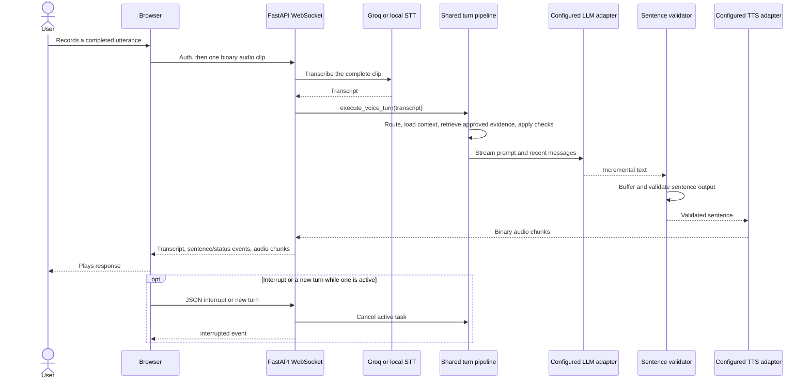

# Voice Pipeline

This describes the implemented WebSocket path in `disha_core/routers/voice.py` and `disha_core/voice.py`. It does not claim live telephony, continuous streaming transcription, specific latency, or clinical validation.

## Turn sequence

## WebSocket contract

The FastAPI application exposes `/voice` and `/ws/conversation`. The client authenticates using a bearer token in the connection or an initial JSON `{"type":"auth","token":"..."}` message. It can send a complete audio clip as a binary WebSocket message, JSON/base64 audio, text JSON, or an interrupt message. Audio turns are bounded by `MAX_VOICE_TURN_BYTES` (10 MiB in the current app). Starting another turn cancels an active turn; the synthesizer also supports barge-in cancellation.

The implementation buffers a complete audio message before transcription. It is not an interim ASR stream, and the code does not establish client-side Silero VAD or 20 ms audio framing. Browser recording/playback behavior is implemented in the frontend and may have different details than earlier design proposals.

## Speech providers and privacy flags

### Transcription

- Normal mode posts a completed audio file to Groq Whisper. It requires `GROQ_HEALTH_DATA_PROCESSING_APPROVED=true` and a configured `GROQ_API_KEY`.
- `LOCAL_ONLY=true` requires a local endpoint from `LOCAL_STT_URL` (defaults to `http://127.0.0.1:8880/v1/audio/transcriptions`) and rejects non-local URLs.
- Transcription is subject to `VOICE_TRANSCRIBE_TIMEOUT`; failure returns a generic unavailable/timeout response.

### Synthesis

- Qwen3-TTS is selected by the configured engine/voice routing and uses `QWEN3_TTS_URL` (defaults to `http://localhost:8880/v1/audio/speech`). In non-local mode, its health-data processing authorization must be enabled.
- If Qwen3-TTS fails for a non-privacy error in non-local mode, the code may fall back to Edge-TTS, which is independently gated by `EDGE_TTS_HEALTH_DATA_PROCESSING_APPROVED=true`.
- `LOCAL_ONLY=true` restricts Qwen3-TTS to a local URL and disables Edge-TTS fallback.
- These are code paths and configuration gates, not evidence that a provider is configured, available, or approved for a particular deployment.
- **Current host check (2026-11-09):** the local Svara model generated WAV audio with the `mlx_audio.tts.generate` CLI, but `/v1/audio/speech` on the MLX Audio server returned no audio and logged `RuntimeError: There is no Stream(gpu, 0) in current thread.` Repeating with MLX Audio 0.6.4 produced the same result. Local server-mode TTS and the full voice path therefore remain unverified; local-only mode does not silently fall back to cloud TTS.

## Shared response and persistence behavior

Voice text turns and transcribed audio turns call the same recommendation path as chat. That path can return early for emergency patterns, unsupported language, unavailable database/knowledge, missing prescribed-meal data, or exercise-safety checks. The output audio is generated from validated text; the WebSocket reports transcript and turn/interruption/error state. The audit queue receives the transcript and response metadata when a transcript exists.

## Verification limits

The repository includes voice unit tests with mocked provider boundaries. They do not prove provider egress authorization outside the tested configuration, real microphone permissions, real model quality, end-to-end latency, or clinical safety. See `disha_core/tests/test_voice_pipeline.py` and [Deployment](DEPLOYMENT.md).
