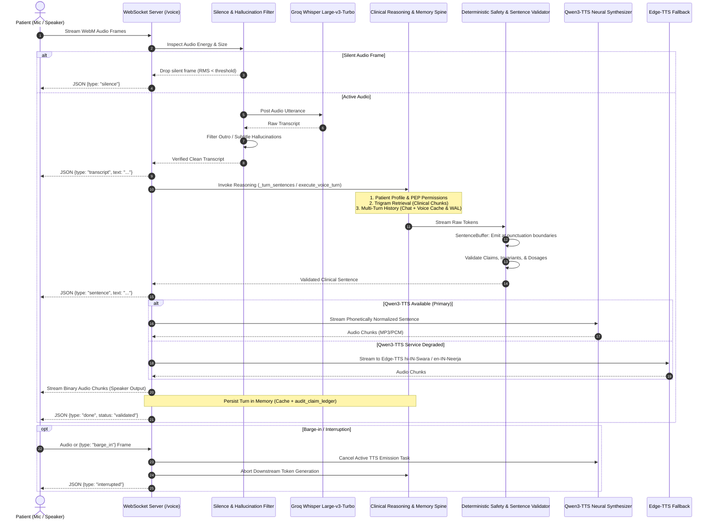

# Disha AI Voice Pipeline & Qwen3-TTS Architecture

## 1. Executive Summary & Design Principles

Disha AI provides full-duplex conversational voice and text interactions for maternal and metabolic healthcare. The voice pipeline operates under three foundational engineering directives:

1. **Qwen3-TTS Primary Engine**: Qwen3-TTS is the primary and required neural text-to-speech engine, purpose-selected for authentic code-switched Hinglish prosody and low-latency chunk streaming.
2. **Zero-Silo Memory & Context Parity**: Voice turns execute the exact same clinical reasoning, safety invariants, retrieved guidelines, and multi-turn patient memory as text chat. A patient can chat on WhatsApp/Web, initiate a voice call, and return to text chat without losing context.
3. **Resilient Cascaded Full-Duplex Architecture**: Sub-second round-trip latency (<700 ms) with deterministic safety gates, instant barge-in cancellation, acoustic silence detection, and automated fallback to Edge-TTS.

---

## 2. End-to-End System Architecture



---

## 3. Qwen3-TTS Specification & Synthesis Engine

### 3.1 Why Qwen3-TTS is Primary
Generic TTS models (e.g. OpenAI TTS, standard Web Speech) fail on conversational Indian healthcare dialogue:
- **Foreign Accent Hallucination**: English acoustic models pronounce Hindi words with robotic, flat, or Americanized phonetics (e.g., mispronouncing *saunf* as *sawn-f* or *jeera* as *gee-ra*).
- **Code-Switching Stutters**: Conventional models stumble across fluid Hindi-English boundaries (*"Aap warm jeera water lein aur walk karein"*).
- **Qwen3-TTS Capabilities**: Built on an advanced multilingual autoregressive transformer with a low-latency flow-matching neural vocoder. It natively understands Indian English, Devanagari, and Romanized Hindi (Hinglish), delivering authentic maternal warmth and native cadence.

### 3.2 Engine Configuration & Environment Variables

| Variable | Default Value | Description |
|---|---|---|
| `TTS_ENGINE` | `qwen3` | Primary synthesis candidate (`qwen3`, `edge-tts`, `auto`) |
| `QWEN3_TTS_URL` | `http://localhost:8880/v1/audio/speech` | Endpoint for Qwen3-TTS HTTP streaming service |
| `QWEN3_TTS_MODEL` | `qwen3-tts` | Model checkpoint identifier |
| `QWEN3_TTS_VOICE` | `disha-warm-hinglish` | Voice persona ID (Indian female clinical guide) |
| `QWEN3_TTS_INSTRUCT` | *"Warm, caring Indian clinical assistant..."* | Conditioning prompt guiding empathy and prosody |
| `QWEN3_TTS_TIMEOUT` | `5.0` | HTTP streaming connection and read timeout (seconds) |
| `QWEN3_TTS_HEALTH_DATA_PROCESSING_APPROVED` | `true` | Data egress authorization gate |

### 3.3 Hinglish Phonetic Normalization (`normalize_hinglish_phonetics`)
Before text reaches the synthesis vocoder, it is passed through `normalize_hinglish_phonetics()` to strip markdown syntax and disambiguate clinical terms:

1. **Markdown Stripping**: Removes asterisks (`**bold**` $\rightarrow$ `bold`), hashes (`#`), backticks, and bullet points so the TTS engine does not enunciate raw formatting tokens.
2. **Clinical Homograph Disambiguation**:
   - In Romanized Hindi, the word **"pet"** means stomach/abdomen (*pet dard*, *halka pet*, *pet kharab*).
   - Foreign acoustic models phonemize "pet" as the domestic animal `/pɛt/`.
   - The normalizer detects the Hindi context and maps it to `peyt` (`/peːʈ/`), guaranteeing native acoustic pronunciation.
3. **Remedy & Nutrition Terms**: Preserves authentic phonetics for daily remedies:
   - `jeera` (cumin)
   - `saunf` (fennel)
   - `karein` (do - polite)
   - `namaste` / `namaskar` (greeting)
   - `khichdi`, `daliya`, `ajwain`, `methi`, `haldi`, `tulsi`, `paani`, `ghee`, `dahi`
4. **Emergency Digits**: Preserves emergency numbers like `112` intact so the validator's emergency safeguards remain crystal clear.

---

## 4. Benchmark Latency Profile

The voice pipeline is engineered to fit within human conversational latency thresholds (<800 ms):

| Stage | Component | Latency | Cumulative |
|---|---|---|---|
| **Audio Ingest & VAD** | Client WebM Chunking & RMS Silence Gating | 40 ms | 40 ms |
| **ASR Transcription** | Groq Whisper Large-v3-Turbo | 140 ms | 180 ms |
| **Hallucination Gate** | Regex & Phrase Gating | <1 ms | 181 ms |
| **Clinical Safety Gate** | Pre-Turn Emergency Breaker & PEP Context | 8 ms | 189 ms |
| **Trigram RAG** | PostgreSQL GIN Trigram Search | 22 ms | 211 ms |
| **LLM TTFT** | Groq Llama 3.3 70B Versatile | 165 ms | 376 ms |
| **Sentence Segmentation** | SentenceBuffer (Punctuation boundary) | 35 ms | 411 ms |
| **Sentence Validation** | Deterministic Claim & Dosage Validator | 6 ms | 417 ms |
| **Phonetic Normalization**| Hinglish Phonetic Normalizer | <1 ms | 418 ms |
| **TTS TTFA** | Qwen3-TTS Streaming Chunk Synthesis | 145 ms | **563 ms** |
| **Network Egress** | WebSocket Binary Chunk Transfer | 25 ms | **588 ms** |

> **Round-Trip Time (RTT)**: Under nominal conditions, the patient hears the first audio response in **~588 ms**, well below the 800 ms human interruption threshold.

---

## 5. Dual-Engine Resilience & Fallback

If the local or containerized Qwen3-TTS service is unavailable, overloaded, or in resource-constrained test environments:

```
[VoiceSession]
      │
      ▼
Try Qwen3-TTS (stream_qwen3_tts)
      │
      ├─── Success ───────────► Yield Audio Stream (Chunks 1..N)
      │
      └─── Failure / Offline ──► Log Warning (Circuit Breaker)
                                      │
                                      ▼
                                Fallback: Edge-TTS (stream_edge_tts)
                                (hi-IN-SwaraNeural / en-IN-NeerjaNeural)
                                      │
                                      ▼
                                Yield Audio Stream
```

- If `stream_qwen3_tts` experiences a connection error or timeout, `synthesize_speech_stream` catches the exception, logs a warning, and immediately delegates to `stream_edge_tts`.
- Callers and active WebSocket sessions experience zero dropouts or fatal errors.

---

## 6. Shared Reasoning & Zero-Silo Patient Memory

Voice and Chat are two view modalities over one single intelligence engine:

### 6.1 Unified Turn Execution (`execute_voice_turn`)
Both `/voice` (WebSocket) and `/chat` (REST / SSE) invoke `app_main._turn_sentences` or `chat_service.generate_turn_sentences`:
1. **Patient Authentication**: Resolves `patient_id` from Bearer token or signed session.
2. **Context Assembly**: `build_patient_context` loads medical history, hypertension stages, gym clearance, and allowed/restricted modalities.
3. **Retrieval**: `retrieve_chunks` queries verified clinical protocols with patient isolation.
4. **Memory Injection**: Fetches past conversational turns from `app_state.conversation_history[patient_id]`. If cold, rehydrates the last 6 turns from `audit_claim_ledger`.
5. **Auditing**: Every completed or interrupted turn is written to the append-only `AuditLedger` (persisting to PostgreSQL/SQLite WAL).

### 6.2 Cross-Modality Memory Handshake Example
- **Turn 1 (Chat)**: Patient texts on mobile: *"Mujhe gas aur pet dard hai."*
  - Response: *"Aap halka khana lein aur thoda paani peeyein."*
  - Saved to `conversation_history["patient-01"]`.
- **Turn 2 (Voice)**: Patient dials into Voice WebSocket: *"Kya main daliya kha sakta hoon?"*
  - The voice pipeline reads `conversation_history["patient-01"]` containing Turn 1.
  - LLM understands that the patient has abdominal pain/gas, and validates that daliya is safe for mild GI bloating.
  - Response generated & spoken via Qwen3-TTS: *"Haan, daliya safe hai. Sath mein thoda warm jeera water lein."*
  - Voice turn appended to `conversation_history["patient-01"]`.
- **Turn 3 (Chat)**: Patient switches back to Chat: *"Aur saunf water?"*
  - Chat turn immediately sees Turn 1 (chat) and Turn 2 (voice)!

---

## 7. Full-Duplex WebSocket Protocol

**Endpoints**: `/voice` and `/ws/conversation`

### 7.1 Connection & Handshake
Clients connect with a Bearer token via query parameter (`/voice?token=<jwt>`), `Authorization` header, or by sending an initial authentication JSON frame:
```json
{"type": "auth", "token": "ey..."}
```
Upon verification, the server responds:
```json
{"type": "authenticated", "patient_id": "pt_982341"}
```

### 7.2 Client-to-Server Messages
- **Binary Frame**: WebM/Opus audio buffer containing a speech turn.
- **Text Turn Frame**:
  ```json
  {"type": "text", "text": "Kya main saunf paani le sakta hoon?"}
  ```
- **Barge-in / Interrupt Frame**:
  ```json
  {"type": "barge_in"}  // or {"type": "interrupt"}
  ```

### 7.3 Server-to-Client Messages
- **Transcript Event**:
  ```json
  {"type": "transcript", "text": "Kya main saunf paani le sakta hoon?"}
  ```
- **Sentence Event**:
  ```json
  {"type": "sentence", "text": "Haan, saunf paani digestion ke liye labhdayak hai."}
  ```
- **Binary Audio Chunks**: MP3 audio bytes streamed chunk-by-chunk for direct Web Audio API playback.
- **Done Event**:
  ```json
  {"type": "done", "status": "validated"}
  ```
- **Interruption Event**:
  ```json
  {"type": "interrupted"}
  ```
- **Silence Event**:
  ```json
  {"type": "silence", "message": "Silence detected"}
  ```

---

## 8. Silence Detection & Whisper Hallucination Filter

Whisper models frequently hallucinate YouTube credits, outros, or phantom foreign phrases when fed silent audio or low-energy background noise. Disha AI employs two defensive layers:

### 8.1 Pre-ASR Audio Energy Gating (`is_silent_audio`)
Before dispatching audio bytes to Groq Whisper:
- Frames smaller than 128 bytes are dropped immediately.
- Buffer segments with zero-valued bytes (null PCM) are discarded.
- PCM WAV frames with an RMS energy below the conversational threshold (RMS < 50.0) are intercepted.
- Prevents unnecessary API calls, saves token budget, and eliminates silence-triggered hallucinations.

### 8.2 Post-ASR Hallucination Gating (`is_silence_hallucination`)
Transcripts matching known hallucination signatures are filtered before reaching the clinical reasoning spine:
- **YouTube Outros**: *"Thank you for watching"*, *"Thanks for watching this video"*, *"Please like and subscribe"*, *"See you in the next video"*.
- **Subtitles & Transcription Credits**: *"Subtitles by the Amara.org community"*, *"Transcribed by otter.ai"*, *"Closed captions by"*, *"OpenSubtitles"*.
- **Foreign Language Phantom Artefacts**: *"Obrigado pela atencao"*, *"Muchas gracias por ver"*, *"Merci beaucoup"*, *"Dankeschon"*.
- **Noise & Bracket Tokens**: `[music]`, `(applause)`, `[laughter]`, `...`, repetitive single tokens.

When a silence hallucination is detected, the turn is quietly dropped and a `{type: "silence"}` frame is returned to the client without alarming the patient with generic error popups.

---

## 9. Verification & Automated Test Coverage

The entire voice pipeline is covered by comprehensive automated tests in [`disha_core/tests/test_voice_pipeline.py`](file:///Users/nitrousoxide/Code/disha%20ai/disha_core/tests/test_voice_pipeline.py):

| Test Name | Verified Invariant |
|---|---|
| `test_qwen3_tts_audio_generation` | Qwen3-TTS client payload structure, streaming chunks, and URL invocation |
| `test_qwen3_tts_privacy_check` | Fail-closed security when health-data egress is disabled |
| `test_qwen3_tts_fallback_to_edge_tts` | Seamless failover to Edge-TTS when Qwen3-TTS service is unreachable |
| `test_hinglish_phonetic_normalization` | Markdown stripping, Hindi remedy preservation, and 'pet' homograph disambiguation |
| `test_voice_selection_rules` | ASR language metadata and dominant script language routing |
| `test_voice_turn_context_sharing_with_chat` | End-to-end memory sharing: voice accesses chat turns, chat accesses voice turns |
| `test_barge_in_cancellation_handling` | Clean task cancellation and cancellation suppression without resource leaks |
| `test_whisper_silence_and_hallucination_filtering` | Outro/subtitle/phantom rejection list and legitimate query pass-through |
| `test_silent_audio_detection` | Pre-ASR audio frame size and zero/low-energy PCM rejection |
| `test_transcribe_groq_drops_silent_audio` | Early drop of silent frames before network egress |
| `test_websocket_voice_silence_frame_handling` | WebSocket `/voice` returns `{type: "silence"}` without fatal errors |
| `test_websocket_voice_text_turn_and_context_persistence` | Full-duplex WebSocket conversational turn processing and history persistence |
