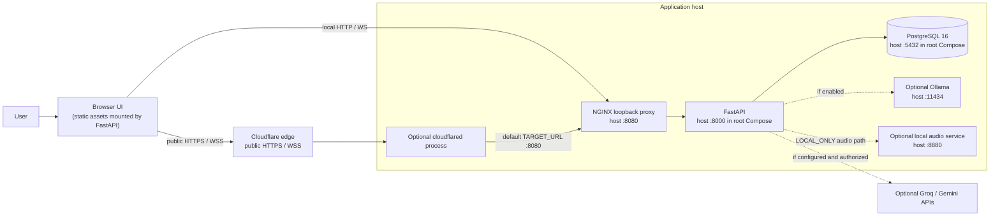

# 01. Runtime System Context

In the root Compose setup, NGINX forwards requests to FastAPI; FastAPI mounts the browser assets and owns the API/WebSocket routes. Cloudflare is an optional ingress path, not an application host or model service. The actual host mappings and the separate `disha_core/compose.yaml` stack are documented in [Deployment](../DEPLOYMENT.md).

The backend has no direct emergency-services integration. A triggered pattern can return a prepared response telling the user to contact emergency services.

Health guidance uses approved PostgreSQL records and lexical full-text/trigram retrieval. User records, prescribed meals, and general health knowledge are separate sources. The active runtime does not use embeddings or pgvector; see [RAG ingestion and retrieval](04_rag_ingestion_and_retrieval.md).
