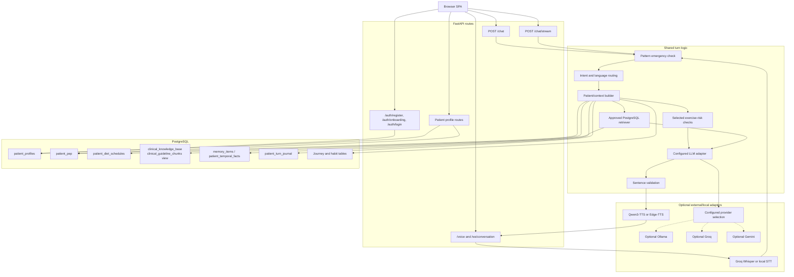

# 02. Runtime Components and Ports

The diagram is a component map, not a promise that every adapter is enabled. Provider choice and fallback remain owned by `disha_core.llm.client.DualProviderClient` and its environment settings. The chat and voice interfaces return metadata such as validation/retrieval status; knowledge chunk IDs do not prove claim-level entailment.

## Route notes

- `/chat` returns JSON and `/chat/stream` returns sentence SSE events.
- `/voice` and `/ws/conversation` are authenticated WebSockets; the implementation accepts whole audio clips, JSON text, or interrupt messages.
- Registration is exposed at both `/auth/register` and `/auth/onboarding`; login is `/auth/login`.
- Normal patient routes resolve identity from bearer credentials. Do not treat a patient identifier in a request payload as authentication.
- A pattern emergency response can be returned before normal chat authentication; it is not an emergency dispatch integration.
