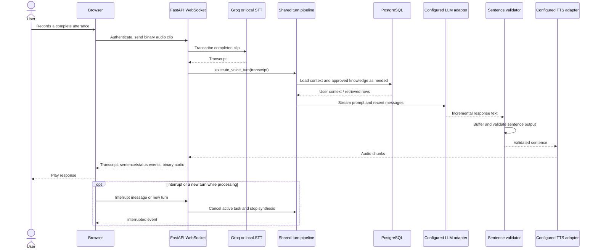

# 03. Voice Turn Sequence

Audio transcription operates on a completed WebSocket message, not interim microphone frames. In normal mode Groq STT requires the explicit processing flag and key; `LOCAL_ONLY` requires a local STT endpoint. Output synthesis uses configured Qwen3-TTS/Edge-TTS paths with independent egress checks. See [Voice Pipeline](../VOICE_PIPELINE.md) for message contract and provider limits.
