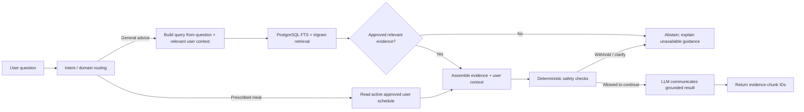

# Knowledge, user context, and recommendation flow

This describes the active chat/voice recommendation path. It supersedes earlier descriptions of pgvector, embedding-based search, semantic chunking, and reciprocal-rank fusion: those are not used by the current runtime retriever.

## Sources of truth

| Information | Runtime source |
|---|---|
| General food, nutrition, recipe, substitution, exercise, and lifestyle knowledge | Approved records in `clinical_knowledge_base`, exposed through `clinical_guideline_chunks` |
| User's prescribed breakfast/lunch/dinner | The user's active, approved `patient_diet_schedules` row for the requested day and meal |
| Preferences, dislikes, conditions, symptoms, limitations, and goals | User profile, `patient_pep`, and persisted user facts |
| Safety and eligibility decisions | Deterministic backend checks; the LLM is not the safety authority |
| Natural-language response | LLM, supplied with retrieved evidence and user context |

A prescribed meal is not general nutrition knowledge. If there is no active approved meal-plan row, the system must not invent a prescribed meal or substitute a generic one.

## Runtime journey

Chat and voice share the turn pipeline in `disha_core.main._turn_sentences`. Meal and exercise questions are retrieved even when the intent router initially classifies them as general coaching. Query terms include relevant persisted preferences and health context. A request for a prescribed meal takes the separate schedule lookup path.

## Retrieval details

- `disha_core.engine.retriever.RETRIEVE_SQL` queries `clinical_guideline_chunks`, which exposes the general knowledge records.
- The SQL restricts results to `approval_status = 'approved'`, then scores trigger-term trigram similarity and PostgreSQL text-search rank. It selects a bounded candidate set, applies the runtime thresholds, and deduplicates results.
- This is lexical retrieval; it does not calculate embeddings, cosine similarity, or RRF.
- Retrieval caching is disabled by default so an approved knowledgebase edit can affect the next turn without a code change.
- Only retrieved approved chunks are placed in the health-knowledge prompt context. Chat JSON, SSE `done`, and voice `done` metadata expose `evidence_ids` and `retrieval_status`; the frontend retains and displays these raw IDs/status alongside the assistant response. Source citation text is included in prompt chunks but is not currently returned to clients. Prescribed schedule text comes from the user's saved record and is not represented as a knowledge chunk.
- When a request requires grounding and no suitable chunk is returned, the turn abstains rather than asking the LLM to supply general health content from its pretrained knowledge.

## Ingestion and approval

The ingestion scripts and bundled SQL seeds now insert health knowledge as `draft`; they do not establish human approval. Migration `0007_quarantine_unreviewed_knowledge` demotes rows bearing known placeholder reviewer IDs. A record is usable for coaching only after its status is `approved`.

The current repository does not provide evidence of an authenticated clinical review workflow, reviewer identity verification, or validation of the live corpus. Do not treat source names, seed comments, dataset labels, or a populated database as proof that content is clinically reviewed. Live database contents and approval provenance must be audited separately before production use.

## Safety and known limitations

- Retrieved evidence is not, by itself, proof that an exercise or food choice is suitable for a particular user. User-reported restrictions are preserved; recognized exercise risks and missing essential safety context can cause withholding or clarification.
- Exercise safety checks do not select routines or alternatives. The former static exercise catalogue and canned alternatives were removed; `disha_core/pep/exercise_engine.py` remains only as a compatibility re-export of fail-closed helpers in `disha_core/pep/exercise_safety.py`.
- The application has no verified structured recipe or food-composition service for constructing full meals or calculating precise nutrient/calorie totals. It should not promise those capabilities.
- The current validator applies safety/rule checks but does not establish semantic entailment of every generated claim from its cited chunks. Chunk IDs prove which records were supplied, not that every sentence is supported.
- If approval integrity, relevance, patient-specific suitability, or claim-level grounding cannot be established, the safe behavior is to withhold, clarify, or refer the user to an appropriate professional—not to use hidden static recommendations.

## Regression coverage

`disha_core/tests/test_recommendation_grounding.py` exercises the shared turn path with controlled database and model boundaries for knowledge edits, missing evidence, separate user preferences, changed prescribed meals, pending meal rejection, evidence IDs, known exercise risks, and response metadata. Focused backend and frontend tests cover response serialization and retention through chat JSON, SSE, and voice. These tests demonstrate pipeline wiring; they do not validate the live database, an external LLM's semantic faithfulness, clinical efficacy, or deployment behavior.
