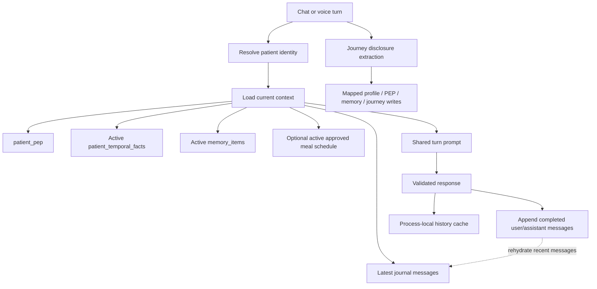

# 05. Onboarding and Conversation Context

## Account and journey data

- Registration at `/auth/register` or `/auth/onboarding` writes account/profile fields, a hash of the bearer token, and selected PEP fields. The service stores supplied conditions/goals as user-provided data; it does not establish clinician verification.
- The request model accepts some safety-related values that registration does not currently copy to PEP safety columns. For implementation details see [Memory and PEP](../MEMORY_AND_PEP.md).
- During turns, `disha_core.journey` extracts disclosures and maps them to configured profile, PEP, memory, temporal-fact, or habit/episode destinations and tracks journey questions/state. These are application-level mappings, not proof of a clinician-only write gate.

## Short-term context behavior

- The context builder reads up to eight most recent messages from `patient_turn_journal`.
- The prompt path uses at most eight history messages. The process-local cache is keyed by patient and retains up to sixteen messages (up to eight user/assistant pairs).
- Completed generated turns are saved to the PostgreSQL journal. A process restart loses the cache but can rehydrate a recent window from the database.
- The shared turn currently uses the default session unless a caller passes a session/call ID. Do not assume chat and voice have isolated histories.
- The journal is not schema-enforced as immutable and no retention policy is documented here.

The memory and journey schema is broader than the context loaded into a single prompt. Table existence does not imply that every value is used, current, clinically reviewed, or proven.
