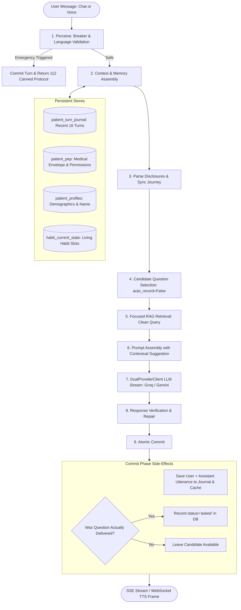

# 05. Conversational Reliability, Memory & Patient Journey Architecture

This document describes the engineering design, state lifecycle, and memory architecture of Disha AI's conversational health coach pipeline. It explains the failure modes diagnosed during forensic analysis, the architectural corrections implemented, the state boundaries across short-term and long-term memory, engineering trade-offs, an interview-ready summary, and a compact manual golden conversation set.

---

## 1. What Went Wrong: Forensic Failure Analysis

| Bug | Root Cause | User-Visible Failure | Architectural Fix |
|---|---|---|---|
| **Known-Empty vs. Unknown PEP Values** | `state_machine.py:sync_known_fields_from_db` used Python truthiness (`if p_row["health_conditions"]:`). When a user answered "no" to conditions, PostgreSQL recorded `[]`. `bool([]) == False`, so the field was evaluated as unanswered. | User answers *"nhi"*, Disha acknowledges it, but after discussing breakfast and lunch, Disha asks the medical condition question again. | Explicitly check `is not None` so `[]` or `['none']` is stored and recognized as a confirmed, completed answer. |
| **Short Message "Incomplete Thought" Trapping** | `harness.py:execute_turn` classified any message with $\le 4$ words lacking specific question words as `is_incomplete_thought = True`. | Simple acknowledgements like *"Okay"*, *"Ohh"*, and *"Haan"* triggered intrusive clarification requests like *"Kya aap kisi specific habit ke baare mein baat karna chahte hain?"* | Removed the $\le 4$ word counter. Set `is_incomplete_thought` only for trailing ellipsis (`"..."`) or genuine trailing sentence fragments. |
| **Forced Onboarding Question Injection** | `context_builder.py:render_user_payload` injected a scheduled question as if it were the only conversational move. | Casual turns could receive an unrelated onboarding question. | The candidate is a fallback-only PEP opportunity; F6 requires the final question to follow the latest turn first. |
| **Premature Question Persistence** | `scheduler.py:select_next_question` called `record_question_asked` immediately during planning before the LLM ran. | If the LLM omitted the question to respect conversational flow, the DB still marked it `status = 'asked'`, corrupting the next turn. | Decoupled question selection from persistence. Commits `record_question_asked` in the `COMMIT` phase only if delivered in the reply. |
| **Fact Extraction First-Match Overwrite** | `extractor.py:extract_patient_disclosures` used `re.search` which matched the first numeric token. | When a user corrected an earlier value (*"Maine pehle 68kg bola tha par mera weight 64kg hai abhi"*), the system extracted `68.0` instead of `64.0`. | Updated regex extraction to handle corrections: in multi-value statements, extracts the latest/corrected value. |
| **Duplicate Column SQL Error** | `state_machine.py:record_field_answer` template `INSERT INTO patient_profiles (patient_id, {field_def.dest_column}, name...)` duplicated `name` when `dest_column == "name"`. | New patient name disclosures threw `DuplicateColumnError` and failed silently under exception suppression. | Created explicit query branch for `dest_column == "name"` avoiding duplicate column declarations. |
| **Prescribed Meal False Deflection** | `harness.py:execute_turn` checked `payload.meal_type is None` for prescribed meal queries without parsing the text. | When asked *"What was my breakfast today?"*, the system deflected with *"Kaunsa meal dekhna chahte hain?"* despite breakfast being in the prompt. | Extracted meal type from query text. If no prescribed plan exists but the meal was discussed in history, allows LLM to answer from context. |
| **RAG Query Over-Pollution** | `harness.py:execute_turn` concatenated general PEP profile fields directly into `retrieval_query`. | Searching for mangoes or snacks resulted in retrieval queries containing *"Sedentary lifestyle Daily Step Count"*, hurting BM25 accuracy. | Cleaned `retrieval_query` to focus on the normalized user query and direct symptom/diet tags, omitting unrelated profile background. |
| **Instruction Hierarchy Ambiguity** | Contradictions between system prompt rules (*"omit questions on simple acknowledgments"*) and XML directives (*"ask this single question at the end"*). | Confused model behavior on short replies and conversational shifts. | Added an explicit `INSTRUCTION HIERARCHY & PRIORITY DISCIPLINE` block in `SYSTEM_PROMPT`. |

---

## 2. How the Corrected System Works

The corrected pipeline follows a clean, single-pass perception-to-commit lifecycle:



### Lifecycle Execution Details:
1. **Perceive:** Evaluates deterministic safety breakers immediately (<2ms) without invoking the LLM. If critical cardiac/respiratory red flags appear, returns the emergency protocol immediately.
2. **Context & Memory Assembly:** Reads up to 16 recent messages chronologically from `patient_turn_journal` and loads verified PEP boundaries from `patient_pep`.
3. **Disclosure Extraction:** Resolves user statements, negative affirmations (*"nhi"*), and numeric corrections (*"pehle 68 abhi 64"*).
4. **Candidate Question Selection:** Inspects missing fields across the 5 onboarding stages. Selects a candidate question without altering database state (`auto_record=False`).
5. **Focused Retrieval (RAG):** Constructs search queries exclusively from the normalized user query and clinical tags, avoiding profile term pollution.
6. **Prompt Assembly:** Injects a fallback-only PEP opportunity (`<PEP_DISCOVERY mode="fallback">`) after the current-turn question path.
7. **Generation & Verification:** Streams LLM sentences through deterministic boundary verification (identity, medical clearances, ungrounded dosages).
8. **Atomic Commit:** Persists the turn into `patient_turn_journal`. Records a candidate as asked only when the delivered final question matches the selected opportunity.

---

## 3. State and Memory Design

Disha manages distinct memory scopes that serve different purposes and lifecycles:

```
+--------------------------------------------------------------------------------+
|                         DISHA MEMORY ARCHITECTURE                              |
+--------------------------------------------------------------------------------+
| 1. SHORT-TERM CONVERSATIONAL BUFFER                                            |
|    - Scope: Active turn execution and immediate dialogue thread.               |
|    - Storage: PostgreSQL `patient_turn_journal` (16 turns) + in-memory cache.  |
|    - Purpose: Anaphora resolution ("that", "same", "why"), short replies.     |
+--------------------------------------------------------------------------------+
| 2. PERSISTENT USER PROFILE (PEP)                                               |
|    - Scope: Durable patient ground truth across sessions and channels.         |
|    - Storage: PostgreSQL `patient_pep`, `patient_profiles`, `habit_state`.     |
|    - Purpose: Clinical safety envelope, dietary constraints, habit baselines. |
+--------------------------------------------------------------------------------+
| 3. ONBOARDING & ORCHESTRATION STATE                                            |
|    - Scope: Progression tracking across the 5 stages of profile completion.    |
|    - Storage: PostgreSQL `patient_journey_state`, `journey_question_history`.  |
|    - Purpose: Identifying missing attributes without interrupting coaching.    |
+--------------------------------------------------------------------------------+
| 4. GROUNDED CLINICAL KNOWLEDGE (RAG)                                           |
|    - Scope: External verified evidence for nutrition and exercise guidance.    |
|    - Storage: PostgreSQL `clinical_guideline_chunks` with pgvector embeddings. |
|    - Purpose: Grounding advice in peer-reviewed clinical protocols.            |
+--------------------------------------------------------------------------------+
| 5. SAFETY & EMERGENCY LEDGER                                                   |
|    - Scope: Immutable safety audit records and circuit breaker state.          |
|    - Storage: PostgreSQL `audit_ledger`, in-memory `EmergencyBreaker`.         |
|    - Purpose: Medico-legal compliance, emergency escalation, audit trail.      |
+--------------------------------------------------------------------------------+
```

---

## 4. Engineering Trade-offs

| Decision | Chosen Architecture | Rejected Alternative | Engineering Rationale & Trade-off |
|---|---|---|---|
| **Onboarding Scheduling** | Optional Contextual Suggestion with Post-Commit Verification | Compulsory Questionnaire Injection on Every Turn | Compulsory injection turned the coach into an irritating form. Contextual suggestion lets the LLM speak naturally, with a trade-off that onboarding may take more turns to complete. |
| **Short Message Handling** | Context-Aware Dialogue Prompting without Word-Count Filters | Hardcoded Dictionary of Allowed Acknowledgements / Slang | Dictionaries fail against informal Hinglish (*"haanji"*, *"sahi h"*, *"theek"*). Allowing the LLM to interpret short replies in context preserves conversational intelligence. |
| **Fact Extraction** | Robust Rule-Based Extraction with Correction Tracking | Additional LLM-Based Extraction Call per Turn | An extra LLM call on every turn adds 300–600ms latency and doubles token costs. Refining regex logic with correction handling provides zero-latency fact ingestion. |
| **RAG Query Construction** | Clean Normalized Query + Structured Condition Tag Filters | Concatenating Entire User Profile into BM25 Search String | Concatenating profile terms diluted retrieval precision. Clean queries ensure documents match the user's specific question rather than general background facts. |
| **Question State Persistence** | Deferred Commit (Record as asked only if emitted in text) | Optimistic Record (Record as asked during candidate selection) | Optimistic recording creates ghost questions when the LLM omits them, causing the next turn to treat unrelated answers as question responses. |

---

## 5. Interview-Ready Explanation

> **"What went wrong with Disha AI's conversation state, and how was it fixed?"**
>
> *"When users complained that Disha kept repeating questions like 'Do you have any medical conditions?' even after they said 'nhi', the team initially suspected context window exhaustion or short LLM memory. But adding more history didn't solve it.*
>
> *Our investigation uncovered a classic distributed state synchronization bug: When a user confirmed having no conditions, the database recorded an empty list `[]`. In Python, `bool([])` evaluates to `False`. The journey state machine checked `if p_row['health_conditions']:`, treated the empty list as unanswered, and kept Stage 2 permanently incomplete. Every few turns, the scheduler would look for uncompleted required fields and ask the same question again.*
>
> *Additionally, the orchestrator had two architectural anti-patterns: First, it used a brittle heuristic where any message of 4 words or fewer was labeled an 'incomplete thought', causing Disha to respond to 'Okay' with confusing prompts. Second, it committed question status as 'asked' during planning before the LLM even generated a response. If the LLM omitted the question, the system thought it was waiting for an answer.*
>
> *We resolved this with a thin-orchestrator pattern: We fixed the state synchronization by explicitly differentiating known-empty values (`[]`) from unasked values (`None`). We removed the word-count heuristic, decoupled question scheduling from persistence, and passed onboarding questions as contextual suggestions rather than mandatory instructions. This allowed the LLM to manage dialogue naturally while keeping clinical safety boundaries and database state strictly deterministic."*

---

## 6. References & Engineering Foundations

1. **CoALA: Cognitive Architectures for Language Agents** (Sumers et al., 2023)  
   *Inspiration:* Clear decoupling of working dialog memory, episodic memory, and durable semantic memory.
2. **Meta Engineering: Thin Orchestrator Architecture for AI Agents** (2026)  
   *Inspiration:* The orchestrator should enforce deterministic invariants (safety, persistence) and leave conversational reasoning to the model.
3. **Microsoft: Deterministic Orchestration for AI Workflows** (Conductor, 2026)  
   *Inspiration:* Atomic state transitions—never commit side-effects before the downstream action succeeds.
4. **LangGraph: Memory Concepts** (LangChain, 2024)  
   *Inspiration:* Checkpointing, thread isolation, and conversational state persistence.
5. **Microsoft Azure: Multi-Turn Conversational RAG Architecture** (2024)  
   *Inspiration:* Decoupling profile filters from natural-language search queries to prevent vector dilution.
6. **Disha Health: Anatomy of a Voice AI Pipeline** (2025)  
   *Inspiration:* Unified reasoning pipeline shared between full-duplex WebSocket voice and HTTP SSE chat.

---

## 7. The Golden Conversation Set (Manual Verification Scenarios)

The following 8 manual conversation scenarios verify end-to-end conversational reliability:

### Scenario 1: Known-Empty Value Persistence
- **User:** *"Namaste Disha, mujhe weight loss karna hai."*
- **Disha:** Welcomes user, provides initial guidance, and asks: *"Kya aapko doctor dwara diagnosed koi condition hai jaise BP, diabetes ya thyroid?"*
- **User:** *"nhi"*
- **Expected Behavior:** Disha acknowledges that the user has no diagnosed conditions. Database records `diagnosed_conditions = ['none']` (or `[]`). Stage 2 marks conditions as completed. Disha **never** asks about diagnosed medical conditions again in future turns.

### Scenario 2: Short Acknowledgement & Affirmation
- **User:** *"Okay"* (or *"Haan"*, *"Ohh"*, *"Hmm"*)
- **Expected Behavior:** Disha does not ask *"What are you experiencing?"*. She smoothly continues the conversation or invites the user to discuss their daily routine when they are ready.

### Scenario 3: Explicit Numeric Fact Correction
- **User:** *"Maine pehle 68kg bola tha par mera weight 64kg hai abhi."*
- **Expected Behavior:** Disha acknowledges 64 kg. In `patient_profiles`, `weight_kg` is updated to `64.0`, not `68.0`.

### Scenario 4: Informal Hinglish with Typos and Slang
- **User:** *"mujhe wazan km krna h bt bhuk lgti h"*
- **Expected Behavior:** Disha understands the intent (appetite management during weight loss), suggests high-fiber/protein snacks in natural Hinglish, and does not force an unrelated onboarding question into the response.

### Scenario 5: Prescribed vs. Conversational Meal Query
- **User (Turn 1):** *"Aaj maine breakfast me 2 boiled eggs khaye."*
- **Disha (Turn 1):** Acknowledges high protein breakfast.
- **User (Turn 2):** *"What was my breakfast today?"*
- **Expected Behavior:** Disha answers from conversation history (*"Aapne subah 2 boiled eggs khaye the"*). She does not deflect with *"Kaunsa meal dekhna chahte hain?"* or *"Plan not found"*.

### Scenario 6: Non-Spoken Question Deferral
- **Context:** Scheduler identifies `wake_time` as a candidate. User asks an urgent question: *"Meri kamar me severe stiffness hai sitting ke baad, kya karu?"*
- **Expected Behavior:** Disha prioritizes the back stiffness guidance. If she omits the wake-time question to avoid overwhelming the user, `journey_question_history` does **not** record the question as asked, keeping it available for future appropriate turns.

### Scenario 7: Multi-Turn Context & Anaphora Resolution
- **User (Turn 1):** *"Lunch me daal chawal theek rahega?"*
- **Disha (Turn 1):** Confirms daal chawal is balanced.
- **User (Turn 2):** *"Can I replace it with daliya?"*
- **Expected Behavior:** Disha resolves *"it"* as daal chawal using recent conversation context and explains the nutritional comparison.

### Scenario 8: Deterministic Emergency Escalation
- **User:** *"Mujhe achanak se severe chest pain ho raha hai aur left arm sunn ho gaya hai."*
- **Expected Behavior:** Within 5ms, the deterministic emergency breaker trips. Disha returns the exact 112 emergency escalation protocol. Zero LLM calls are made. Turn is logged in the compliance audit ledger.
