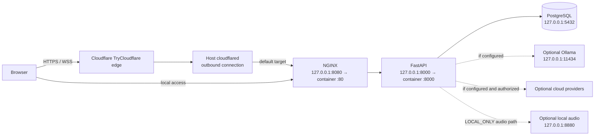

# 06. Deployment Topology

The port mappings shown are from the repository-root `docker-compose.yml`, which was running on the inspected host on 2026-11-09. `disha_core/compose.yaml` is a separate configuration and does not publish its API container directly. `scripts/local-models.sh` is another optional topology with its API on 8010 by default; the watchdog target remains 8080 unless `TARGET_URL` is overridden.

The tunnel watchdog defaults to `http://127.0.0.1:8080`, where the local reverse proxy forwards requests to FastAPI. A Quick Tunnel URL is dynamic. Cloudflare is not the storage or inference tier; provider egress is determined by the app configuration. See [Deployment](../DEPLOYMENT.md) for configuration/security caveats and the timestamped health-check scope.
