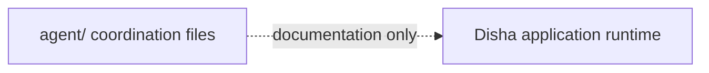

# 07. Repository Documentation and Agent Notes

The files under `agent/` are development coordination and handover artifacts, not runtime services in the Disha application. They do not participate in chat, voice, database, or tunnel request processing.

Use the repository's current files as the source for active work coordination. Historical notes can contain machine- or date-specific status and should not be treated as current deployment evidence. Runtime architecture is documented in [Current Runtime Architecture](../ARCHITECTURE.md); operational checks are in [Deployment](../DEPLOYMENT.md).
