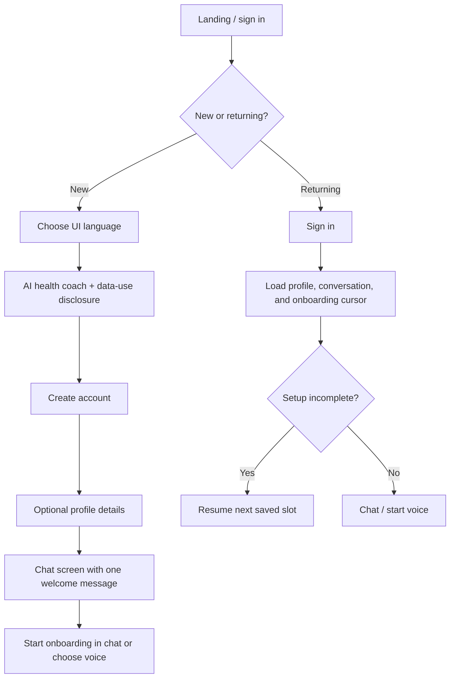
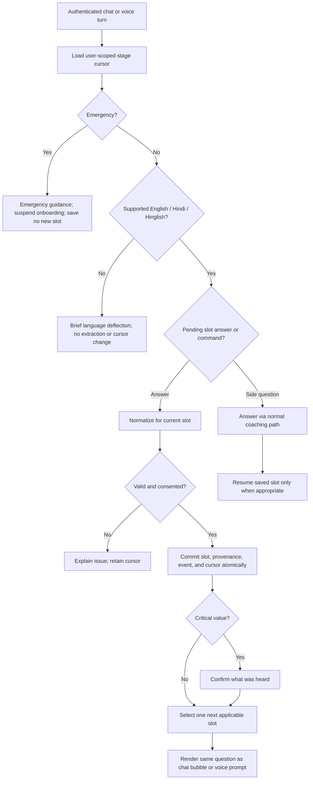
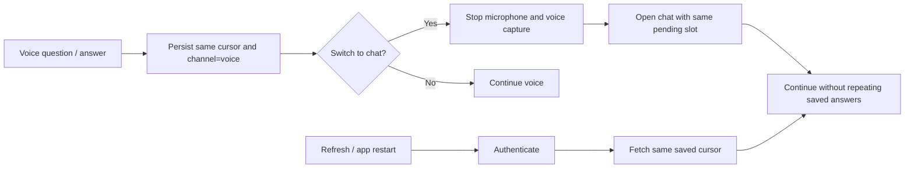
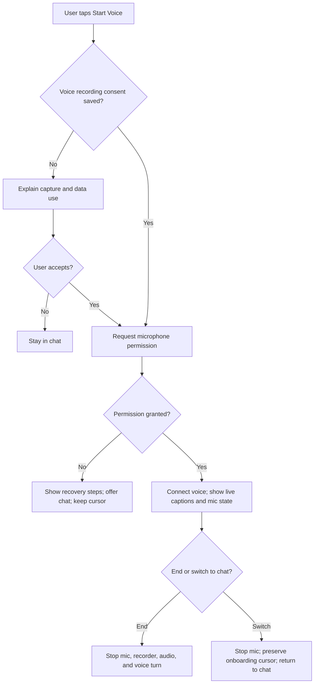
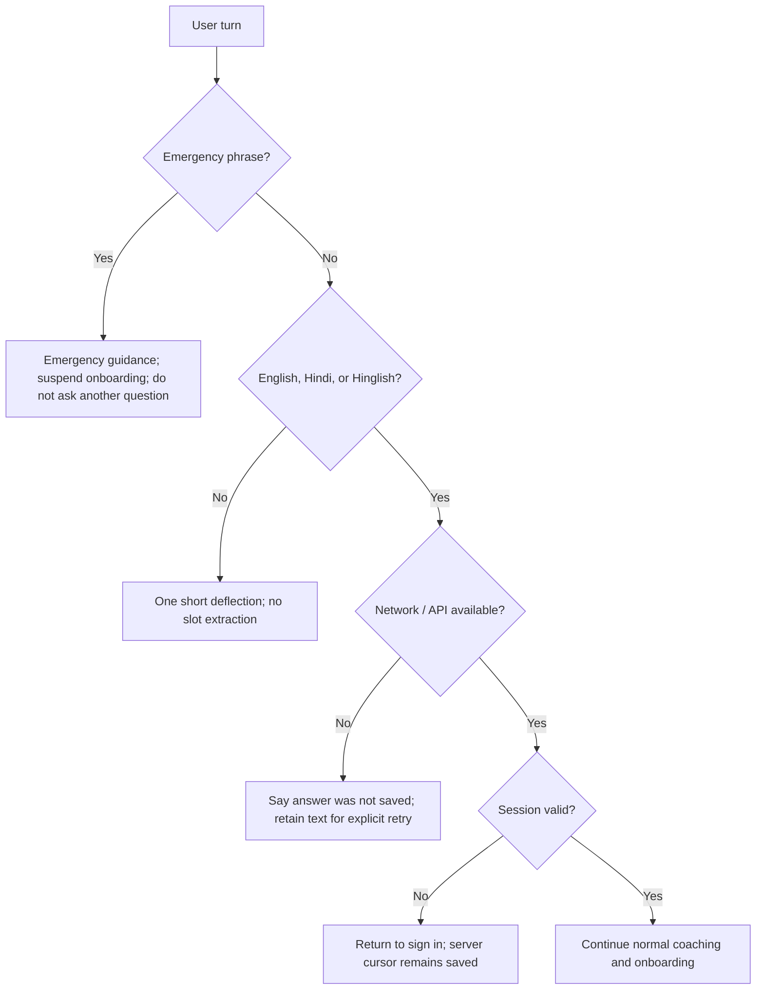
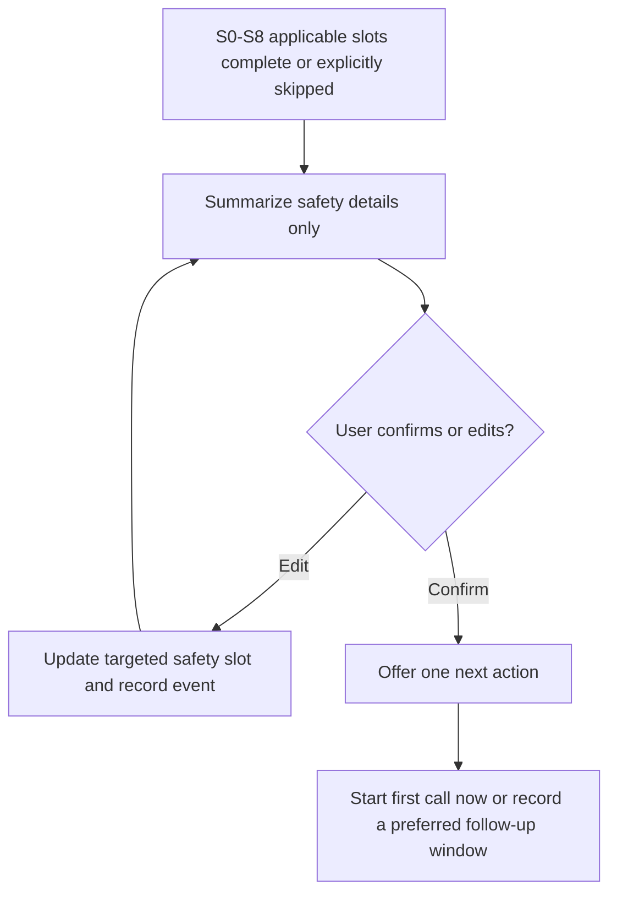

# User Flows

**Status:** As-built paths are marked **WORKING / PARTIAL / BROKEN** based on code review. Browser QA and runtime evidence are pending in `docs/design/DEFECTS.md`; current archived screenshots are not live-browser proof.

## First visit and account creation

**Current status:** Account registration and sign-in exist. Optionality, single welcome, profile/history hydration, and locale limits are being corrected. Disclosure and consent are incomplete; no real staged onboarding UI exists yet.

## Onboarding through chat or voice

**Current status:** Chat and voice share the backend turn path; basic extraction and scheduling exist. The targeted slot state machine, consent gate, atomic slot writes, explicit commands, and user-facing resume flow are not implemented. The intended deterministic flow above is not yet live.

## Channel switch and interruption

**Current status:** Backend journey tables persist state, but browser history and an explicit onboarding resume cursor are not hydrated. “To Chat” currently hides the call overlay without ending mic capture; this is a blocker for the redesigned flow.

## Call, consent, and mic denial

**Current status:** Voice capture, WebSocket, and audio playback exist. The consent dialog markup is absent, so the current guard does not prevent voice startup. Live captions are not wired. Permission error copy exists but end-to-chat lifecycle must be fixed.

## Emergency, unsupported language, offline, and expired session

**Current status:** Emergency checks precede normal chat processing. Existing language detection and session handling require browser/API verification. Offline answer retention and explicit retry are incomplete; no silent sensitive-data queue is intended.

## Completion and first follow-up

**Current status:** There is no verified outbound-call/reminder scheduler. Until one exists, the UI must call a follow-up window a user preference and must not claim an appointment, notification, or proactive call was scheduled.
