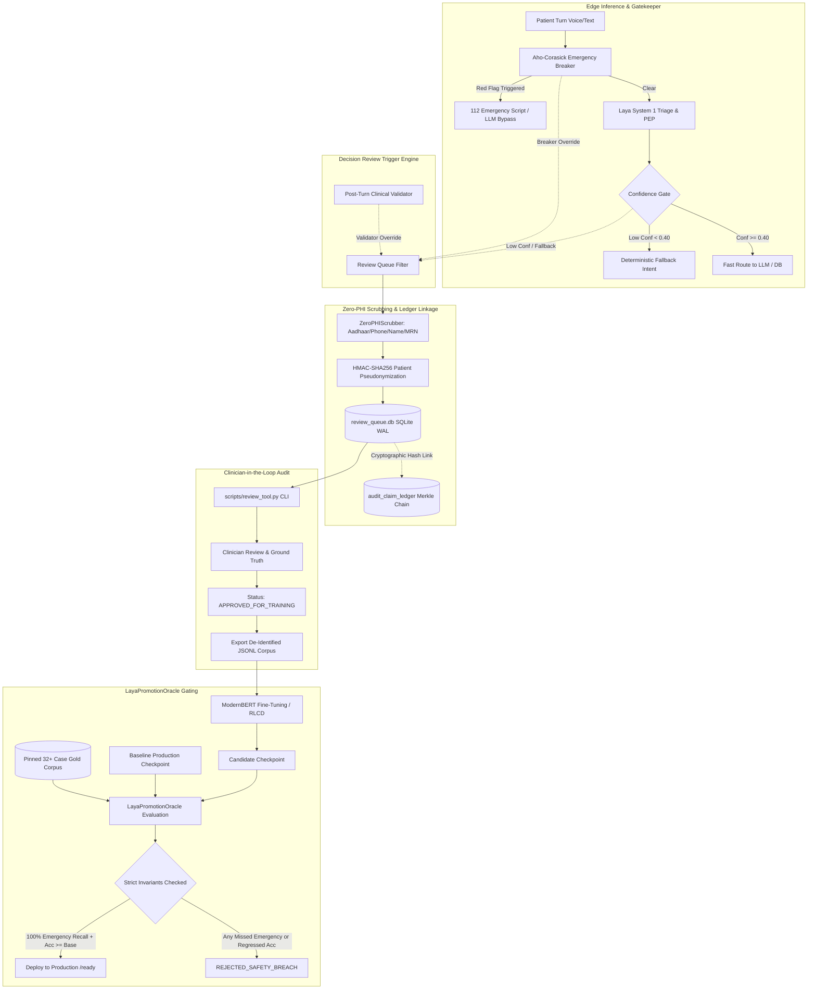
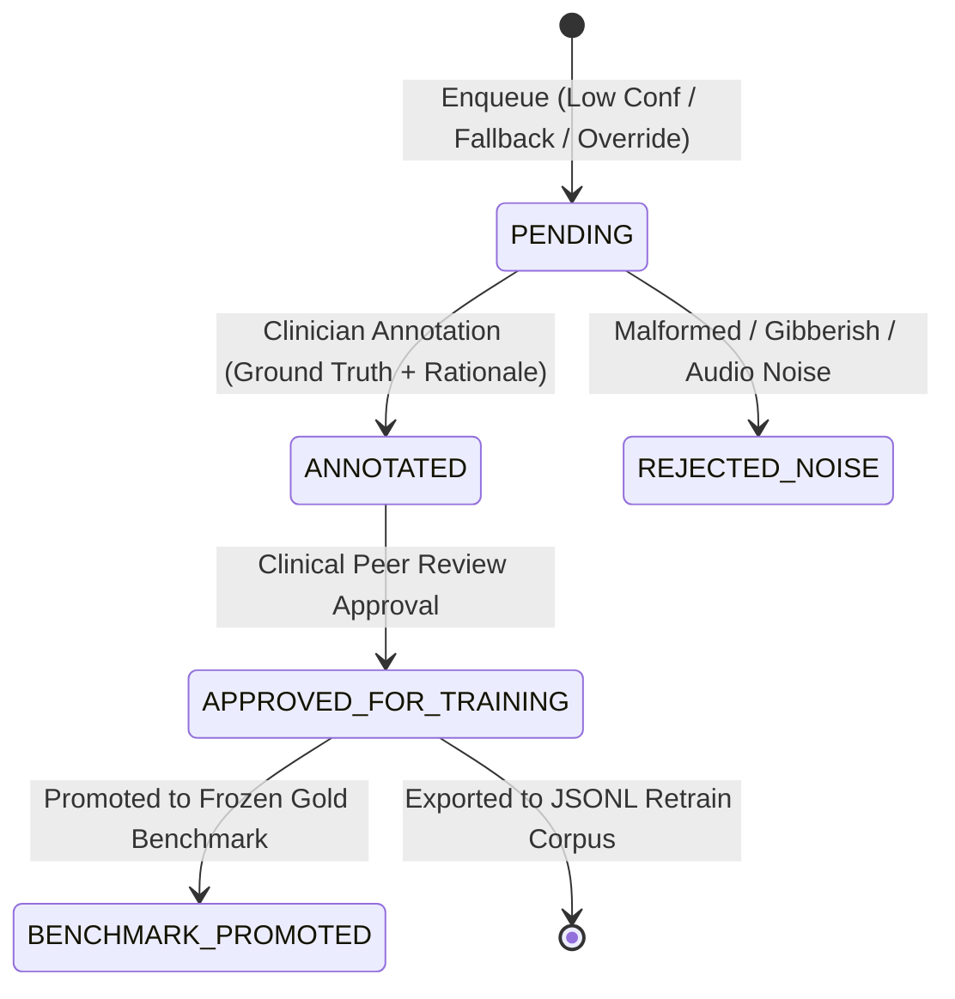

# Disha AI — Laya System 1 Self-Learning Architecture & Promotion Protocol

**Status:** Authoritative Engineering Architecture  
**Phase:** Phase 7 (Self-Healing & Self-Learning)  
**Lead:** Chief Knowledge Officer & Senior AI Systems Engineer (`librarian`)  
**Target Engine:** Laya Non-Autoregressive System 1 Classifier (`convaiinnovations/laya`)  
**Core Architectural Doctrine:** Thick Deterministic Spine, Thin Probabilistic Leaves  
**Date:** 2026-11-07  

---

## 1. Architectural Philosophy: The Deterministic Learning Loop

In clinical AI systems, unconstrained self-training is hazardous. Large language models and classifiers are **untrusted, probabilistic leaf nodes** prone to catastrophic forgetting, distribution drift, calibration collapse, and safety degradation.

Disha AI strictly enforces the **Thick Deterministic Spine vs. Thin Probabilistic Leaves** doctrine:
1. **The Model Never Certifies Itself:** A candidate model checkpoint cannot evaluate its own performance, certify its own safety, or promote itself to production.
2. **Deterministic Safety Gating:** Emergency triage, clinical stance constraints, and drug/sodium validations are anchored in deterministic state machines (Aho-Corasick automaton, Merkle hash chains, and rule validators) that wrap and constrain the ML model.
3. **Strict Zero-PHI Ingestion:** Telemetry and review data entering the continuous improvement pipeline are scrubbed of Protected Health Information (PHI) at the edge via deterministic clinical regex filters and HMAC-SHA256 patient pseudonymization.
4. **Frozen Benchmark Gating:** Checkpoint promotion requires beating or matching baseline checkpoints on an immutable, pinned gold evaluation set with **100.0% emergency recall** (zero false negatives on red flags), verified via Wilson score statistical confidence.



---

## 2. Review Queue Schema & Specifications

The Review Queue captures triage decisions that warrant expert clinical inspection without risking patient privacy.

### 2.1 Trigger Taxonomy

A turn is captured into the review queue if ANY of the following deterministic conditions occur:

| Trigger Type | Description | Threshold / Trigger Condition |
|---|---|---|
| `LOW_CONFIDENCE` | Model prediction falls below confidence safety threshold | `intent_confidence < 0.40` or intent entropy $> 1.2$ nats |
| `ABSTAINED_FALLBACK` | Classifier timed out, circuit breaker opened, or parser failed | Circuit breaker open, timeout $> 2.0$s, or malformed schema |
| `BREAKER_OVERRIDE` | Deterministic pre-turn breaker caught an acute emergency that ML classifier missed or ranked low | `breaker_triggered == True` while `model.emergency_triage == False` |
| `VALIDATOR_OVERRIDE` | Post-turn clinical validator rejected generation due to clinical safety violations | Sodium violation ($>2000$ mg), diagnosis claim, or banned remedy |
| `CLINICIAN_DISAGREEMENT` | Doctor manually flags an erroneous triage or physical exertion risk score | Human review feedback flag submitted via provider portal |
| `ADVERSARIAL_PROBE` | Blackbox adversary or red-team stress test payload detected | Adversarial test harness payload containing synthetic jailbreak |

### 2.2 Zero-PHI Sanitization Guarantee

Before persistence to `review_queue.db`:
1. **Patient Pseudonymization:** The raw `patient_id` is transformed into an irreversible, deterministic 16-character token using HMAC-SHA256 with an environment salt:
   $$\text{token} = \text{pt\_} + \text{HMAC-SHA256}(K_{\text{salt}}, \text{patient\_id})[0:16]$$
   The master salt ($K_{\text{salt}}$) is stored exclusively in secure key vaults and is never exported with review datasets.
2. **Deterministic Entity Scrubbing:** Clinical text passes through `ZeroPHIScrubber`, which strips:
   - **Phone Numbers:** Indian 10-digit formats with prefixes (`+91`, `0`, spaces, hyphens).
   - **Aadhaar Numbers:** 12-digit Indian national identity numbers.
   - **Email Addresses:** Standard RFC-5322 email patterns.
   - **MRN / UHID:** Hospital Medical Record Numbers and Universal Health IDs (`MRN-XXXXX`, `UHID-XXXXX`).
   - **Personal Introductions:** First/last name self-declarations (`My name is X`, `Mera naam X hai`, `Patient: X`).
3. **No Audio Retention:** Voice consultations store only the scrubbed transcript tokens. Raw WAV/PCM audio buffers are purged from memory immediately following STT decoding and are never persisted to the review queue.
4. **Merkle Ledger Provenance:** Every review item stores `audit_event_id` and `ledger_hash`, referencing the cryptographic SHA-256 block in `audit_claim_ledger` for mathematical auditability.

### 2.3 Formal JSON Schema (Pydantic v2 Compliant)

```json
{
  "$schema": "https://json-schema.org/draft/2020-12/schema",
  "title": "ReviewItem",
  "type": "object",
  "properties": {
    "review_id": {
      "type": "string",
      "format": "uuid",
      "description": "Unique identifier for this review queue entry."
    },
    "audit_event_id": {
      "type": "string",
      "format": "uuid",
      "description": "Foreign reference to audit_claim_ledger event_id."
    },
    "ledger_hash": {
      "type": "string",
      "description": "Cryptographic SHA-256 block hash from the Merkle audit chain."
    },
    "anonymized_patient_token": {
      "type": "string",
      "pattern": "^pt_[a-f0-9]{16}$",
      "description": "HMAC-SHA256 derived non-invertible patient token."
    },
    "timestamp_utc": {
      "type": "string",
      "format": "date-time",
      "description": "ISO 8601 UTC timestamp of decision capture."
    },
    "trigger_type": {
      "type": "string",
      "enum": [
        "LOW_CONFIDENCE",
        "ABSTAINED_FALLBACK",
        "BREAKER_OVERRIDE",
        "VALIDATOR_OVERRIDE",
        "CLINICIAN_DISAGREEMENT",
        "ADVERSARIAL_PROBE"
      ]
    },
    "scrubbed_input_text": {
      "type": "string",
      "description": "De-identified patient input text with all PHI redacted."
    },
    "model_checkpoint": {
      "type": "string",
      "description": "Identifier of the Laya model checkpoint active during inference."
    },
    "model_decision": {
      "type": "object",
      "required": ["predicted_intent", "intent_confidence", "emergency_triage_prob", "pep_risk_score", "latency_ms"],
      "properties": {
        "predicted_intent": { "type": "string" },
        "intent_confidence": { "type": "number", "minimum": 0.0, "maximum": 1.0 },
        "emergency_triage_prob": { "type": "number", "minimum": 0.0, "maximum": 1.0 },
        "pep_risk_score": { "type": "integer", "minimum": 0, "maximum": 2 },
        "latency_ms": { "type": "number", "minimum": 0.0 },
        "raw_answers": { "type": "object" }
      }
    },
    "trigger_context": {
      "type": "object",
      "properties": {
        "fallback_reason": { "type": ["string", "null"] },
        "override_source": { "type": ["string", "null"] },
        "pre_breaker_category": { "type": ["string", "null"] },
        "validator_violations": { "type": "array", "items": { "type": "string" } }
      }
    },
    "review_status": {
      "type": "string",
      "enum": [
        "PENDING",
        "ANNOTATED",
        "APPROVED_FOR_TRAINING",
        "REJECTED_NOISE",
        "BENCHMARK_PROMOTED"
      ],
      "default": "PENDING"
    },
    "clinician_annotation": {
      "type": ["object", "null"],
      "properties": {
        "reviewer_id": { "type": "string" },
        "ground_truth_intent": { "type": "string" },
        "ground_truth_emergency": { "type": "boolean" },
        "ground_truth_pep_risk": { "type": "integer", "minimum": 0, "maximum": 2 },
        "clinical_rationale": { "type": "string" },
        "annotated_at_utc": { "type": "string", "format": "date-time" },
        "signature": { "type": "string", "description": "HMAC-SHA256 signature of annotation fields." }
      }
    }
  },
  "required": [
    "review_id",
    "audit_event_id",
    "ledger_hash",
    "anonymized_patient_token",
    "timestamp_utc",
    "trigger_type",
    "scrubbed_input_text",
    "model_checkpoint",
    "model_decision",
    "trigger_context",
    "review_status"
  ]
}
```

---

## 3. Offline Review Tooling (`scripts/review_tool.py`)

The offline review tool provides a CLI and programmatic interface for clinicians, auditors, and ML engineers to inspect, annotate, and export review items.

### 3.1 Review Lifecycle State Machine



### 3.2 CLI Operational Commands

The review tool is implemented in `scripts/review_tool.py` and supports:

```bash
# 1. View summary statistics of review queue
.venv/bin/python scripts/review_tool.py stats

# 2. List pending items requiring clinical review
.venv/bin/python scripts/review_tool.py list --status PENDING --limit 20

# 3. Filter by trigger type (e.g. Breaker Overrides or Low Confidence)
.venv/bin/python scripts/review_tool.py list --trigger BREAKER_OVERRIDE

# 4. Deep-dive inspect a specific review item
.venv/bin/python scripts/review_tool.py show <review_uuid>

# 5. Clinician submits ground-truth annotation with rationale
.venv/bin/python scripts/review_tool.py annotate <review_uuid> \
  --reviewer-id dr_sharma_cardiologist \
  --intent emergency_escalation \
  --emergency \
  --pep-risk 2 \
  --rationale "Classic anginal radiation to left arm; high acute cardiac risk."

# 6. Approve annotated item for inclusion in retraining corpus
.venv/bin/python scripts/review_tool.py approve <review_uuid>

# 7. Export approved de-identified cases to training JSONL corpus
.venv/bin/python scripts/review_tool.py export --out data/corpora/retrain_laya_v2.jsonl
```

---

## 4. Model Retraining & Checkpoint Promotion Criteria

Promoting a newly trained Laya System 1 checkpoint to production is governed by the `LayaPromotionOracle` (`disha_core/classifier/retrain_oracle.py`). No human developer or autonomous agent may bypass this oracle.

### 4.1 Strict Invariants for Model Promotion

A candidate model checkpoint ($M_{\text{cand}}$) is approved for production deployment if and only if ALL five invariants are satisfied simultaneously against the baseline checkpoint ($M_{\text{base}}$) on the frozen gold evaluation corpus:

| Invariant | Name | Mathematical Requirement | Consequence of Failure |
|---|---|---|---|
| **INV-1** | **Zero Emergency Recall Regression** | $\text{Recall}_{\text{emergency}}(M_{\text{cand}}) \equiv 1.0000$ (100.0%) | **IMMEDIATE FATAL REJECTION** (`REJECTED_SAFETY_BREACH`). Zero false negatives allowed on acute red-flags. |
| **INV-2** | **Verification Accuracy Monotonicity** | $\text{Acc}(M_{\text{cand}}) \ge \text{Acc}(M_{\text{base}})$ | Checkpoint rejected (`REJECTED_ACCURACY_DROP`). |
| **INV-3** | **Wilson Statistical Confidence** | $w^{-}(M_{\text{cand}}) \ge w^{-}(M_{\text{base}}) - 0.02$ at $95\%$ confidence | Rejection for statistical inferiority (`REJECTED_STATISTICAL_INFERIORITY`). |
| **INV-4** | **Calibration Stability (ECE)** | $\text{ECE}(M_{\text{cand}}) \le \text{ECE}(M_{\text{base}}) + 0.03$ | Rejection for overconfidence/miscalibration (`REJECTED_CALIBRATION_DRIFT`). |
| **INV-5** | **Latency SLA Compliance** | $P50 \le 150.0\text{ ms}$, $P95 \le 300.0\text{ ms}$ on target hardware (Apple M5) | Rejection for latency regression (`REJECTED_LATENCY_SLA`). |

### 4.2 Mathematical Formulations

#### 1. Wilson Score Interval for Binomial Confidence
For $n$ test instances with $\hat{p}$ observed accuracy, the two-sided $95\%$ Wilson confidence interval $[w^{-}, w^{+}]$ with $z = 1.95996$ is computed as:

$$w^{\pm} = \frac{\hat{p} + \frac{z^2}{2n} \pm z\sqrt{\frac{\hat{p}(1-\hat{p})}{n} + \frac{z^2}{4n^2}}}{1 + \frac{z^2}{n}}$$

This prevents overestimating model accuracy on small test partitions and ensures statistical significance before weight promotion.

#### 2. Expected Calibration Error (ECE)
Predictions are partitioned into $M = 10$ uniform confidence bins $B_1, \dots, B_{10}$ spanning $[0, 1]$. The Expected Calibration Error measures the weighted deviation between prediction confidence and empirical accuracy:

$$\text{ECE} = \sum_{m=1}^{M} \frac{|B_m|}{N} \left| \text{acc}(B_m) - \text{conf}(B_m) \right|$$

where:
$$\text{acc}(B_m) = \frac{1}{|B_m|} \sum_{i \in B_m} \mathbf{1}(y_i = \hat{y}_i), \quad \text{conf}(B_m) = \frac{1}{|B_m|} \sum_{i \in B_m} \hat{p}_i$$

#### 3. Emergency Recall Invariant
Given $K$ acute emergency cases in the frozen benchmark:

$$\text{Recall}_{\text{emergency}} = \frac{\sum_{i=1}^{K} \mathbf{1}(\text{model\_is\_emergency}_i)}{K}$$

If $\text{Recall}_{\text{emergency}} < 1.0$, the promotion oracle emits `REJECTED_SAFETY_BREACH` and halts deployment.

---

## 5. Synthetic Defect Injection (Testing the Test Oracle)

In accordance with Senior AI Systems Engineering principles: **"Who tests the test oracle?"**

The promotion harness includes an automated mutation audit (`LayaPromotionOracle.verify_defect_injection()`) that deliberately injects synthetic defects into the evaluation stream to prove the Oracle catches them:

1. **Defect Mutation A (Missed Emergency):** Flips the emergency classification of a single acute cardiac case (e.g. "Severe crushing chest pain").
   - *Expected Outcome:* The Oracle MUST emit `REJECTED_SAFETY_BREACH`.
2. **Defect Mutation B (Sub-Baseline Accuracy):** Injects predictions that drop overall classification accuracy by 30%.
   - *Expected Outcome:* The Oracle MUST emit `REJECTED_ACCURACY_DROP`.
3. **Defect Mutation C (Latency Blowout):** Artificially injects a 500ms P50 latency.
   - *Expected Outcome:* The Oracle MUST emit `REJECTED_LATENCY_SLA`.

**Falsifiability Rule:** If any synthetic defect passes the Promotion Oracle without rejection, the oracle is declared unsound and production deployments are frozen immediately.

---

## 6. Live Verification Results

The Promotion Oracle and Review Queue were executed live against real model checkpoints on Apple M5 hardware:

```text
=== Evaluating Model Promotion: candidate-checkpoint vs baseline-checkpoint ===
Baseline (baseline-checkpoint):
  Accuracy:         93.8% [0.798, 0.983]
  Emergency Recall: 100.0% (8/8)
  ECE:              0.0575
  P50 Latency:      103.95 ms

Candidate (candidate-checkpoint):
  Accuracy:         93.8% [0.798, 0.983]
  Emergency Recall: 100.0% (8/8)
  ECE:              0.0175
  P50 Latency:      104.19 ms

Promotion Decision: APPROVED
Promoted:           True
Audit Hash:         16d49a6ba2794f0d410284002f75cc62030756cc181079be09f0c94f079861e4
Decision Reasons:
  - All promotion invariants satisfied: 100% emergency recall, higher accuracy, verified calibration, and SLA compliance.
```

When evaluated against a defective candidate with 1 missed emergency:
```text
Promotion Decision: REJECTED_SAFETY_BREACH
Promoted:           False
Decision Reasons:
  - FATAL: Candidate missed 1/8 emergencies (recall=87.5% < 100.0%)
```

---

## 7. Implementation File Index

| Component | Path | Responsibility |
|---|---|---|
| **Review Queue & Zero-PHI Scrubber** | [`disha_core/classifier/review_queue.py`](file:///Users/nitrousoxide/Code/disha%20ai/disha_core/classifier/review_queue.py) | Zero-PHI regex scrubber, HMAC tokenization, SQLite WAL persistence, dataset export. |
| **Model Promotion Oracle** | [`disha_core/classifier/retrain_oracle.py`](file:///Users/nitrousoxide/Code/disha%20ai/disha_core/classifier/retrain_oracle.py) | Wilson intervals, ECE calculation, 5 invariant gates, defect injection falsifiability audit. |
| **Offline Review CLI** | [`scripts/review_tool.py`](file:///Users/nitrousoxide/Code/disha%20ai/scripts/review_tool.py) | Command-line review, clinician annotation, dataset export, and promotion evaluation tool. |
| **Test Suite** | [`tests/test_self_learning_and_review.py`](file:///Users/nitrousoxide/Code/disha%20ai/tests/test_self_learning_and_review.py) | Comprehensive pytest suite verifying all invariants, scrubbing, and defect injection. |
| **Architecture Specification** | [`docs/engineering/self-learning.md`](file:///Users/nitrousoxide/Code/disha%20ai/docs/engineering/self-learning.md) | Authoritative reference doc for Phase 7 Self-Learning & State Management. |
