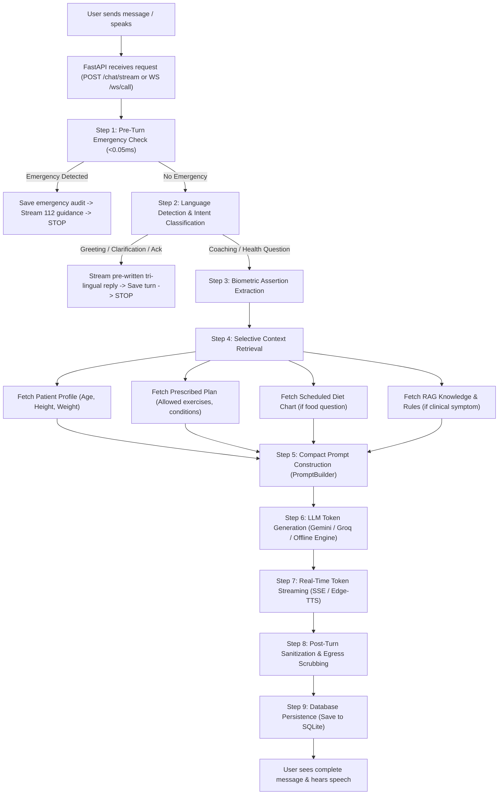

# Project Walkthrough: Step-by-Step Request Lifecycle

Here is the exact step-by-step explanation of what happens when a user sends a message to Disha AI, from the moment they hit "Send" to the moment the response appears on their screen.

---

---

## The 9-Step Request Lifecycle

### Step 1: User Sends Message & Pre-Turn Safety Check (<0.05ms)
- The user types a message in chat (`POST /chat/stream`) or speaks over the WebSocket (`/ws/call`).
- Before any AI model is contacted, the **Pre-Turn Safety Circuit Breaker** runs regex checks for life-threatening emergencies (acute crushing chest pain, radiating left arm pain, difficulty breathing, stroke symptoms, or self-harm).
- **If an emergency is detected:** The system halts immediately. It saves an emergency record to the database and streams a direct instruction to call 112 / 108. The LLM is never called.

### Step 2: Language & Intent Routing
- If safe, the engine detects the language of the message:
  - English $\to$ `"en"`
  - Devanagari Hindi $\to$ `"hi"`
  - Roman Hindi $\to$ `"hinglish"`
- It checks the intent:
  - If it is pure gibberish (e.g. `"asdasd"` or `"h"`), it immediately replies with a polite clarification in that language: *"Main samajh nahi paayi. Thoda aur explain kar sakte hain?"*.
  - If it is a greeting (*"Good morning"*) or an acknowledgement (*"Theek hai"*), it emits a friendly node and finishes.

### Step 3: Biometric Extraction
- If the user stated an updated biometric metric (e.g., *"My weight is now 74.5 kg"*), a regex extractor catches it.
- It immediately updates the `patients` table with `weight_kg = 74.5` and logs a record in `user_memories`.

### Step 4: Selective Context Retrieval (Routing)
The system only queries the specific databases required for the question:
- **Food / Dinner questions:** Queries `patient_meals` for today's scheduled meal (e.g., 150g paneer bhurji, ~420 kcal). If none is scheduled, it notes that no meal plan exists yet.
- **Gym / Workout questions:** Queries `patient_pep` for authorized exercise modalities (e.g., Walking vs. Gym clearance).
- **Pricing questions:** Queries `pricing_plans` for authorized subscription fees (₹1,499).
- **Clinical symptoms (e.g., bloating, acidity):** Queries `clinical_rules` and triggers the **Two-Tier Hybrid RAG** (BM25 + 512D Vector search) for doctor-vetted guidelines (e.g., warm jeera-saunf water).

### Step 5: Compact Prompt Construction
The `PromptBuilder` takes these isolated pieces and constructs a tight prompt:
1. Core system persona ("You are Disha, a caring AI health coach...").
2. Explicit Language Directive ("You MUST respond in Hinglish using Roman script...").
3. Patient Biometrics & Goal.
4. Active Care Plan (Allowed exercises & diet type).
5. Confirmed User Memories (preferences, past stated facts).
6. Retrieved System Facts (only the relevant meal or clinical rule).
7. Recent 4 turns of dialogue history for conversation continuity.

### Step 6: LLM Token Generation
- The assembled messages are sent to **Google Gemini (free tier)** or **Groq Llama 3.3 70B (free tier)**.
- If both APIs are unreachable or offline, the request seamlessly routes to Disha's built-in `OfflineEngine`.

### Step 7: Real-Time Streaming & Voice Synthesis
- As tokens arrive from the model, they are immediately streamed to the browser over Server-Sent Events (`data: {"type": "token", "token": "..."}`).
- If on voice mode, the `SentenceBuffer` groups tokens into complete spoken sentences. As soon as a sentence finishes, Microsoft Edge-TTS synthesizes natural audio chunks and streams them over the WebSocket.

### Step 8: Post-Turn Sanitization & Egress Scrubbing
Once generation finishes, the full response passes through two safety filters:
1. **Post-Turn Sanitizer:** Verifies that required clinical remedies were included (e.g., jeera and saunf for bloating) and ensures no contradictions with patient conditions.
2. **Egress Gate:** Scrubs any sensitive personal data (phone numbers, Aadhaar numbers, email addresses) and removes internal reference tags like `[Approved Reference...]`.

### Step 9: Database Persistence
The turn is committed to SQLite:
- In `call_sessions`: updates session turn count.
- In `call_turns`: records turn latency, pre-guardrail status, retrieved rules, and scrubbed output.
- In `conversation_messages`: saves both the user's utterance and the assistant's response.
The user sees the finished answer in the chat timeline, and the conversation is permanently preserved for the next session.
