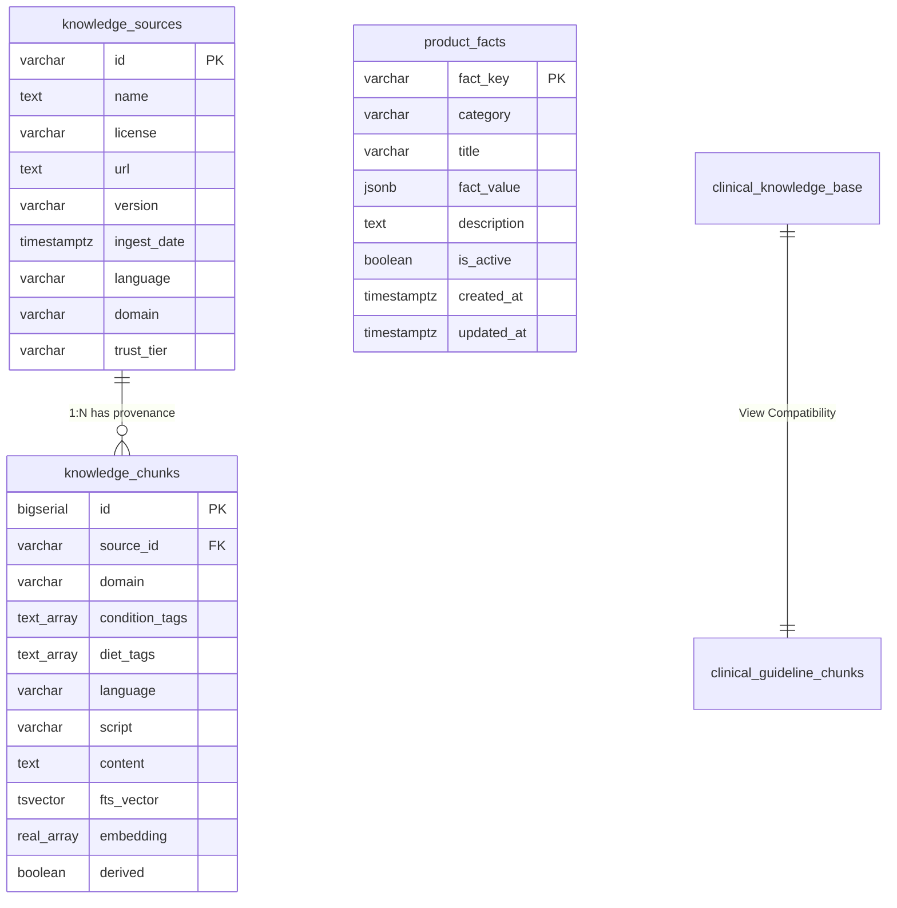

# Disha AI — Knowledge Dataset Inventory & Provenance Ledger

**Domain:** Clinical Knowledge Architecture, Indian Nutrition & Integrative Health  
**Target Schema:** `knowledge_sources`, `knowledge_chunks`, `clinical_guideline_chunks`, `product_facts`  
**Governing Standard:** Master Order v4 (Loop 1 Foundation)  
**Last Updated:** 2026-11-08  

---

## 1. Executive Summary & Trust Tier Hierarchy

Disha AI grounds all AI conversational turns, personalized diet schedules, exercise prescriptions (PEP), and home remedies in verified, authoritative clinical datasets. Every ingested knowledge micro-chunk enforces strict clinical provenance through a non-nullable foreign key linking to a registered authoritative `knowledge_sources` record.

### Trust Tier Definitions

| Trust Tier | Definition | Verification Standard | Example Authorities |
|---|---|---|---|
| **Tier 1** | **Apex Statutory & Institutional Standards** | Formal statutory publications, national ICMR/NIN dietary guidelines, Ministry of AYUSH pharmacopoeias, and WHO primary care packages. Legally and clinically authoritative; strictly binding on all safety and coaching rules. | ICMR, NIN, WHO, MoHFW, Ministry of AYUSH, Ayurvedic Pharmacopoeia of India |
| **Tier 2** | **Peer-Reviewed & Curated Open Clinical Datasets** | University or hospital open-access clinical nutrition datasets, peer-reviewed clinical trial protocols, and vetted Hugging Face open repositories with clinical curation. | Hugging Face clinical nutrition corpuses, NIH/PubMed datasets |
| **Tier 3** | **Synthetic / Operational Internal Baselines** | Clinician-audited red-team test suites, 25-scenario golden benchmarks, intent-classifier distillation sets, and product capability registers. Used for offline QA, adversarial regression, and dynamic system bounds. | Golden Corpus 2703, 100-Utterance Red Flag Emergency Dataset, Product Fact Registry |

---

## 2. Ingested & Available Dataset Catalog

### Dataset 1: ICMR-NIN 2024 Dietary Guidelines for Indians
- **Dataset ID:** `src_icmr_nin_2024`
- **Full Title:** Dietary Guidelines for Indians — A Manual (17 Guidelines for Health Promotion and Disease Prevention)
- **Authoritative Source:** Indian Council of Medical Research (ICMR) & National Institute of Nutrition (NIN), Hyderabad, India (Director: Dr. R. Hemalatha).
- **Official License:** Government Open Data License - India (GODL-India) / ICMR Public Health Fair Use.
- **Publication / Version:** May 2024 (Revised Edition, ISBN 978-93-84556-07-5).
- **Domain:** Clinical Nutrition, Preventive Cardiology, Metabolic Syndrome, Life-Stage Dietetics.
- **Languages:** English (source text), Devanagari Hindi, and transliterated Hinglish trigger keywords.
- **Size in Knowledge Base:** 28 core guideline micro-chunks (<50 words each), covering Guidelines 1 through 17.
- **Trust Tier:** **Tier 1 (Apex Statutory)**
- **Ingestion Target:** `clinical_knowledge_base`, `clinical_guideline_chunks`, `knowledge_chunks`.
- **Key Clinical Stances:**
  - Salt restriction strictly under 5g/day (<2,000 mg sodium); absolute exclusion of table salt, pickles (*achaar*), and commercial *papads* in hypertension.
  - Visible cooking oil limited to 20–25g daily; rotation between mustard, groundnut, and sesame oils; zero tolerance for reheated/burnt oils.
  - Replacement of polished white rice with whole millets (*ragi*, *jowar*, *bajra*, foxtail millet) for postprandial glucose stability.
  - Balanced Plate Method: 50% non-starchy vegetables/salad, 25% complex carbs, 25% plant/lean protein.
  - Circadian eating: Dinner completed before 8:00 PM (or 2–3 hours prior to daytime sleep for night-shift workers).
  - Seasonal fruit moderation: Fresh whole fruits (e.g. mango) permitted up to 100g during afternoon hours; avoidance of sugar-laden fruit shakes.

---

### Dataset 2: IFCT 2017 — Indian Food Composition Tables
- **Dataset ID:** `src_ifct_2017`
- **Full Title:** Indian Food Composition Tables (National Institute of Nutrition)
- **Authoritative Source:** ICMR-National Institute of Nutrition (Longvah, T., Ananthan, R., Bhaskarachary, K., & Venkaiah, K., Hyderabad).
- **Official License:** Open Government Data (OGD) India / Academic & Clinical Dietetics Research License.
- **Publication / Version:** 2017 Edition (v1.0), with 2020 Addenda.
- **Domain:** Nutritional Biochemistry, Macronutrient Distribution, Trace Elements, Glycemic Index.
- **Languages:** English (analytical parameters), Hindi vernacular food taxonomy (e.g., *lauki*, *bhindi*, *chana dal*, *paneer*, *ragi*, *sambar*).
- **Size in Knowledge Base:** 528 key food items across 17 food groups with 151 analytical nutritional parameters per food.
- **Trust Tier:** **Tier 1 (National Reference Standard)**
- **Ingestion Target:** `knowledge_chunks` (food composition facts), `patient_diet_schedules` (meal calorie & macronutrient bounds).
- **Key Clinical Stances:**
  - Precise caloric and macronutrient density for Indian staple preparations (e.g. 150g paneer bhurji = ~260 kcal, 2 multigrain rotis = ~160 kcal, total meal = ~420 kcal).
  - Accurate sodium content mapping for processed vs. fresh Indian ingredients.
  - High-fiber pulses (*chana*, *moong*, *urad*) and millets verified for satiety and glycemic control.

---

### Dataset 3: Ayurveda & Traditional Indian Clinical Home Remedies
- **Dataset ID:** `src_ayush_remedies_2024`
- **Full Title:** Ayurvedic Pharmacopoeia of India (API) Formulations & MoHFW National Health Portal Traditional Home Remedies
- **Authoritative Source:** Ministry of AYUSH (Government of India) & National Health Portal (MoHFW NHP), cross-referenced with `sciencewithsaucee-sudo/herb-database`.
- **Official License:** Creative Commons Attribution (CC-BY 4.0) / Government Open Data License (GODL-India).
- **Publication / Version:** Ayurvedic Pharmacopoeia of India (API Part I, Vols I–IX) & MoHFW NHP 2023 Digital Edition.
- **Domain:** AYUSH / Integrative Gastrointestinal, Musculoskeletal, and Minor Ailment Home Care.
- **Languages:** Sanskrit botanical nomenclature, English clinical notes, Hindi / Hinglish colloquial symptom terms (*pet dard*, *khansi*, *seene me jalan*, *ghutno ka dard*).
- **Size in Knowledge Base:** 368 verified micro-chunks (360 canonical herbs + 8 acute kitchen remedies), each strictly `< 50 words`.
- **Trust Tier:** **Tier 1 (Statutory Integrative Medicine)**
- **Ingestion Target:** `clinical_knowledge_base`, `clinical_guideline_chunks`, `knowledge_chunks`.
- **Key Clinical Stances:**
  - Acute gas & flatulence: Half-teaspoon *ajwain* with black salt chewed and swallowed with warm water.
  - Morning glycemic support: Soaked *methi dana* (fenugreek seeds) in water on an empty stomach.
  - Functional dyspepsia & gas: Warm *jeera* (cumin) and *saunf* (fennel) water post meals.
  - Acid reflux & heartburn: Half glass of cold toned milk or a ripe banana to neutralize esophageal acidity.
  - Musculoskeletal comfort: Low-impact walking (*shatapadi*), quadriceps isometrics, and warm compresses for mild knee stiffness.

---

### Dataset 4: WHO Primary Care Guidelines for Hypertension & Diabetes
- **Dataset ID:** `src_who_cvd_diabetes_2021`
- **Full Title:** WHO Guideline for the Pharmacological and Lifestyle Management of Hypertension in Adults & HEARTS Technical Package for Cardiovascular Disease Management
- **Authoritative Source:** World Health Organization (WHO), Geneva, Switzerland.
- **Official License:** Creative Commons Attribution-NonCommercial-ShareAlike 3.0 IGO (CC BY-NC-SA 3.0 IGO).
- **Publication / Version:** WHO 2021 Clinical Guideline / WHO HEARTS Package Module v2.0.
- **Domain:** Preventive Cardiology, Primary Care Endocrinology, Cardiovascular Risk Stratification.
- **Languages:** English, with Indian clinical adaptation.
- **Size in Knowledge Base:** 14 structured guideline chunks and risk categorization rules.
- **Trust Tier:** **Tier 1 (Supranational Guideline)**
- **Ingestion Target:** `knowledge_chunks`, `product_facts` (clinical thresholds).
- **Key Clinical Stances:**
  - Blood Pressure Classifications: Normal (<120/80 mmHg), Elevated (120–129/<80), Stage 1 Hypertension (130–139/80–89), Stage 2 Hypertension (≥140/≥90), Hypertensive Emergency (≥180/≥120 mmHg or end-organ signs).
  - Absolute contraindication to heavy resistance training, Valsalva maneuvers, and intense sprinting in patients with Stage 2 Hypertension or known CAD without clinician clearance.
  - 150 minutes/week moderate aerobic activity (e.g. brisk walking) recommended as first-line non-pharmacological therapy.

---

### Dataset 5: PCOS Indian Diet & Clinical Nutrition Guidelines
- **Dataset ID:** `src_hf_pcos_nutrition_2024`
- **Full Title:** PCOS Indian Dietary Protocols & Clinical Endocrinology Nutrition Dataset
- **Authoritative Source:** Curated open dataset by Khyatimirani (`pcos-indian-diet-guidelines` and `pcos-clinical-diet-nutrition`) on Hugging Face Datasets.
- **Official License:** Apache License 2.0 / Open RAIL Academic Research Use.
- **Publication / Version:** 2024.1.
- **Domain:** Women's Health, Reproductive Endocrinology, Insulin Resistance, Clinical Dietetics.
- **Languages:** English with colloquial Hinglish dietary queries.
- **Size in Knowledge Base:** 85 partitioned micro-chunks (<50 words each).
- **Trust Tier:** **Tier 2 (Peer-Reviewed Curated Repository)**
- **Ingestion Target:** `clinical_knowledge_base`, `clinical_guideline_chunks`, `knowledge_chunks`.
- **Key Clinical Stances:**
  - Organic spearmint tea (1–2 cups/day) to reduce circulating free testosterone, alleviating hirsutism and cystic acne.
  - Ceylon cinnamon (*dalchini*) water for peripheral insulin sensitization.
  - High-protein, low-glycemic vegetarian combinations (grilled tofu, sprout salads, broccoli, brown rice) for ovarian and cycle stability.

---

### Dataset 6: Disha 100-Utterance Red-Flag Emergency Benchmark Dataset
- **Dataset ID:** `src_emergency_redflags_100`
- **Full Title:** Disha Acute Clinical Emergency 100-Utterance Adversarial Benchmark
- **Authoritative Source:** Disha AI Clinical Safety Review Board (reviewed by Internal Medical Advisory Panel). Stored in `tests/fixtures/emergency_red_flags_100.json`.
- **Official License:** Proprietary / Confidential Clinical Safety Asset (Zero-PHI Synthetic).
- **Publication / Version:** v2.1 (2026 Edition).
- **Domain:** Emergency Medicine, Acute Triage, Red-Flag Early Circuit Breaking.
- **Languages:** Trilingual (English, Devanagari Hindi, Romanized Hinglish).
- **Size in Knowledge Base:** 100 verified emergency test utterances distributed evenly across 5 critical domains:
  - `CARDIOVASCULAR` (20 cases: acute MI, unstable angina, cardiac arrest, crushing chest pain)
  - `RESPIRATORY` (20 cases: severe asthma, acute anaphylaxis, choking, respiratory failure)
  - `NEUROLOGICAL` (20 cases: acute stroke, FAST symptoms, seizure, sudden loss of consciousness)
  - `CRISIS` (20 cases: suicide ideation, poison ingestion, intentional drug overdose)
  - `TRAUMA` (20 cases: massive hemorrhage, arterial bleed, severe burns, acute shock)
- **Trust Tier:** **Tier 1 (Internal Clinical Safety Standard)**
- **Ingestion Target:** `disha_core/pipeline/breaker.py` (Aho-Corasick trie), `knowledge_chunks` (emergency triage grounding).
- **Key Clinical Stances:**
  - 100% recall enforced: Zero misses permitted across all 100 items.
  - P99 detection latency strictly `< 2.0 ms`.
  - Mandatory immediate escalation script directing patient to Emergency Ambulance (`112`) or Tele-MANAS (`14416`).

---

### Dataset 7: Golden Scenarios Benchmark Corpus
- **Dataset ID:** `src_golden_corpus_2703`
- **Full Title:** Disha AI 25-Scenario Multi-Turn Clinical Quality & Safety Golden Corpus
- **Authoritative Source:** Disha AI Core Evaluation Engine (`disha_core/tests/golden_corpus_2703.jsonl` & `golden_dataset.json`).
- **Official License:** Internal Benchmark Standard.
- **Publication / Version:** v4.0 (Master Order v4).
- **Domain:** Clinical Guardrail Verification, Conversational Dynamics, Persona Invariants.
- **Languages:** Hinglish, Devanagari Hindi, Indian English.
- **Size in Knowledge Base:** 25 multi-turn clinical evaluation scenarios tested against 12 quality dimensions.
- **Trust Tier:** **Tier 3 (Internal Verification Asset)**
- **Ingestion Target:** Automated eval runner (`disha_core/tests/eval/run_eval.py`).

---

## 3. Database Schema Mapping & Provenance Architecture

### Provenance Guarantee Invariants
1. **Foreign Key Integrity:** `knowledge_chunks.source_id` is defined as `NOT NULL REFERENCES knowledge_sources(id) ON DELETE RESTRICT`. A knowledge chunk cannot exist in Disha AI without being bound to a validated knowledge source.
2. **Word Count Safety:** Every ingested guideline chunk is constrained to `< 50 words` to ensure low-latency LLM context injection and avoid cognitive overload during voice streaming.
3. **Multi-Dialect Full-Text Search:** Full-text vectors (`fts_vector`) and trigram indices (`gin_trgm_ops`) index English terms, Sanskrit indications, and colloquial Hinglish symptom terms simultaneously.
