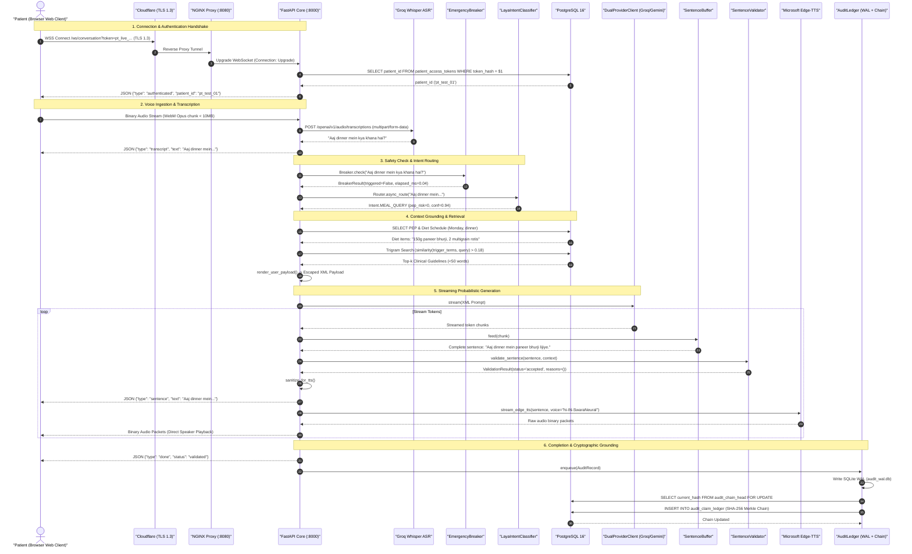
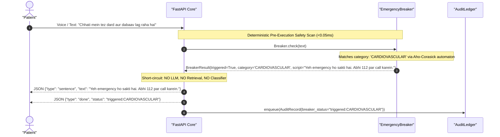

# Disha AI — Turn Processing & Data Flow Cartography

**Document Status:** Production Authoritative  
**Source Code Baseline:** `disha_core/` (Commit `458caf1` / `db200a7`)  
**Design Pattern:** State Machine Dataflow & Fail-Closed Gateways

---

## 1. Overview of Execution Modes

Disha AI operates across three distinct input modes:
1. **Duplex Voice WebSocket (`/ws/conversation` & `/voice`):** Binary WebM/PCM voice streaming with real-time ASR, sentence-by-sentence LLM generation, streaming Edge-TTS, and millisecond barge-in cancellation.
2. **Streaming Text SSE (`/chat/stream`):** Server-Sent Events yielding validated sentences (`data: {"sentence": "..."}`) ending with an audit status marker (`event: done\ndata: {"status": "validated"}`).
3. **Synchronous Text REST (`/chat`):** Complete request-response turn yielding validated text payload with execution status and audit ledger enqueueing.

---

## 2. End-to-End Voice Turn Lifecycle (Nominal Flow)



---

## 3. Emergency Breaker Short-Circuit Flow

When an acute life-threatening condition is detected, the **entire LLM, retrieval, and context pipeline is bypassed**:



---

## 4. Real-Time Barge-In Interruption Flow

Disha AI supports natural conversational barge-in. When a patient speaks while the system is actively synthesizing or playing audio, the active turn is cancelled within milliseconds:

```mermaid
sequenceDiagram
    autonumber
    actor Patient as "Patient"
    participant Browser as "Client VAD / AudioContext"
    participant Core as "FastAPI VoiceSession"
    participant EdgeTTS as "Microsoft Edge-TTS"

    Note over Core, Patient: Disha is actively synthesizing and streaming Sentence 2
    Core->>EdgeTTS: Synthesizing audio chunk...
    Core-->>Patient: Audio packets playing via Web Audio API

    Note over Patient, Browser: Patient interrupts: "Ruko, mujhe ek baat batao..."
    Browser->>Browser: Mic AnalyserNode detects energy > 20 (ENERGY_THRESHOLD)
    Browser->>Browser: stopAudioPlayback() & drain local audioQueue
    Browser->>Core: WebSocket Frame: {"type": "interrupt"}

    Note over Core: Barge-In Cancellation Handler (<15ms)
    Core->>Core: cancel_active_turn() -> turn_task.cancel()
    Core->>EdgeTTS: Cancel Edge-TTS HTTP/WS stream task
    Core-->>Patient: WebSocket Frame: {"type": "interrupted"}
    
    Note over Browser, Core: Client transitions to 'listening'; Core ready for new turn
    Browser->>Browser: setTelephonyStatus('listening')
```

---

## 5. Detailed Turn Processing Step-by-Step

### Step 1: Ingress Authentication
- **File:** `disha_core/main.py:96-113` (`_authenticated_patient`)
- **Action:** Extracts Bearer token from WebSocket query parameters (`?token=...`), header (`Authorization: Bearer ...`), or initial JSON payload (`{"type": "auth", "token": "..."}`).
- **Verification:** Calculates `hashlib.sha256(token.encode()).hexdigest()` and executes:
  ```sql
  SELECT patient_id FROM patient_access_tokens
  WHERE token_hash = $1 AND revoked_at IS NULL
    AND (expires_at IS NULL OR expires_at > NOW())
  ```
- **Error Handling:** If token missing, invalid, or expired, socket terminates immediately with WebSocket close code `4401`.

### Step 2: Speech-to-Text Transcription
- **File:** `disha_core/voice.py:44-80` (`transcribe_groq`)
- **Gate Check:** Checks `_allowed("GROQ_HEALTH_DATA_PROCESSING_APPROVED")`. If false, raises `VoicePrivacyError` and aborts.
- **Dispatch:** Dispatches audio buffer (WebM) to Groq Whisper endpoint (`https://api.groq.com/openai/v1/audio/transcriptions`) with timeout `1.0s`.
- **Payload:** Model `whisper-large-v3-turbo`, response format `json`.
- **Feedback:** Server emits `{"type": "transcript", "text": "<text>"}` to the client for real-time UI display.

### Step 3: Emergency Circuit Breaker Check
- **File:** `disha_core/pipeline/breaker.py:175-235` (`EmergencyBreaker.check`)
- **Mechanism:** Text normalized to NFKC, stripped of zero-width spaces (`\u200b-\u200d\ufeff\u00ad`), punctuation replaced with spaces.
- **Automaton:** Ingested into C-accelerated `_AhoCorasick` trie automaton matching 5 clinical emergency categories:
  - `CARDIOVASCULAR` (chest pain, chhati mein dard, seene mein dabaav, dil ka daura).
  - `RESPIRATORY` (cannot breathe, saans ruk rahi, asthama attack).
  - `NEUROLOGICAL` (facial droop, chehra tedha, slurred speech, lakwa).
  - `CRISIS` (suicide, khudkushi, zeher, kill myself).
  - `TRAUMA` (arterial bleeding, khoon ki ulti, major accident).
- **Fallback Regex:** If not caught by trie, spaced Hinglish regular expressions (`c h h a t i ... d a r d`) scan the utterance.
- **Action:** If triggered, sets `breaker_status = "triggered:<category>"`, emits hardcoded emergency advice (calling 112 or Tele-MANAS 14416), enqueues audit, and terminates the turn.

### Step 4: System 1 Intent Classification
- **File:** `disha_core/classifier/adapter.py:209-323` (`LayaClassifierAdapter.classify`)
- **Engine:** Interacts with Laya (`convaiinnovations/laya` 421M parameter model) via containerized HTTP (`POST {LAYA_SERVER_URL}/v1/systemone`) or local in-process `laya.Agent`.
- **Questions Evaluated:**
  - `intent`: `meal_query` | `symptom_complaint` | `general_coaching` | `emergency_escalation`
  - `emergency_triage`: Binary noul question (threshold calibrated at 0.70).
  - `pep_risk`: Physical exertion score (0=low, 1=moderate, 2=high).
- **Safety Circuit Breaker:** `ClassifierCircuitBreaker` trips after 3 consecutive failures, engaging a 30-second cooldown period and falling back to deterministic regex heuristics (`RuleIntentClassifier`).
- **Confidence Gate:** If intent confidence `< 0.40`, falls back to conservative rule-based routing.

### Step 5: Patient Context Assembly & Retrieval
- **Files:** `disha_core/engine/context_builder.py` & `disha_core/engine/retriever.py`
- **Context Construction:** Queries patient's Physical Exertion Protocol (`patient_pep`) and active meal prescription for the current Indian Standard Time weekday (`patient_diet_schedules`).
- **Lexical Retrieval:** Queries PostgreSQL `clinical_knowledge_base` using `pg_trgm` similarity threshold (`0.18`) combined with simple English full-text search (`ts_rank`):
  ```sql
  SELECT chunk_id, condition_tag, context_header, guideline_content, source_citation,
         required_remedy_tokens,
         similarity(trigger_terms, $1) AS trigram_score,
         ts_rank(tsv_content, plainto_tsquery('simple', $1)) AS text_score
  FROM clinical_knowledge_base
  WHERE approval_status = 'approved'
    AND (trigger_terms % $1 OR tsv_content @@ plainto_tsquery('simple', $1))
  ORDER BY GREATEST(...) DESC LIMIT 5;
  ```
- **Constraint Enforcement:** If `diet_status == "NOT_FOUND"` for a `meal_query`, the turn is immediately rewritten to `MEAL_NOT_FOUND_REPLACEMENT`, bypassing LLM generation.
- **XML Serialization:** Builds lean, escaped XML (`<PATIENT_PROFILE><PEP_PERMISSIONS .../><DIET_SLOT .../></PATIENT_PROFILE><CLINICAL_GROUNDING><CHUNK .../></CLINICAL_GROUNDING><USER_UTTERANCE>...</USER_UTTERANCE>`).

### Step 6: Probabilistic LLM Generation & Sentence Buffering
- **Files:** `disha_core/llm/client.py` & `disha_core/llm/sentence_buffer.py`
- **Model Client:** `DualProviderClient` streams tokens from Groq API (`openai/gpt-oss-120b`). If Groq returns 429/5xx or times out (1.2s first-token SLA), fails over to Gemini Flash (`gemini-3.6-flash`).
- **Buffering:** `SentenceBuffer` ingests token chunks and splits on punctuation marks (`.`, `!`, `?`, `।`), deferring periods when preceded and followed by digits (e.g. `1.5 mg` is not split).
- **Turn Cap:** Maximum 3 sentences emitted per conversational turn to prevent cognitive overload.

### Step 7: Deterministic Sentence Validation
- **File:** `disha_core/pipeline/validator.py` (`SentenceValidator.validate_sentence`)
- **Assertion Rules:**
  1. *Markdown Stripping:* Removes `*`, `_`, `#`, backticks, bullet points.
  2. *Channel Boundaries:* Rewrites external messaging promises (WhatsApp, SMS, Telegram) to the in-app "My Plan" tab.
  3. *Identity Declarations:* Rewrites any claim of being a doctor, clinician, or human to: `"Main Disha hoon, aapki AI health coach."`
  4. *Diagnostic Declarations:* Rewrites attempts to diagnose conditions (diabetes, hypertension, cancer).
  5. *Prescription Alterations:* Rewrites any attempt to increase, decrease, or prescribe medications.
  6. *Hypertension Sodium Gate:* Blocks recommendations of high-sodium items (papad, achaar, namkeen) for hypertensive patients.
  7. *Commercial Pricing Gate:* Strictly enforces ₹0 follow-ups and ₹1,499/month nutritionist plan. Any other currency ($/€) or amount is rewritten.
  8. *Physical Exertion Protocol (PEP):* Validates exercise modalities against patient permissions (`allowed_modalities`, `restricted_modalities`, `gym_clearance`). Unlisted or restricted workouts trigger safe rewrites.
  9. *Clinical Remedy Gate:* Requires explicit clinician approval (`protocol_approved`) and configured token presence (e.g., `jeera`, `saunf`). If unconfigured, rewrites to `REMEDY_UNAVAILABLE`.

### Step 8: Text-to-Speech Streaming
- **File:** `disha_core/voice.py:82-94` (`stream_edge_tts`)
- **Voice Selection:** Automatically chooses `hi-IN-SwaraNeural` (for Hindi/Hinglish) or `en-IN-NeerjaNeural` (for English) based on script dominance and lexical markers (`aap`, `mera`, `hai`).
- **Gate Check:** Checks `_allowed("EDGE_TTS_HEALTH_DATA_PROCESSING_APPROVED")`.
- **Streaming:** Emits binary MP3 audio packets directly over the WebSocket connection.

### Step 9: Merkle Audit Logging
- **File:** `disha_core/compliance/ledger.py` (`AuditLedger._persist`)
- **Queueing:** Non-blocking in-memory queue (capacity 2048) backed by persistent SQLite WAL (`audit_wal.db`).
- **Persistence:** Asynchronous background worker locks the chain head via PostgreSQL row lock:
  ```sql
  SELECT current_hash FROM audit_chain_head WHERE singleton = TRUE FOR UPDATE;
  ```
- **Cryptographic Hash Formula:**
  $$\text{current\_hash} = \text{SHA-256}(\text{prev\_hash} \parallel \text{patient\_id} \parallel \text{user\_input} \parallel \text{llm\_output} \parallel \text{status})$$
- **Database Write:** Inserts into `audit_claim_ledger` and updates `audit_chain_head`. Deletes processed record from SQLite WAL.
