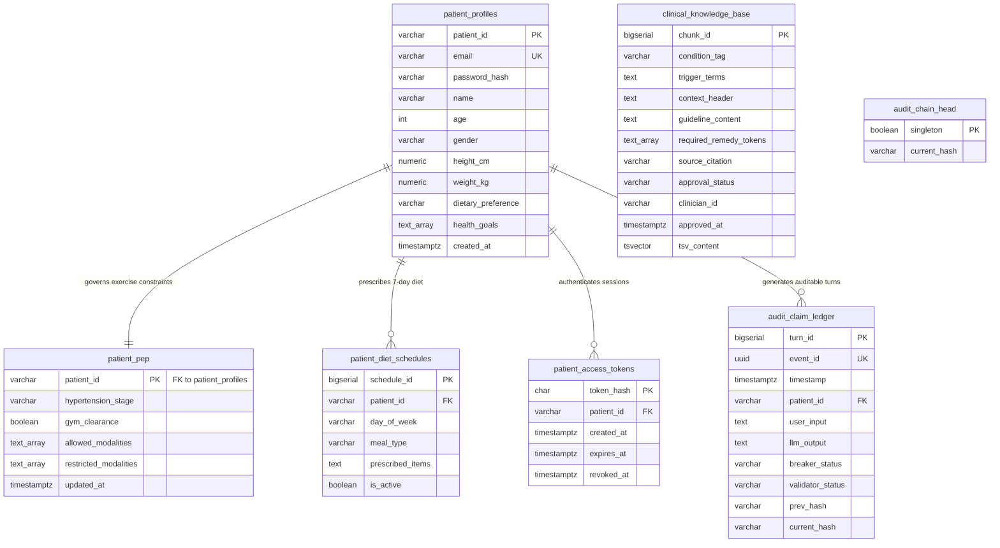

# Disha AI — PostgreSQL 16 Relational Schema & Merkle Ledger Cartography

**Document Status:** Production Authoritative  
**Target RDBMS:** PostgreSQL 16 (Alpine) with `pg_trgm` Extension  
**Source DDL:** `disha_core/db/schema.sql`, `disha_core/compliance/ledger.py`

---

## 1. Entity-Relationship Overview



---

## 2. Table-by-Table Architectural Definitions

### 2.1 `clinical_knowledge_base`
Stores clinician-reviewed, institutionally cited micro-chunks (<50 words) used for lexical grounding during dialogue turns.

```sql
CREATE TABLE IF NOT EXISTS clinical_knowledge_base (
    chunk_id BIGSERIAL PRIMARY KEY,
    condition_tag VARCHAR(64) NOT NULL,
    trigger_terms TEXT NOT NULL CHECK (btrim(trigger_terms) <> ''),
    context_header TEXT NOT NULL DEFAULT '',
    guideline_content TEXT NOT NULL,
    required_remedy_tokens TEXT[] NOT NULL DEFAULT '{}',
    source_citation VARCHAR(256) NOT NULL CHECK (btrim(source_citation) <> ''),
    approval_status VARCHAR(16) NOT NULL DEFAULT 'draft'
        CHECK (approval_status IN ('draft', 'approved', 'rejected')),
    clinician_id VARCHAR(64),
    approved_at TIMESTAMPTZ,
    tsv_content tsvector GENERATED ALWAYS AS (
        to_tsvector('simple'::regconfig, trigger_terms || ' ' || context_header || ' ' || guideline_content)
    ) STORED,
    CHECK (btrim(guideline_content) <> ''),
    CHECK (cardinality(regexp_split_to_array(btrim(guideline_content), E'\\s+')) < 50),
    CHECK (approval_status <> 'approved' OR (clinician_id IS NOT NULL AND approved_at IS NOT NULL))
);
```

#### Invariants & Constraints:
* **Micro-Chunk Word Count Limit:** `cardinality(regexp_split_to_array(btrim(guideline_content), E'\\s+')) < 50`. Strictly enforced at the database level to ensure prompts never exceed lean context budgets.
* **Clinician Accountability:** `approval_status <> 'approved' OR (clinician_id IS NOT NULL AND approved_at IS NOT NULL)`. Draft chunks can never be approved without recording the reviewing clinician's identifier and timestamp.
* **Generated Search Vector:** `tsv_content` automatically indexes terms, header, and content using PostgreSQL `'simple'` dictionary for multi-lingual and Hinglish query support.

#### Production Indexes:
```sql
CREATE INDEX IF NOT EXISTS idx_clinical_tsv ON clinical_knowledge_base USING GIN(tsv_content);
CREATE INDEX IF NOT EXISTS idx_clinical_trgm ON clinical_knowledge_base USING GIN(trigger_terms gin_trgm_ops);
CREATE INDEX IF NOT EXISTS idx_clinical_tsv_approved ON clinical_knowledge_base USING GIN(tsv_content) WHERE approval_status = 'approved';
CREATE INDEX IF NOT EXISTS idx_clinical_trgm_approved ON clinical_knowledge_base USING GIN(trigger_terms gin_trgm_ops) WHERE approval_status = 'approved';
```

---

### 2.2 `patient_profiles`
Core demographic, physical, and medical profile information.

```sql
CREATE TABLE IF NOT EXISTS patient_profiles (
    patient_id VARCHAR(64) PRIMARY KEY,
    email VARCHAR(255) UNIQUE NOT NULL,
    password_hash VARCHAR(128) NOT NULL,
    name VARCHAR(128) NOT NULL,
    age INT,
    gender VARCHAR(32),
    height_cm NUMERIC,
    weight_kg NUMERIC,
    dietary_preference VARCHAR(64),
    health_goals TEXT[],
    created_at TIMESTAMPTZ NOT NULL DEFAULT NOW()
);
```

#### Invariants & Security:
* `password_hash` stores `SHA-256(password + "disha_salt_v1")`.
* `email` is strictly unique and indexed for fast credential lookups during authentication.

---

### 2.3 `patient_pep` (Physical Exertion Protocol)
Enforces cardiovascular safety and workout boundary controls.

```sql
CREATE TABLE IF NOT EXISTS patient_pep (
    patient_id VARCHAR(64) PRIMARY KEY,
    hypertension_stage VARCHAR(16),
    gym_clearance BOOLEAN NOT NULL DEFAULT FALSE,
    allowed_modalities TEXT[] NOT NULL DEFAULT '{}',
    restricted_modalities TEXT[] NOT NULL DEFAULT '{}',
    updated_at TIMESTAMPTZ NOT NULL DEFAULT NOW()
);
```

#### Business Rules:
* When `hypertension_stage` is `"stage 1"` or `"stage 2"`, or if `gym_clearance` is `false`, high-strain modalities (`heavy deadlifts`, `valsalva maneuver`, `sprinting`) are appended to `restricted_modalities`.
* The `SentenceValidator` queries this table to block LLM recommendations outside `allowed_modalities`.

---

### 2.4 `patient_diet_schedules`
Stores the active 7-day nutritional prescription for each patient.

```sql
CREATE TABLE IF NOT EXISTS patient_diet_schedules (
    schedule_id BIGSERIAL PRIMARY KEY,
    patient_id VARCHAR(64) NOT NULL,
    day_of_week VARCHAR(16) NOT NULL
        CHECK (day_of_week IN ('monday', 'tuesday', 'wednesday', 'thursday', 'friday', 'saturday', 'sunday')),
    meal_type VARCHAR(16) NOT NULL CHECK (meal_type IN ('breakfast', 'lunch', 'dinner')),
    prescribed_items TEXT NOT NULL CHECK (btrim(prescribed_items) <> ''),
    is_active BOOLEAN NOT NULL DEFAULT TRUE,
    UNIQUE(patient_id, day_of_week, meal_type)
);
```

#### Invariants:
* `UNIQUE(patient_id, day_of_week, meal_type)` prevents duplicate or ambiguous meal prescriptions for any time slot.
* If a queried meal slot does not exist or is inactive, `context_builder.py` sets `diet_status = "NOT_FOUND"`, triggering a deterministic fallback that blocks recipe fabrication.

---

### 2.5 `patient_access_tokens`
High-security session token storage utilizing raw token hashing.

```sql
CREATE TABLE IF NOT EXISTS patient_access_tokens (
    token_hash CHAR(64) PRIMARY KEY CHECK (token_hash ~ '^[0-9a-f]{64}$'),
    patient_id VARCHAR(64) NOT NULL CHECK (btrim(patient_id) <> ''),
    created_at TIMESTAMPTZ NOT NULL DEFAULT NOW(),
    expires_at TIMESTAMPTZ NOT NULL,
    revoked_at TIMESTAMPTZ,
    CHECK (expires_at > created_at)
);

CREATE INDEX IF NOT EXISTS idx_patient_access_tokens_patient_active
    ON patient_access_tokens(patient_id, expires_at) WHERE revoked_at IS NULL;
```

#### Invariants:
* Plaintext bearer tokens are **never written to disk**. The client holds `pt_live_<token>`, while the database stores `SHA-256(pt_live_<token>)`.
* Active token verification takes `<0.8ms` using the partial B-tree index `idx_patient_access_tokens_patient_active`.

---

### 2.6 `audit_claim_ledger` & `audit_chain_head`
Implements the immutable cryptographic SHA-256 Merkle chain ledger (`disha_core/compliance/ledger.py`).

```sql
CREATE TABLE IF NOT EXISTS audit_claim_ledger (
    turn_id BIGSERIAL PRIMARY KEY,
    event_id UUID NOT NULL UNIQUE,
    timestamp TIMESTAMPTZ NOT NULL DEFAULT NOW(),
    patient_id VARCHAR(64) NOT NULL,
    user_input TEXT NOT NULL,
    llm_output TEXT NOT NULL,
    breaker_status VARCHAR(32) NOT NULL,
    validator_status VARCHAR(32) NOT NULL,
    prev_hash VARCHAR(64) NOT NULL,
    current_hash VARCHAR(64) NOT NULL
);

CREATE TABLE IF NOT EXISTS audit_chain_head (
    singleton BOOLEAN PRIMARY KEY DEFAULT TRUE CHECK (singleton),
    current_hash VARCHAR(64) NOT NULL
);

-- Seed genesis block with 64 zeros
INSERT INTO audit_chain_head(singleton, current_hash)
VALUES (TRUE, repeat('0', 64)) ON CONFLICT (singleton) DO NOTHING;
```

#### Merkle Cryptographic Chain Formula:
Every conversation turn records the cryptographic digest of itself concatenated with the prior head:
$$\text{payload} = \text{prev\_hash} \parallel \text{patient\_id} \parallel \text{user\_input} \parallel \text{llm\_output} \parallel \text{breaker\_status} \parallel \text{validator\_status}$$
$$\text{current\_hash} = \text{SHA-256}(\text{payload})$$

#### Concurrency & Row-Locking:
To guarantee serialized order across concurrent turns without race conditions:
```python
async with connection.transaction():
    prev_hash = await connection.fetchval(
        "SELECT current_hash FROM audit_chain_head WHERE singleton = TRUE FOR UPDATE"
    )
    # compute digest...
    await connection.execute("INSERT INTO audit_claim_ledger ...", digest)
    await connection.execute("UPDATE audit_chain_head SET current_hash = $1 WHERE singleton = TRUE", digest)
```

---

## 3. Local SQLite Write-Ahead Log (WAL) Schema

To guarantee zero data loss during process crashes or ungraceful Docker shutdowns before PostgreSQL writes complete, `disha_core/compliance/ledger.py` maintains an ephemeral local SQLite WAL (`audit_wal.db` with `PRAGMA journal_mode=WAL;`):

```sql
CREATE TABLE IF NOT EXISTS wal_audit_records (
    event_id TEXT PRIMARY KEY,
    patient_id TEXT,
    user_input TEXT,
    llm_output TEXT,
    breaker_status TEXT,
    validator_status TEXT,
    created_at REAL
);
```

* **Write Path:** Enqueued instantly upon turn completion.
* **Drain Path:** When the PostgreSQL transaction commits, the record is removed from SQLite WAL (`DELETE FROM wal_audit_records WHERE event_id = ?`).
* **Recovery Path:** On startup or crash recovery, `_init_wal()` reads all remaining uncommitted rows from SQLite and loads them back into the asynchronous worker queue.
