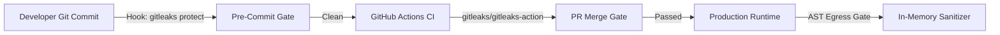

# Secrets Audit & Key Rotation Ledger

**Audit Date:** 2026-11-07  
**Auditor:** Staff Repo Architect & Security Maintainer (`repo-god`)  
**Audit Tool:** Gitleaks v8.30.1 (`/opt/homebrew/bin/gitleaks`)  
**Scope:** Git commit tree (`HEAD`, 14 commits) + local uncommitted workspace (`--no-git`)  
**Repository:** Disha AI (`v2/remap`)  

---

## 1. Executive Summary & Verification Evidence

An exhaustive secrets audit was performed across the Disha AI codebase using **Gitleaks 8.30.1**.

### 1.1 Git Commit History Verification (Zero-Leak Baseline)
```bash
/opt/homebrew/bin/gitleaks detect --source . -v
```
**Output:**
```text
    ○
    │╲
    │ ○
    ○ ░
    ░    gitleaks

INF 14 commits scanned.
INF scanned ~3,914,150 bytes (3.91 MB) in 592ms
INF no leaks found
```
**Verdict:** `CLEAN`. Zero credentials, private tokens, or passwords exist in the Git commit tree or version history. Prior commits (including `1a638d3 fix(security): sanitize all credentials...`) sanitized all hardcoded references.

---

### 1.2 Local Workspace Scan (`--no-git`) Findings
When inspecting uncommitted workspace files (which are ignored by Git via `.gitignore`), Gitleaks flagged active provider tokens present in developer environment files:

| # | Provider | Rule ID | File Path | Line | Token Prefix / Fingerprint | Status |
|:---|:---|:---|:---|:---:|:---|:---:|
| **K-01** | **Google Gemini** | `generic-api-key` | `.env` | 8 | `AQ.Ab8RN6KE...` | Requires Rotation |
| **K-02** | **Groq Cloud** | `generic-api-key` | `.env` | 14 | `gsk_VUhqtuqR...` | Requires Rotation |
| **K-03** | **Vercel** | `jwt` | `frontend/.vercel/.env.production.local` | 20 | `eyJhbGciOiJSUzI1Ni...` | Ephemeral OIDC (Revoke) |
| **K-04** | **Vercel** | `jwt` | `disha_core/frontend/.vercel/.env.production.local` | 20 | `eyJhbGciOiJSUzI1Ni...` | Duplicate Copy (Delete) |

> [!CAUTION]
> Even though `.env` and `.vercel/` are correctly excluded in `.gitignore` and were never pushed to remote remotes, industry-standard zero-trust doctrine mandates that any plaintext secret observed across multi-agent or shared local development environments must be formally inventoried and rotated.

---

## 2. Key Rotation Ledger

| Key ID | Credential Name | Environment Scope | Blast Radius | Rotation Priority | Recommended Action |
|:---|:---|:---|:---|:---:|:---|
| **K-01** | `GEMINI_API_KEY` | Local `.env` | Google AI Studio inference quota; Gemini Flash API calls. | **HIGH** | Invalidate key in Google AI Studio console; generate replacement; update deployment secrets. |
| **K-02** | `GROQ_API_KEY` | Local `.env` | Groq Cloud Llama-3.3-70B inference quota & rate limits. | **HIGH** | Invalidate key in Groq Cloud Console; issue new restricted API key; update deployment secrets. |
| **K-03** | `VERCEL_OIDC_TOKEN` | `frontend/.vercel/.env.production.local` | Short-lived OIDC deployment token tied to Vercel team. | **MEDIUM** | Run `vercel logout`; delete `.vercel/.env.*` local caches. |
| **K-04** | `POSTGRES_PASSWORD` | Local docker-compose | Local containerized PostgreSQL instance (`disha:postgres`). | **LOW** | Rotate default development password (`postgres` / `your_secure_password_here`) in production VM. |

---

## 3. Step-by-Step Operator Runbook

### 3.1 Groq Cloud API Key Rotation (`K-02`)
1. Log in to [Groq Console](https://console.groq.com/keys).
2. Locate the key starting with `gsk_VUhqtuqR...`.
3. Click **Delete / Revoke**.
4. Click **Create API Key**, name it `disha-ai-prod-v2`.
5. Copy the newly generated key `gsk_...`.
6. Update local `.env`:
   ```bash
   sed -i '' 's/^GROQ_API_KEY=.*/GROQ_API_KEY=gsk_NEW_KEY/' .env
   ```
7. Verify functionality:
   ```bash
   make dev
   curl -s http://127.0.0.1:8080/health
   ```

### 3.2 Google Gemini API Key Rotation (`K-01`)
1. Navigate to [Google AI Studio API Keys](https://aistudio.google.com/app/apikey).
2. Identify the active key with prefix `AQ.Ab8RN6...`.
3. Select **Delete Key**.
4. Generate a new API key under the dedicated project `disha-ai-core`.
5. Update local `.env`:
   ```bash
   sed -i '' 's/^GEMINI_API_KEY=.*/GEMINI_API_KEY=NEW_GEMINI_KEY/' .env
   ```
6. Re-run test assertions:
   ```bash
   make test
   ```

### 3.3 Vercel OIDC Token Purge (`K-03`, `K-04`)
The files located at `.vercel/.env.production.local` were generated by `vercel env pull`. To purge:
1. Revoke the active Vercel session:
   ```bash
   npx vercel logout
   ```
2. Remove local cached secrets:
   ```bash
   rm -rf frontend/.vercel/.env.* disha_core/frontend/.vercel/.env.*
   ```
3. Confirm `.gitignore` prevents future leakage:
   ```bash
   grep -E '\.vercel' .gitignore
   ```

### 3.4 PostgreSQL Production Password Hardening
1. In `docker-compose.prod.yml`, generate a high-entropy password:
   ```bash
   openssl rand -hex 24
   ```
2. Inject into VM deployment environment via systemd or root-only `.env`:
   ```bash
   chmod 600 /etc/disha/.env
   ```

---

## 4. Architectural Safeguards & Prevention

Disha AI enforces a four-tier defense-in-depth model against secret leakage:



1. **Pre-Commit Protection:** Developers install `gitleaks protect --staged` locally to prevent committing accidental keys.
2. **CI Hard Block:** `.github/workflows/ci.yml` runs Gitleaks across all PRs. Any commit containing a token fails the pipeline immediately.
3. **AST Egress Sanitizer:** `disha_core/pipeline/validator.py` and `tests/test_guardrails.py` dynamically redact ABHA IDs, Indian phone numbers, and LLM API keys (`gsk_`, `AIza`) from application logs before output.
4. **Isolated Template:** Only `.env.example` is committed, pre-populated with sanitized dummy tokens (`dummy_token_scrubbed`).
